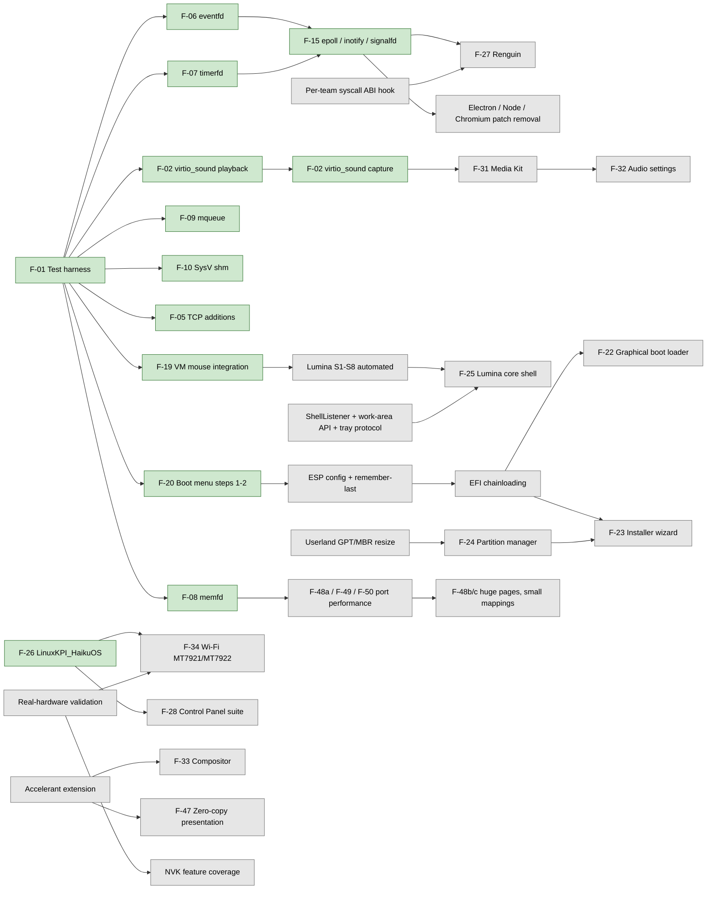

# Renga Master Roadmap

**Last updated:** 2026-11-11
**Branch of record:** `ce/main` of [Techniix/haiku](https://github.com/Techniix/haiku/tree/ce/main), head `23ca3768` (46 commits on top of upstream `4197d30f`, `hrev60381`)
**Document owner:** Renga maintainer (GitHub: Techniix)

## How to read and maintain this document

This is **the** authoritative status source for Renga. If another document disagrees with it about the status of a component, this document wins and the other document is out of date.

Rules for maintaining it:

1. **One entry per component.** Every major component or proposed project has exactly one entry in the [Feature register](#feature-register). Status lives there and nowhere else. Other sections refer to register entries by ID (for example `F-07`) instead of repeating their status.
2. **Supporting documents are linked, not copied.** Design detail, porting semantics, harness usage and upstream bug write-ups live in the documents listed under [Supporting documents](#supporting-documents) and are linked from the relevant register entries. They do not carry status.
3. **History is appended, never silently rewritten.** [Section 10](#10-completed-work-and-development-history) grows at the bottom. If an earlier statement turns out wrong, add a dated correction row; do not edit the old row.
4. **Status values are fixed.** Use exactly one of the eight values in the [legend](#status-legend). Implementation status and testing status are recorded separately. Code that only compiles is not "Implemented".
5. **Percentages only for countable milestones** (for example "Porting API pack 1: 6 of 6 items"). No subjective completion estimates.
6. **Facts carry evidence.** A status above "In Development" names a commit hash and a test result. Every hash resolves at `https://github.com/Techniix/haiku/commit/<hash>`.
7. **Update with every merged change.** A commit that changes a component's status updates its register entry, adds a row to section 10, and (for port-visible features) updates `3rdparty/ce/PORTING.md` in the same commit, as that file's own rule already requires.

### Status legend

| Status | Code | Meaning |
| --- | --- | --- |
| Not Started | `NS` | No design and no code in Renga. May be listed in the audit. |
| Investigating | `INV` | Research or prototyping under way; no agreed design. |
| Designed | `DES` | A written design exists (usually in the original audit); no Renga code. |
| In Development | `DEV` | Code is being written, or code exists but has not passed its tests (includes compile-only code). |
| Implemented | `IMP` | Code complete and committed; automated tests not yet passing or not yet written. |
| QEMU Tested | `QT` | Committed, and passes its automated checks in the QEMU harness. |
| Hardware Tested | `HT` | Additionally verified on real hardware, with the machine and result recorded. |
| Release Ready | `RR` | Hardware tested, documented, no open blocking bugs, enabled in the Renga image. |

Upstream maturity uses the audit's classes: **A** complete/mature, **B** nearly complete, **C** partial, **D** experimental, **E** not implemented, **F** needs modernization (combinations such as B/F mean "works, but dated"). Difficulty uses the audit's 1-10 scale (1 = self-contained userspace fix, 10 = cross-cutting kernel or app_server redesign). Effort: S days, M weeks, L 1-3 months, XL a quarter or more.

---

## Table of contents

- [Executive summary](#executive-summary)
- [1. Vision and architectural principles](#1-vision-and-architectural-principles)
- [2. Verified upstream Haiku implementation status](#2-verified-upstream-haiku-implementation-status)
- [3. Current Renga implementation status](#3-current-renga-implementation-status)
- [Feature register](#feature-register)
- [4. Incomplete or partially implemented functionality](#4-incomplete-or-partially-implemented-functionality)
- [5. Planned improvements and new features](#5-planned-improvements-and-new-features)
- [6. Priorities and milestones](#6-priorities-and-milestones)
- [7. Technical dependencies](#7-technical-dependencies)
- [8. Testing and validation](#8-testing-and-validation)
- [9. Architectural risks and blockers](#9-architectural-risks-and-blockers)
- [10. Completed work and development history](#10-completed-work-and-development-history)
- [Upstream sync](#upstream-sync)
- [Supporting documents](#supporting-documents)
- [Open questions and decisions log](#open-questions-and-decisions-log)

---

## Executive summary

**What is Renga today?** Renga is a fork of Haiku (upstream base `4197d30f`, `hrev60381`, 2026-11-04) developed on the `ce/main` branch of Techniix/haiku. It is upstream Haiku plus 103 commits (2026-11-08 to 2026-11-10): about 33,200 added lines in upstream files and 22,400 in the fork's own `3rdparty/ce` directory. It boots in QEMU under BIOS and UEFI, from disk, CD and virtio-blk, and identifies itself as Renga in the boot loader, ISO volume ID, About window, Deskbar and Installer. The fork was named Renga on 2026-11-08 because Haiku, Inc.'s distribution guidelines do not allow "Haiku" in a distribution's name. `uname` still reports Haiku so ports keep detecting the platform.

**What has been completed?** (all QEMU Tested; none Hardware Tested yet)
- Fork foundation: branch model (`master` = upstream, work on `ce/main`), automatic `hrev` tag workflow, a headless QEMU test harness with hang capture, screenshots, key and pointer injection, and four boot paths. Current committed baseline: **767/767** checks (BIOS, also with 2 CPUs) and **764/764** (UEFI), and `renga-raw` **835/835** with the Media Kit, hot-plug and camera checks, since `64f9fbad`.
- `epoll`, `inotify` and `signalfd` (`F-15`, all three): Linux semantics including edge-triggered, one-shot, nesting and fork sharing (epoll, 84 checks); create/delete/rename with cookies, modify/attrib/close events, overflow (inotify, 47 checks); per-thread pending signals, SIGCHLD, queued realtime signals (signalfd, 28 checks).
- Porting API pack 1, **6 of 6 items (100%)**: `eventfd`, `timerfd`, `memfd_create`, POSIX message queues, System V shared memory, libc fill-ins (`getrandom`, `getauxval`, `backtrace*`, `copy_file_range`, `sendmmsg`/`recvmmsg`), user contexts (x86_64), TCP keepalive.
- Media Kit phase 1 (`F-31`, `F-32` controls): per-application volume and mute remembered by signature, any application on any output, "What you hear" and per-application loopback as Media Kit sources, recording gain, click-free changes, with controls in the Deskbar volume popup, the Media preferences and SoundRecorder (`ef41c576`, `369f3e7d`); `virtio_sound` capture (`F-02`, `19369300`); four upstream Media Kit bugs fixed on the way (section 10.2, 25-28).
- Media Kit phase 2, devices (`F-31`, 2026-11-10; `042cbb63` to `64f9fbad`): USB Audio Class 1 and 2 in `usb_audio` (UAC1 QEMU Tested with `usb-audio`, UAC2 tested against a mock USB stack); sound cards that come and go without a media services restart, with the default output falling back and returning and the Media preferences following; HDMI/DisplayPort sink detection and ELD parsing in `hda` (parser tested, codec side needs hardware); UVC webcams (YUY2, MJPEG) in `usb_webcam` (payload code tested, USB side needs a camera) and a camera choice with live preview in CodyCam. Fourteen upstream bugs fixed on the way (section 10.2, 29-42).
- Media Kit phase 4, codecs and streaming, and the rest of phases 1-2 (`F-31`, `F-32`; 2026-11-11, `b97b48c7`, `2af2370d`, `eb769e72`, `2756f347`): a low-latency audio mode per application (256-frame periods, fixed `BSoundPlayer` buffers; 16-19 ms from callback to playout against 51-55 ms in the harness) with its switch in the Media preferences; HDMI/DisplayPort playback in `hda` (stereo, ELD formats; Implemented, needs hardware); an encode/decode API (`MediaWriter`/`MediaReader`) with VP8/VP9/Opus encoders and codec headers reaching the container, WebM in Screenshot; HLS/DASH playback and UDP/RTP/SRT output through FFmpeg's protocols, in MediaPlayer and Screenshot's "Stream to:"; a cubeb back end recipe in RengaPorts (compile-checked only). QEMU Tested except HDMI and cubeb.
- Media Kit completion (`F-31`, `F-32`, `F-57` item 4; 2026-11-11, `c3afd0b7` to `9731ba84`): the Audio preferences (one place for output, input, applications and devices, with search and an advanced view; QEMU Tested); AAC, MP3, Vorbis and FLAC encoding from float, MP4 and MP3 files, audio seeking in WebM and Ogg, FLV and RTMP output (QEMU Tested against an in-guest FFmpeg RTMP server); a VA-API-shaped video acceleration interface inside the Media Kit with a software reference back end (no GPU back end yet; it is not libva, so FFmpeg's `*_vaapi` codecs are not available to ports); windowed-sinc resampling as the mixer default (-74 to -78 dB THD+N against -35 dB before); clock-drift correction for streams on a second card (QEMU shows the mechanism, hearing it needs two cards); WebM and MP4 playing in WebPositive through the Media Kit (the packaged HaikuWebKit's own sound has gaps, see `F-57`). Upstream bugs fixed on the way: section 10.2, 47-54, including the lost wake-up in user-level rw locks behind the app_server hang.
- Media Kit phase 3, capture APIs (`F-31`, `F-44`; 2026-11-10, `4d383de9`, `3fd8fe19`, `30e05e0b`): app_server screen capture of the screen, a window or a region, damage-based and timestamped, with a per-application permission prompt, remembered decisions, a recording indicator and the Screen recording preferences; a capture session combining that video with system audio, one application's audio and the microphone (writing a file through the FFmpeg plug-in or feeding a listener) and a Media Kit video node; screen recording in Screenshot. QEMU Tested (39 `capture.*` checks, 4 screenshots). Stability fixes before it: a DPC cancel race that panicked with two CPUs (`62b132b3`, an upstream bug), dropouts on cards fed in another card's time (`2cb5d6ca`), mixer gain changes landing between cycles (`d5adf412`), and three test or timeout fixes (`390d7f73`, `b0b0440c`, `27160089`); an FFmpeg plug-in bug broke every audio encode (`61a6a636`).
- Tier 1 work: `TCP_INFO`, abortive-close reset, `virtio_sound` playback, `virtio_block` flush/trim/resize and shipping on x86_64, NVMe multi-namespace, EFI loader boot-disk preference, boot menu timeout with countdown.
- Identity: live-animated Renga boot splash, Renga branding, `renga-raw`/`renga-anyboot`/`renga-vmware` build profiles, Techniix repository preferred over HaikuPorts, Ctrl as the default shortcut key with a switch back to Alt.
- Upstream bugs found and fixed in the fork (10 written up for later reporting, plus 2 newer ones): see [Section 10.2](#102-upstream-haiku-bugs-found-and-fixed-in-renga).

**Work order (maintainer, 2026-11-12):** F-59 real-hardware feedback (running), then an anyboot image for the maintainer to confirm F-59 on his PC; F-58 batch 2 (OBS O-16 to O-20, Quasar header notes); F-61 responsiveness suite with the flaky-check fixes, together with F-67 automatic bisect, compiler warnings and static analysis, speed regression alarms and the QEMU stress tests; OBS O-21 (F-58, small, added 2026-11-13); F-57 WebKit quick fixes together with F-30 NTP time sync; the F-60 review report; the port-performance and API batch (F-48a, F-49, F-50, F-52); **Chromium phases C and D (F-43) together with gamepads (F-42)** (moved up by the maintainer, 2026-11-13: C is the Wayland layer as a Renga component with clipboard, drag and drop, input methods, scaling and several outputs; D is the D-Bus session bus, xdg-desktop-portal with a Renga backend, notifications, Secret Service and UPower; gamepads also give phase H its Gamepad API base), with an image for the 8BitDo test and the Chromium port (logs and crash reports only; the 8BitDo bundle comes with the Test Station image); F-67 Test Station (diagnostic bundle, power-cut logging, unclean-shutdown prompt, sessions, guided tests, `renga-diag`), whose image repeats the 8BitDo test as a guided test with a bundle; boot loader batch A (F-20/F-22: menu shown when there is a choice, power-safe state, several installs, "Restart into...", boot counting and automatic recovery, recovery entries, boot progress); Renguin (F-27, with F-63's go/no-go note); bundled apps batch 1 (F-44, with F-41 menu editing and folder sharing) and batch 2; **Lumina (F-25) S1-S8 and its integration as a real slot** (no longer "in parallel", which never got a turn with one helper at a time), followed by the Deskbar modernisation, start button and widgets that build on it (F-41, F-65); F-60 reviews and F-66 Tracker; boot loader batch B (the graphical menu); LinuxKPI redesign (F-26, added 2026-11-12, before the GPU stage because its DRM bridge brings Intel and AMD graphics); then the GPU stage, Chromium E-H (phase B is port work in Chromium-HaikuOS's `renga` branch, started 2026-11-13), the WebKit rebase and the later items.

**What is being developed now?** The Media Kit was finished on 2026-11-11 (`F-31`, `F-32`, `F-57` item 4; `c3afd0b7`, `34e8c402`, `96463230`, `446221a6`, `99463e1f`, `0d10d162`, `9731ba84`): the app_server hang fixed at its cause (user-level rw locks and signals), the Audio preferences, the rest of phase 4, phase 5 plumbing, resampling quality, clock-drift correction and HTML5 media in WebPositive; QEMU Tested except what needs hardware (GPU back ends for phase 5, two real cards for drift). `F-58`, partner requests batch 1, was finished on 2026-11-12 (`975c0eff`, `d97f5a34`, `b92ace62`, `805d2929`, `34526255`, `ab6f163f`, `d6f1bc7b`, `23d36b26`, `fcac2cd7`, `744fa9b4`): the OBS Studio port's O-1 to O-9, O-12 and O-13 and the Quasar driver's R-1 prerequisite (descriptor passing to app_server, `<add-ons/graphics/GpuPresent.h>`), plus the maintainer's mt7921e boot panic; QEMU Tested except the UVC side of O-5 and the crash report's driver line (need hardware). Next: `F-59`, then the `F-57` quick-fix batch. Before that: LinuxKPI in Renga (`F-26`, `F-34`; 2026-11-11, [`c9134779`](https://github.com/Techniix/haiku/commit/c9134779) to [`947dbafd`](https://github.com/Techniix/haiku/commit/947dbafd)): the maintainer's working MT7922 Wi-Fi driver (`mt7921e`, LinuxKPI_HaikuOS branch `stage-c`) is built in-tree with the image, with its firmware in the system package; LinuxKPI Manager and `lkpictl` are built and installed; the LinuxKPI core is QEMU Tested against QEMU's `edu` device; Wi-Fi itself needs the maintainer's regression check on his MT7922 (`WIFI-HARDWARE-TEST.md` in the hand-over). Before that: The Media Kit (`F-31`) on 2026-11-11: the low-latency audio mode (`b97b48c7`), HDMI/DisplayPort playback in `hda` (`2af2370d`, needs hardware), phase 4 encode/decode API with WebM codecs (`eb769e72`) and streaming (`2756f347`), all QEMU Tested except HDMI; a cubeb back end recipe in RengaPorts (not built yet). Also The maintainer's first real-hardware install. Boot loader first part (`F-22`, `170b3815`, 2026-11-10/11): the boot menu lists and starts other operating systems (UEFI: EFI loaders on every EFI system partition through `LoadImage`/`StartImage`; BIOS: partition boot records and other disks' MBRs, chainloaded) and removable media found in the background, with a default entry and timeout set in the new Boot menu preferences; QEMU Tested on both firmwares (`--other-systems`). Installer in-place replacement (`F-23` early part, `7ce49272`): existing Haiku/Renga installations are detected and named; upgrade (keeps home, settings and installed packages, the old system kept as a bootable package state), replace (keeps files) and erase (second confirmation naming the volume), with a command-line mode; QEMU Tested on BIOS and UEFI (`--installer-upgrade`: upgrade, then boot the upgraded disk and its old state from the boot menu). Test steps for the maintainer are in the hand-over (`REAL-HARDWARE-TEST.md`). Before that: the Media Kit (`F-31`). Phase 3, capture APIs, was done on 2026-11-10 (`4d383de9`, `3fd8fe19`, `30e05e0b`; QEMU Tested), with screen recording in Screenshot (`F-44`). Phase 2, devices, was worked on 2026-11-10 (`042cbb63`, `569433a9`, `b0c4cd43`, `7ba2f32e`, `64f9fbad`): USB audio, hot-plug, HDMI sink detection and UVC cameras, QEMU Tested where QEMU has the device and Implemented (needs hardware) where it does not; HDMI playback is the open item. Step 0, `virtio_sound` capture (`F-02`, `19369300`), and phase 1, mixing and routing with its controls (`F-32`; `4ca8c8b2`, `ef41c576`, `369f3e7d`), were finished on 2026-11-09 and are QEMU Tested. Left of phase 1: a low-latency mode, the cubeb back end and measured resampling quality (see `F-31`); hot-plug detection in the multi_audio add-on was done in phase 2 (`569433a9`). The small Chromium OS gaps (`F-43` phase A) were finished on 2026-11-09 (`82cd4654` to `575f9cc0`): `thread_local` destructors, CPU affinity in libroot, `getdents64`, `getpeereid`, `POLLRDHUP`, `memfd` sealing, the QUIC UDP options and `MADV_DONTNEED`, with ten upstream bugs fixed on the way (section 10.2, 14-23). The harness gained quick partial runs and per-program timing on 2026-11-09 (`c36db227`). `epoll` (`71101ac5`), `inotify` (`b421d52a`) and `signalfd` (`e1638a07`), completing `F-15`, were finished and committed on 2026-11-09, as was VM mouse integration (`F-19`).

**What is blocked?**
- NVMe multi-namespace (`F-04`) cannot reach Hardware Tested until the maintainer runs it on his real NVMe PC (pending, by his choice).
- Lumina as the core shell (`F-25`) waits on the S1-S8 acceptance checklist, which has never been run. It is to be automated in QEMU by the agent; the harness can now inject keys and pointer moves and take screenshots.
- Electron, modern Node and Chromium patch removal no longer wait on `epoll` (available since `71101ac5`); they now wait on ports being rebuilt against it and against `inotify` (available since `b421d52a`) and `signalfd` (`e1638a07`). Renguin (`F-27`) waits on a per-team syscall ABI hook. Installer "install alongside" (`F-23`) waits on the partition resize backend (`F-24`).
- Public release waits on an undecided Renga version scheme.

**What should we work on next?** In the agreed order (2026-11-09):
3. Periodic NTP sync (`F-30`).
4. `virtio_sound` capture (`F-02`): done 2026-11-09.
5. Media Kit work (`F-31`; phases 1, 3, 4 and 6 done and QEMU Tested by 2026-11-11 with the Audio preferences (`F-32`), resampling quality and clock-drift correction; phase 2 devices 2026-11-10/11, HDMI playback Implemented (needs hardware), hardware validation open; phase 5 plumbing done (`446221a6`), GPU back ends with the GPU stage; HTML5 media in WebPositive (`F-57` item 4) done in-tree): open are an FFmpeg update, a cubeb build on Renga, the GPU back ends and the portal backend in `F-43` phase D.
6. In parallel: automate Lumina S1-S8 in QEMU (`F-25`).

**What are the biggest remaining challenges?**
- Everything is QEMU-only so far. No Renga change has a recorded real-hardware result.
- The fork must carry all changes permanently. Upstream's `AGENTS.md` forbids AI-generated contributions, so rebase cost grows with every upstream file touched (236 upstream files today).
- The XL items upstream also lacks: suspend/resume, multi-monitor, compositing, modern Wi-Fi (through LinuxKPI), GPU 3D and hardware video. Each needs real hardware, cross-subsystem design, or both.
- Lumina has about 18k lines that are compile-verified only. Its runtime behaviour inside app_server (lock nesting, hook timing) is unknown.

---

## 1. Vision and architectural principles

### 1.1 Goals

1. **Implement the audit roadmap while keeping Haiku efficient and lightweight.** New runtime components are on-demand or optional, and settings default off where they cost resources.
2. **A more feature-complete OS.** Image slimming was considered and **dropped on 2026-11-09**: Renga aims to be more complete, not smaller. telnetd and ftpd already ship switched off.
3. **"Haikuify" BSD and Linux code where that is efficient.** Port proven code (FreeBSD net80211/iflib/linuxkpi, OpenBSD drivers, Linux APIs) behind native Haiku interfaces, instead of importing foreign subsystems wholesale.
4. **Core components to build around:**
   - **LinuxKPI_HaikuOS**: Linux kernel drivers on Haiku through a FreeBSD-style LinuxKPI layer. MediaTek MT7921/MT7922 Wi-Fi comes first. A separate repository (`F-26`).
   - **Renguin**: a FreeBSD-Linuxulator-style Linux binary compatibility layer. A separate repository (`F-27`).
   - **Lumina_HaikuOS** as the core desktop shell, but only after its S1-S8 acceptance checklist passes (`F-25`).
5. **User-facing redesigns:** a graphical multiboot boot loader in the Renga style (airy gust, leaves, dappled light; `F-22`), a redesigned installer (`F-23`) and an advanced partition manager (`F-24`), a Control Panel suite covering installed software, hardware and a LinuxKPI device manager (`F-28`), and an audio settings redesign after the Media Kit work, with per-app volume and routing, loopback and mixing, and an advanced view (`F-32`).

### 1.2 Architectural principles

These come from the audit's architecture report and apply to every change:

- **Prefer add-ons, new directories and new files over edits to upstream files.** Drivers, decorators, ControlLooks, input filters, disk-system add-ons, Tracker add-ons and launch_daemon jobs all load without touching upstream files.
- **Keep upstream hunks small and behind a setting** when an upstream file must change. Example: the build profile hook is a 9-line include in `Jamrules`.
- **Never edit upstream config in place.** Use launch_daemon overrides, the Renga build profile and extra package lists. For example, `3rdparty/ce/Jamfile` generates the HaikuPorts priority config instead of editing upstream's.
- **On-demand runtime components.** Use conditional launch_daemon jobs, optional packages and default-off settings. Example: `boot_menu_timeout` is absent by default, so nothing changes.
- **Add-only ABI; Haiku and BeOS programs keep running** (maintainer's guarantee, 2026-11-09; checks in `F-46`). New syscalls and symbols are additive. Never change public class sizes or vtable order (x86_gcc2 compatibility). Packages that need Renga-only symbols go to the Techniix repository, not to repositories for stock Haiku.
- **Platform identity stays Haiku.** `uname -s`, `__HAIKU__`, `B_HAIKU_*`, MIME signatures, package names and paths are unchanged. Only user-visible display names change (the `DISTRO_NAME` macro).
- **Every change gets an automated check, plus a known-bad case for the check itself.** New harness checks get a case in `selftest.py` so a broken check cannot pass silently. Wherever possible, a new test is shown to fail on the old code.
- **Every user-facing feature ships with its GUI** (maintainer, 2026-11-09). A feature people use or configure is not Implemented until it can be reached and controlled from the desktop: a settings page (today's preferences, later the Control Panel, `F-28`), a menu, a Deskbar or panel item, or a window, as fits. The GUI is part of the same work item and is checked with screenshots in the harness. Pure programming interfaces (`epoll`, `memfd`, ...) and automatic behaviour without options are exempt; settings that exist only as files or command-line switches are not.
- **Tiered test gates** (maintainer, 2026-11-11; replaces "all four full runs before every commit"). *Every commit (change-based selection, maintainer 2026-11-12, replaces the per-commit full renga-raw run):* a fresh build, `selftest.py` with 0 failures, and the suites that cover the changed files (`--only`, on renga-raw and on default) plus a boot check; the commit message lists the changed areas and the suites chosen. Changes to shared foundations still get the full four-way set on that commit: the kernel, drivers, the boot loader and installer, app_server, libbe/libroot and other shared libraries, locking or memory management, the harness itself, and any file the selection map does not cover (unknown means full). Until the selection map (`F-67`, `ce-select`) exists, the helper chooses the suites by hand, conservatively. Notes-only commits (the roadmap, `docs/partners/`) do not change the gate key (`ce-gates.sh`), so they never force a re-run. *Also full default, `--smp 2` and UEFI runs on that commit* when it touches the kernel, drivers, the boot loader or installer, locking, memory management, libroot, the harness itself, or anything else where SMP or firmware can differ. *End of every batch* (before reporting it done) *and before every image handed to the maintainer:* the full four-way sweep on the final tree; a regression found there is bisected over the batch's commits and fixed before the batch counts as done. *Known flaky checks* (listed in section 8.3 and the README: currently `media_latency.low_latency_latency`, `media.click_free_volume`, `sound_settings.output_device_back`, `linuxkpi.edu_dma_*` on UEFI) are retried once automatically and reported either way; a repeated failure blocks. Commit messages state which tier ran and its numbers.
- **Grouped testing for independent items** (maintainer, 2026-11-12, at the main session's discretion). Application, media, UI and test items that do not depend on each other are written in sets of 2-4, tested together with one full four-way gate set on the combined tree, then committed one item per commit citing the shared run. Kernel, scheduler, memory, locking, driver and boot changes are still gated one piece at a time. A failure in a combined run is traced to its item from the failing checks and only the affected suites are re-run after the fix.
- **Lean by design, never at the cost of what the user is doing** (maintainer, 2026-11-11). Renga's own background services start on demand and stay idle when they have nothing to do (an indexer pauses under load, Bluetooth services need Bluetooth hardware). Renga never throttles, delays or batches a program's own work to save resources (no "data saver" or "app standby" behaviour that delays mail or notifications). Fresh-desktop memory, idle CPU, idle wake-ups and boot time are measured every batch (`F-61`); a regression must be justified in its commit.
- **Responsiveness first, including Lumina.** Lumina and every Renga component follow the BeOS approach: one thread per window, nothing slow on a UI or media thread, measured by `F-61`.
- **Advanced customization, easy to find** (maintainer, 2026-11-12). Every behaviour Renga adds or changes can be turned on and off or adjusted (title-bar buttons, snapping, tiling, overview, animations, notifications, previews, indexing, ...), with sensible defaults. Settings live where people look for them: the Control Panel (`F-28`) is the single home, organised by topic with a search that finds every individual setting by name and synonym; each feature also links to its own settings in place (a "Settings..." entry in its right-click menu or window menu, a gear in its popup) so nobody has to hunt; every page has "Restore defaults"; advanced options sit behind an "Advanced" expander on the same page, not in hidden files. Settings that exist only as files or command-line switches do not count (see the GUI rule above). Harness checks confirm each new toggle exists, is found by the Control Panel search and takes effect.
- **No KPTI or other always-on costs by default.** The compositor, if built, is optional and off by default.
- **AI-written work stays in the fork.** Upstream's `AGENTS.md` (at `4197d30f`) forbids AI-generated or AI-assisted contributions. The maintainer files upstream reports himself, in his own words. That is not a priority now; candidates are collected in the [upstream bug reports doc](https://claude.ai/artifact/FVtf9E5sE982Ty1zWf9Sm9).

### 1.3 Branch and release model

| Item | Rule |
| --- | --- |
| `master` | Identical to upstream Haiku. Never carries fork work. |
| `ce/main` | All Renga work, with detailed commit messages (what, why, test evidence with numbers). |
| Topic branches | One per project where useful. |
| `hrev` tags | The "Renga hrev tag" GitHub Actions workflow (`.github/workflows/ce-hrev-tag.yml`, commit `5ab6008b`) pushes the nearest upstream `hrev` tag on every push to `ce/main`. `hrev60381` is live. |
| Rebase cadence | Fixed cadence, e.g. fortnightly (audit proposal; no rebase done yet). |
| Technical identifiers | Keep their old names on purpose: `ce/main`, `3rdparty/ce`, `CE_HARNESS`, `CE_TRACE`, `ce-test.py`, `CE-TEST`/`CE-SUITE`/`CE-INFO`/`CE-HOST` markers (`088de3b7`). |

---

## 2. Verified upstream Haiku implementation status

This section summarises the original audit of upstream Haiku at `4197d30f` (2026-11-04). Findings were verified in source unless marked otherwise; nothing in the audit was run on hardware or in a VM. Renga changes are **not** reflected here; see the [Feature register](#feature-register). For file and line evidence, see the [audit doc](https://claude.ai/artifact/LNXsA8MXQR5CAgvSHXxmqR).

**Overall verdict (audit):** Haiku's core is mature and fast. It stops short of a complete modern desktop in five places: power (no sleep), displays (one monitor, no compositing, partial HiDPI), connectivity (no IPv6 autoconfiguration, firewall, SMB, mDNS or WPA3; thin Wi-Fi coverage), multimedia (no modern webcams, encoders or hardware video) and porting APIs (no `epoll`/`eventfd`/`timerfd`/`mqueue`). 389 of 509 kernel commits since January 2025 (76%) come from one developer.

### 2.1 Kernel and core OS

| Component | Class | Main gap (upstream) |
| --- | --- | --- |
| Scheduler | A | Ignores Intel P/E hybrid cores; `SMP_MAX_CPUS` = 64 |
| VM | B | `madvise` hints other than `MADV_FREE` are no-ops; no user huge pages; very active upstream |
| Teams, threads, signals | A/B | Team-ID wraparound bug (`team.cpp:3892`) |
| Native IPC (ports, sems, areas) | A | No ownership checks (BeOS heritage) |
| POSIX IPC | C/E | No `<mqueue.h>` (Trac #5684), no `<sys/shm.h>` (Trac #2657) |
| Linux-style event APIs | E | No `epoll`, `eventfd`, `timerfd`, `signalfd`, `inotify`, `memfd_create` (Renga: see `F-06` to `F-08`, `F-15`) |
| kqueue | C | `EVFILT_READ`/`WRITE`/`PROC` only |
| Syscalls | A | No per-team ABI hook (needed by Renguin) |
| device_manager | B/F | `suspend`/`resume` hooks never called; about 75 legacy drivers; no IOMMU |
| x86-64 | A | UMIP/PKU/PCID detected but unused |
| arm64 / riscv64 | C/D | Several panics and missing features |
| cpufreq / cpuidle | C | No device runtime PM |
| Suspend / resume / hibernate | E | Only S5 power-off (Trac #11227, unowned) |
| ACPI | A/B | No S3/S4 |
| Security hardening | C/F | No KPTI, retpoline or VERW; no kernel ASLR; no sandboxing |
| Kernel debugging | A | No CI test harness for kernel tests (inferred) |
| Virtualization (NVMM) | D/C | Maturity unclear |

### 2.2 Kits

| Kit | Class | Main gap |
| --- | --- | --- |
| Application, Storage, Support | A | None significant |
| Interface | A/F | HiDPI is font-size only; no HarfBuzz, no BiDi |
| Media | B/C/F | Webcams, modern encoders, hardware video, capture API, Bluetooth audio |
| Network (libnetapi) | A | No ALPN |
| Network (HTTP services) | C/D | `libnetservices2` private; HTTP/1.1 only |
| Device / Game | B/F | R5 joystick model; no hotplug, rumble or mapping |
| Translation | A | No HEIF, JPEG XL or SVG (inferred) |
| Locale | B | ICU 74; TODOs |
| Mail | B/F | No IMAP IDLE, no OAuth2 |
| Print | C/F | IPP 1.0, no driverless printing |
| Package | A | No package or repository signatures; libsolv 0.3.0 (2013) |
| OpenGL | C (out of tree) | Mesa 22.0.5, llvmpipe only |
| MIDI | B | No MIDI 2.0 |

**Media Kit deep dive (audit).** Working: the node graph, media_server, the system mixer, ffmpeg decode (FFmpeg 6.1.5), `multi_audio` output, and `BMediaFile`/`BSoundPlayer`. Stubbed: 338 `UNIMPLEMENTED()` hits, mostly in `legacy/`, plus parameter-web stubs and `BMediaEncoder::Init()`. The encoder table has no H.264/HEVC/VP8/VP9/AV1/Vorbis/Opus and no rate control. The mixer cannot change format while running. Media2 `BMediaClient::Connect()` returns `B_ERROR`. Missing entirely: UVC webcams, hardware video, a screen-capture API, A2DP, per-app volume UI and routing policy, HDMI/DP audio (reverted, Trac #20171) and a pro-audio graph.

### 2.3 Desktop and UI

| Component | Class | Main gap |
| --- | --- | --- |
| app_server drawing | A (2D) / F (pipeline) | No 2D acceleration, no vsync on present, no compositing |
| Multi-monitor | E/C | One accelerant only (Trac #18441, #10486) |
| HiDPI | C | No global or per-screen scale (Trac #13087, #15864) |
| Window management | A/B | No work-area API; Zoom knows only Deskbar |
| Workspaces | A | Minor |
| Decorators | B/F (ABI) | Add-ons compile against app_server internals |
| ControlLook / theming | B | No named schemes or theme bundles |
| Remote desktop | C/D | TODOs |
| input_server | A (devices) / C (IME) | BeOS-era IME protocol |
| Tracker | A | No tabs or dual pane (inferred) |
| Deskbar | A/B | Polls the window list (no push events) |
| launch_daemon | A | None |
| Login / multi-user | D/E | `src/apps/login` not shipped |
| Notifications | B | No history, no do-not-disturb |
| Accessibility | E | Nothing (Trac #12804) |
| Preferences | A/B | No scheme presets, global scale or multi-head UI; no power preferences |

### 2.4 Hardware and drivers

| Area | Class | Main gap |
| --- | --- | --- |
| intel_extreme | B (Gen2-9) / C (Gen11-12) / E (Raptor Lake+, Arc) | Shared framebuffer; 2D engine disabled |
| radeon_hd | B (to Hawaii) / E (DCE10+) | Newer IDs disabled under `#if 0` |
| vesa / framebuffer (GOP) | A | None |
| virtio_gpu | B (2D) / E (3D) | virgl/venus needs a Mesa winsys |
| GPU 3D / Vulkan | E in tree | No DRM, dma-buf, page-flip or fence hooks; the maintainer's out-of-tree NVIDIA driver (Quasar) is the audit's suggested route, behind a generic accelerant extension |
| HDR / VRR | E | None |
| HDA audio | B | HDMI/DP reverted; one stream; no Intel SOF |
| USB audio | B- | 24-bit packed disabled |
| virtio_sound | E | 134-line stub, not in image |
| Wired Ethernet | A- | ixgbe/ixl/ice and USB `ure` missing |
| Wi-Fi | C | No MediaTek, Realtek rtw88/89, ath10k/11k or Intel BE200 |
| WPA3 | E | Trac #18287 |
| Bluetooth | D | No RFCOMM, HID host, A2DP or BLE |
| USB host | B+ | No UAS, no streams |
| USB-C / Thunderbolt / USB4 | E | No UCSI, TB or PCIe hotplug |
| NVMe | B+ | First namespace only |
| AHCI | B | No NCQ |
| virtio_block | B- | No DISCARD/WRITE_ZEROES; not shipped on x86_64 (found later, `5b068a5e`) |
| SD/eMMC, UFS | C+/D | Upstream active |
| USB HID, PS/2 | A-/B | None |
| I2C HID | D | Not packaged; polls; no GPIO drivers |
| Printers | C/F | IPP Everywhere missing |
| Webcams | E/F | UVC commented out of build |
| ACPI / PCI | A/B | No ASPM, PCIe hotplug or AER |
| Sensors / thermal | B/E | No coretemp, no sensor API, no fan control |

### 2.5 Networking

| Component | Class | Main gap |
| --- | --- | --- |
| TCP | B/F | No CUBIC/BBR; no `TCP_KEEP*`, `TCP_INFO`, Fast Open; ECN, SYN cache and F-RTO unimplemented |
| UDP / IPv4 / ICMP | A/B | No `IP_PKTINFO` |
| IPv6 | C | No SLAAC, no DHCPv6 (Trac #8317) |
| Firewall / NAT | E | Nothing |
| DNS | B/F | No caching, DoT/DoH or `.local` |
| DHCP | B | No option 121 |
| VPN | C/D | TUN/TAP only |
| NFS | C | `AUTH_SYS` only |
| SMB/CIFS | E | None |
| FUSE | C | FUSE 2.9 only |
| TLS | B | No TLS 1.2 floor, no ALPN, leaked verify param |
| WebKit / WebPositive | C/F | Upstream lag unverified |
| mDNS / DNS-SD | E | None |
| Time sync | C | One-shot SNTP only |
| Legacy services | F | ftpd, telnetd (ship switched off) |

### 2.6 Software ecosystem

| Component | Class | Main gap |
| --- | --- | --- |
| packagefs + package_daemon | A | None |
| Package kit / pkgman / HaikuDepot | A / F (security) | No signatures; libsolv 0.3.0 |
| POSIX coverage | B | Missing items listed in the audit; most are now closed in Renga (`F-08` to `F-14`); `aio_*`, robust mutexes and `statfs` remain |
| Linux binary compat | E | No per-team ABI, no `ptrace` |
| Flatpak / Snap | E | Impossible under the current architecture; not pursued |
| Toolchain | B | GCC 13.3 pinned, GCC 15 migration in progress |

---

## 3. Current Renga implementation status

### 3.1 Snapshot (2026-11-09, `ce/main` at `23ca3768`)

| Measure | Value |
| --- | --- |
| Commits on top of upstream | 46 (author date 2026-11-08: 32, 2026-11-09: 14) |
| Upstream files changed | 79 files outside `3rdparty`, +17,204 / -351 lines (of which about 8,200 lines are generated splash and logo image headers) |
| Fork-only tree | `3rdparty/ce`: 38 files, +9,609 lines (harness, tests, artwork scripts, build profiles, repository config, docs) |
| Harness baseline | 619/619 (BIOS, `minimum-raw`, 1 and 2 CPUs) and 616/616 (UEFI, `minimum-anyboot`) after `F-43` phase A (`575f9cc0`); 324/324 (`renga-raw`) from before `epoll` |
| Test suites | 6 committed in-guest suites (`virtio_sound`, `posix_compat` with 10 programs, `virtio_block`, `nvme`, `pkg_priority`, `shortcut_keys`), plus host-side checks; `pointer` in development |
| Hardware-tested components | 0 |
| Uncommitted work | VM mouse integration (9 files changed, +397/-21 lines, plus the new `3rdparty/ce/tests/pointer/` suite) |

### 3.2 Register overview

The full entries are in the [Feature register](#feature-register). This table is an index only.

| ID | Component | Status | Testing |
| --- | --- | --- | --- |
| F-01 | Test harness | QEMU Tested | Self-test plus every run |
| F-02 | virtio_sound | QEMU Tested (playback and capture) | 69 `virtio_sound.*` + 4 audio checks |
| F-03 | virtio_block | QEMU Tested | 20 checks + 2 host |
| F-04 | NVMe multi-namespace | QEMU Tested | 18 checks + 4 host; hardware pending |
| F-05 | TCP additions | QEMU Tested | 32 checks (loopback) |
| F-06 | eventfd | QEMU Tested | 19 checks |
| F-07 | timerfd | QEMU Tested | 27 checks |
| F-08 | memfd_create | QEMU Tested (with sealing) | 41 checks |
| F-09 | POSIX message queues | QEMU Tested | 39 checks |
| F-10 | System V shared memory | QEMU Tested | 18 checks |
| F-11 | libc additions | QEMU Tested | 19 checks |
| F-12 | ucontext | QEMU Tested | 8 checks |
| F-15 | epoll / inotify / signalfd | QEMU Tested | 84 epoll + 47 inotify + 28 signalfd checks |
| F-16 | Boot splash | QEMU Tested | Screenshots + frame log |
| F-17 | Renga branding | QEMU Tested (partly) | 1-2 checks per run |
| F-18 | Build profiles and images | QEMU Tested (`renga-raw` only) | 3 image checks |
| F-13 | Package repository priority | QEMU Tested | 4 + 1 checks |
| F-14 | Shortcut keys (Ctrl default) | QEMU Tested | 7 checks |
| F-19 | VM mouse integration | QEMU Tested | `pointer` suite, 321/321 |
| F-20 | EFI loader and boot menu | QEMU Tested (steps 1, 4 and 7 in text form; 2 partly) | 1-2 checks per run; `--other-systems` |
| F-21 | hrev tag workflow | Implemented | Dry run plus live tag |
| F-22 | Graphical boot loader | First part QEMU Tested, Windows entry verified on real hardware (2026-11-11); graphical menu Designed | 10 `other_systems.*`/`other_media.*` (UEFI) and 9 (BIOS) with `--other-systems`; 9 `bootmenu.*` + screenshot (renga-raw) |
| F-23 | Installer redesign | Early part (in-place replacement) QEMU Tested, upgrade verified on real hardware (2026-11-11; stale non-packaged driver issue in F-59); wizard Designed | `installer.*` with `--installer-upgrade` (27 BIOS, 28 UEFI checks in the installer suite); 4 `installer_ui.*` + screenshot (renga-raw) |
| F-24 | Partition manager | Designed | None |
| F-25 | Lumina, rebuilt into Renga (window management, title bars, panel) | Designed (rework 2026-11-12: merging into Renga; portable core host-tested) | Host unit tests only |
| F-26 | LinuxKPI_HaikuOS | QEMU Tested (core, in-tree build, Manager and `lkpictl`); `mt7921e` Implemented in Renga, hardware regression check pending | 31 `linuxkpi.*` (every image), 10 `linuxkpi_ui.*` + `linuxkpi_ui.screenshots` (renga-raw) |
| F-27 | Renguin | Designed (scheduled, work order item 13) | None |
| F-28 | Control Panel suite | Not Started | None |
| F-29 | Upstream bug fixes carried | QEMU Tested | See section 10.2 |
| F-30 | Periodic NTP sync | Not Started | None |
| F-31 | Media Kit | Phase 1 QEMU Tested, with windowed-sinc resampling and clock-drift correction (cubeb back end: recipe in RengaPorts, compile-checked only); phase 2 In Progress (USB audio UAC1, hot-plug QEMU Tested; UAC2, HDMI detection and playback, UVC Implemented, need hardware); phase 3 QEMU Tested; phase 4 QEMU Tested (open: FFmpeg update, network audio, WebRTC); phase 5 plumbing QEMU Tested with a software back end, GPU back ends not started; phase 6 QEMU Tested (`F-32`) | 35 `media.*` + 11 `media_audio.*` + 17 `media_usb.*` + 5 `media_usb_audio.*` (renga-raw); 46 `usb_audio.*` + 32 `usb_audio_uac2.*` + 6 `usb_audio_out.*`, 19 `hda_eld.*`, 18 `uvc.*` (every image); 39+7 `capture.*` + `capture.screenshots`, 21+2 `media_latency.*`, 17 `media_codec.*`, 9+1 `media_stream.*` (renga-raw); 2026-11-11 also `media_codec`, `media_stream` (RTMP), 9 `video_accel.*`, `media_resample` (4), `media_drift` (5), `html5_media` (9 + screenshots), `sound_settings` with `sound_audio` (renga-raw), `user_locks` 24 (every image) |
| F-32 | Audio settings redesign | QEMU Tested (the Audio preferences, `34e8c402`, with the resampling menu, `99463e1f`; the Control Panel page waits for `F-28`) | 6 `media_ui.*` + 4 screenshots, 2 `media_usb` screenshots, 7 `codycam.*` + 2 screenshots, `media_latency` 3 GUI checks + 2 screenshots, `mediaplayer_hls` screenshot (renga-raw) |
| F-33 | Compositor | Not Started | None |
| F-34 | Wi-Fi | Implemented (MT7920/MT7921/MT7922 through LinuxKPI in the system package; worked on the maintainer's MT7922 as LinuxKPI_HaikuOS `stage-c`, Renga build not yet run on hardware) | `firmware_packaged`, `mt7921e_packaged`; no Wi-Fi in QEMU |
| F-35 | GPU / graphics | Not Started | None |
| F-36 | USB | Not Started | None |
| F-37 | Power management / suspend | Not Started | None |
| F-38 | Multi-monitor and HiDPI | Not Started | None |
| F-39 | Networking beyond TCP | Not Started | None |
| F-40 | Visual identity pack (themes) | Not Started | None |
| F-41 | Deskbar modernisation | Investigating (requirements set) | None |
| F-42 | Gamepad support and configurator | Investigating (requirements set) | None |
| F-43 | Chromium platform readiness | In Development (phase A QEMU Tested; B-H Designed) | Phase A: 143 checks in 7 programs |
| F-44 | Bundled applications | Designed (three batches); screen recording in Screenshot QEMU Tested | `capture.screenshot_*`, `capture.recording_*` (renga-raw) |
| F-46 | Haiku and BeOS program compatibility | Designed (guarantee and checks) | None |
| F-47 | Zero-copy presentation and a Haiku Vulkan surface | Designed | None |
| F-48 | Guest-memory and VM performance (hole punching, huge pages, many small mappings) | Designed | None |
| F-49 | Futex-style waiting (`futex()` wait/wake) | Designed | None |
| F-50 | Game mode (gamemode-compatible API, native service, Control Panel switch) | Designed | None |
| F-51 | Crash logs and system log viewer | QEMU Tested (needs real hardware) | `crashlog` suite: 21 checks on every image, 32 on renga-raw (GUI) plus `crashlog.screenshots`; host check `crashlog.debugger_reboots` |
| F-52 | Linux/POSIX API batch 2 (pidfd, file operations, prctl, sockets, xattr, POSIX AIO) | Designed | None |
| F-53 | Secure Boot (shim, Renga key) | Not Started | None |
| F-54 | Driverless printing and scanning (IPP Everywhere, eSCL) | Not Started | None |
| F-55 | Colour emoji in app_server | Not Started | None |
| F-56 | Profiling and tracing tools | Not Started | None |
| F-57 | WebKit keep-up (HaikuWebKit rebase, WebPositive quick fixes) | In Progress (item 4, HTML5 media through the Media Kit: in-tree part QEMU Tested, `9731ba84`; WebKit-side patch in RengaPorts, not built) | 9 `html5_media.*` + `html5_media.screenshots` (renga-raw) |
| F-58 | Partner requests, batch 1 (OBS Studio and Quasar requests to Renga) | QEMU Tested (O-5's UVC side and the crash report's driver line Implemented, need hardware; 2026-11-12) | `media_routing` 17 + 3 host, `virtual_camera` 7 + 1 host, `screen_capture` +13, `codycam` +2, `uvc` +5, `seqpacket` 12, `appserver_fd` 8, `wlan_reload`, `driver_override` |
| F-59 | Real-hardware feedback, batch 1 (maintainer test of 9731ba84) | QEMU Tested, needs real hardware (2026-11-12; YouTube item moved to F-57) | `hw_cursor.*`, `screen_read.*`, `tracker_menu.*`, `devnotify.*`, `capture.*` additions, `crashlog.debugger_hint`, `installer.boot_menu_system`, `bootmenu.window_volume_system`, revision selftests |
| F-60 | Existing applications and preferences: review and Renga refresh | Designed | None |
| F-61 | Responsiveness under load ("the BeOS demo") as a release gate | Designed | None |
| F-62 | BFS queries as the system's search: smart folders, tags, content index | Designed | None |
| F-63 | Media graph made visible: patchbay and Linux audio as nodes (go/no-go per part) | Investigating | None |
| F-64 | Automation app (modern successor to `hey` scripting) | Designed | None |
| F-65 | Live widgets: replicants for the modern desktop, with Lumina | Designed | None |
| F-66 | Tracker modernisation | Designed | None |
| F-67 | Quality engineering: Test Station, bisect, warnings, fuzzing, stress tests | Designed | None |
| F-45 | RengaPorts (separate ports and package repository) | In Development (repository published; Renga image side pending) | None |

---

## Feature register

Each entry is the single source of status for its component. Fields: Upstream maturity (audit class), Renga maturity, Status, Completed, Remaining, Known bugs/limitations, Dependencies, Difficulty (audit 1-10 scale, "not rated" where the audit gives none), Risk, Testing status, Next milestone, Recommended next action, Links.

### Infrastructure

#### F-01 Test harness

| Field | Value |
| --- | --- |
| Upstream maturity | No CI harness for kernel tests (audit, inferred) |
| Renga maturity | Headless QEMU harness used for every commit since `8bca4a27` |
| Status | **QEMU Tested** |
| Completed | `ce-test.py`: builds the test targets and image, boots headless QEMU, parses `CE-TEST` lines, and records audio and checks it with a Goertzel tone detector. Fails the run on driver `ERROR()` output, QEMU guest errors, rejected memory accesses (`qemu.invalid_accesses`) or a panic. KDL session on panic. Stall detection: after 90 s of silence it presses Alt+SysRq+D and saves `kdl.log` with every backtrace and mutex holder (`125ff214`). `--screenshots` (`15a619d6`). `--smp N` (`5da78dc1`). `--firmware uefi` with OVMF pflash and a fresh variable store, `--media cdrom` (`5c308487`). `--disk-bus virtio`, scratch disks with host-side space checks (`5b068a5e`). `CE-HOST block_resize` requests (`d83a00e3`). NVMe two-namespace controller with byte-for-byte host verification (`0758b116`). `--two-installs` decoy (`4b26e677`). `--boot-menu-timeout` (`2b728fa3`). Branding checks (`22bf89ca`). Image identity checks for `renga-*` (`0b6a27a6`, `85bff35a`). `CE-HOST sendkey` key injection (`23ca3768`). `debug_server` "kill" default so crashing tests do not hang (`c6cbef2e`). `selftest.py` covers the analysis with known-bad cases (12/12 at introduction; 0 failures at `23ca3768`). |
| Remaining | Lumina S1-S8 automation. The efficiency budget the audit asks for (boot-to-desktop time, idle RAM, idle wakeups, image size) is not measured yet. Real-hardware test procedure. |
| Known bugs/limitations | QEMU only (TCG/KVM). Desktop-level UI (AboutSystem, Installer) cannot yet be opened automatically. `renga-anyboot`/`renga-vmware` images are not booted by the harness. |
| Dependencies | QEMU, OVMF (`OVMF_VARS_4M.fd`), xorriso (ISO checks), optional Pillow (PNG screenshots) |
| Difficulty | 4 (audit Tier 1, "kernel/POSIX test harness") |
| Risk | Low |
| Testing status | Every run; `selftest.py` 0 failures |
| Next milestone | Commit pointer and screenshot requests; add a scripted Lumina S1-S8 run |
| Recommended next action | Add efficiency metrics (boot time, idle RAM) to `summary.md` so regressions against the lightweight goal show up |
| Links | [3rdparty/ce/README.md](https://github.com/Techniix/haiku/blob/ce/main/3rdparty/ce/README.md); commits above |

#### F-21 hrev tag workflow and branch model

| Field | Value |
| --- | --- |
| Upstream maturity | Not applicable (fork tooling) |
| Renga maturity | Workflow live |
| Status | **Implemented** |
| Completed | Workflow pushes the nearest upstream `hrev` tag on each push to `ce/main`, using `git ls-remote` against review.haiku-os.org (the GitHub mirror has no tags) (`5ab6008b`, docs `02ab80e6`). `hrev60381` live. |
| Remaining | First rebase onto a newer upstream; check that the new tag gets published |
| Known bugs/limitations | Only the nearest tag is published, not all ~58,000 |
| Dependencies | GitHub Actions, `GITHUB_TOKEN` |
| Difficulty | Not rated |
| Risk | Low |
| Testing status | Dry run against the real repositories (`626dd266` described as `hrev60381-7-g626dd`), tag live on GitHub |
| Next milestone | First upstream rebase |
| Recommended next action | Run the first rebase with the [Upstream sync](#upstream-sync) procedure |
| Links | `.github/workflows/ce-hrev-tag.yml` |

#### F-18 Build profiles and images

| Field | Value |
| --- | --- |
| Upstream maturity | Upstream profiles only (`nightly-*`, `minimum-*`) |
| Renga maturity | Three Renga profiles |
| Status | **QEMU Tested** (`renga-raw` only) |
| Completed | `renga-raw`, `renga-anyboot` and `renga-vmware` in `3rdparty/ce/build/RengaBuildProfiles`, hooked from `Jamrules` (the only upstream build-file change for this). Full desktop image, volume label "Renga", Techniix repository configured, and an `HAIKU_RENGA_EXTRA_PACKAGES` list (empty) (`0b6a27a6`). Harness images disable media_server so it does not grab the test sound card. |
| Remaining | Boot `renga-anyboot` and `renga-vmware` in the harness. Add Lumina to `HAIKU_RENGA_EXTRA_PACKAGES` once `F-25` passes S1-S8. Settle a Renga version scheme. |
| Known bugs/limitations | Image slimming dropped (decision 2026-11-09). `HAIKU_VERSION` is still upstream's `r1~beta6`. |
| Dependencies | `F-01`, `F-13` |
| Difficulty | Not rated |
| Risk | Low |
| Testing status | `renga-raw`: 246/246 at introduction, 286/286 at `23ca3768`; identity checks `image.volume_name`, `image.repositories`, `image.repository_priority` |
| Next milestone | All three profiles boot in the harness |
| Recommended next action | Add a harness run of `renga-anyboot` under UEFI and CD |
| Links | [RengaBuildProfiles](https://github.com/Techniix/haiku/blob/ce/main/3rdparty/ce/build/RengaBuildProfiles) |

#### F-13 Package repository priority (Techniix over HaikuPorts)

| Field | Value |
| --- | --- |
| Upstream maturity | Package kit A; configured priority ignored at install time (upstream bug) |
| Renga maturity | Configured priority honoured; Renga images prefer Techniix |
| Status | **QEMU Tested** |
| Completed | `BPackageManager::_AddRemoteRepository()` applies the configured priority (pkgman and HaikuDepot). Renga images configure HaikuPorts with priority 2 (`HAIKU_RENGA_HAIKUPORTS_PRIORITY`), Haiku and Techniix 1, generated from `3rdparty/ce/Jamfile` without touching upstream rules (`85bff35a`). |
| Remaining | Show and change repository priorities in the Repositories settings (GUI rule, section 1.2; today only `pkgman` and the image configuration set them). Package and repository signing (audit Tier 3, difficulty 6). Third-party HaikuDepot metadata for the Techniix repository. |
| Known bugs/limitations | The Techniix `repo.info` still says priority 1, so adding the repository by hand with `pkgman add-repo` ties with HaikuPorts (higher version wins) |
| Dependencies | Techniix/haiku-packages repository |
| Difficulty | Not rated (signing: 6) |
| Risk | Low |
| Testing status | `pkg_priority` suite 4 checks (failed on old code) + `image.repository_priority`; `renga-raw` 279/279 at the commit |
| Next milestone | Signed repository |
| Recommended next action | Consider setting priority in the Techniix `repo.info` to remove the hand-added tie case |
| Links | README "Repository priorities"; PORTING.md packaging caveat |

#### F-46 Haiku and BeOS program compatibility

| Field | Value |
| --- | --- |
| Upstream maturity | Haiku runs Haiku programs of its architecture; BeOS R5 programs run only on 32-bit x86_gcc2 hybrid builds of Haiku, never on x86_64 Haiku |
| Renga maturity | Add-only ABI rule followed so far (section 1.2; section 9: no public class layout changed). The HaikuPorts packages in Renga images are built for stock Haiku and run unchanged. No automated ABI check yet |
| Status | **Designed** |
| Completed | Guarantee set by the maintainer (2026-11-09): Renga must always run the Haiku programs, and the BeOS programs that Haiku ran, as Haiku did before Renga |
| Remaining | 1. ABI check in the harness: exported dynamic symbols of the system libraries (libroot, libbe, libmedia, libnetwork, libbnetapi, libtracker, libtranslation, libdevice, libgame, libpackage, libtextencoding, libmail, libmidi, libmidi2, libscreensaver, libdebug, libglut, libgnu, libbsd) compared with the same libraries built from the upstream base (`master` at the base revision, rebuilt at each upstream sync): no symbol removed, no data-object or vtable (`_ZTV*`) size changed, no symbol version changed. 2. Runtime check: a set of programs built against the upstream base (and unmodified HaikuPorts packages) started on Renga in the harness, with their results checked. 3. BeOS programs: see the open question below |
| Known bugs/limitations | Renga builds x86_64 images only, like most Haiku installs; BeOS R5 programs therefore do not run on Renga today, exactly as on x86_64 Haiku |
| Dependencies | None (the upstream base build is needed for check 1) |
| Difficulty | 3 (ABI check); 9 for 32-bit and BeOS programs on x86_64 |
| Risk | Low for the checks; the guarantee itself constrains every change (section 1.2) |
| Testing status | QEMU Tested (default, `--smp 2`, UEFI, renga-raw, `--installer-upgrade`); hardware cursor drags, capture timing on a real GPU, a real USB headset, the warm-restart report and the boot menu on real firmware need the maintainer's PC |
| Next milestone | ABI check in the harness |
| Recommended next action | Build the upstream base libraries once and add the symbol comparison as a host check |
| Links | Section 1.2 (add-only ABI, platform identity); section 9 risk register |

**Decided (maintainer, 2026-11-09): option (c), long term.** Renga stays x86_64; 32-bit Haiku and BeOS (x86_gcc2) programs are to run on 64-bit Renga later (a 32-bit compatibility layer: 32-bit user teams, syscall and signal translation, 32-bit runtime_loader and libraries, a gcc2 libroot/libbe ABI layer). Lowest priority of everything on this roadmap (maintainer, 2026-11-09): it comes last, after all other work. Options considered: (a) keep Renga x86_64-only and guarantee Haiku x86_64 compatibility (BeOS programs then work as on x86_64 Haiku, that is not at all); (b) add a 32-bit x86_gcc2-hybrid Renga image as a second architecture, which doubles builds and harness runs and leaves out x86_64-only work such as LinuxKPI and the NVIDIA driver; (c) later, 32-bit program support on x86_64 (upstream has explored it; large).

#### F-45 RengaPorts: separate ports and package repository for Renga

| Field | Value |
| --- | --- |
| Upstream maturity | Not applicable (HaikuPorts serves Haiku) |
| Renga maturity | [Repository](https://github.com/Techniix/RengaPorts) created by the maintainer and populated (`9cd51c31`, 2026-11-09): README, HaikuPorts-style recipe layout, `repo.info` (repository "Renga", served from GitHub Pages), `tools/update-repo.sh` publishing to a separate `packages` branch |
| Status | **In Development** |
| Completed | Design (maintainer's request, 2026-11-09): Techniix ports for stock Haiku stay in their project repositories and `Techniix/haiku-packages`; ports built for Renga (using Renga-only APIs, or Renga builds of programs that also exist for Haiku) go to `Techniix/RengaPorts`, so the two never mix. Every RengaPorts package `REQUIRES` `renga`, so stock Haiku refuses to install it |
| Remaining | Enable GitHub Pages on the `packages` branch when the first package is published (the branch is created by `tools/update-repo.sh`). In the Renga tree: the `haiku` system package of Renga images `PROVIDES` `renga = <version>`; Renga images configure the Renga repository (priority 1) next to Haiku and HaikuPorts (priority 2), replacing the Techniix Haiku repository in `3rdparty/ce/repositories`; harness checks (`image.repository_priority` updated, a package requiring `renga` installs on Renga and is refused on a stock image). First ports: Renga builds that use `epoll`/`inotify`/`signalfd`/`memfd` (e.g. the Chromium port after `F-43` phase B) |
| Known bugs/limitations | None yet |
| Dependencies | `F-13` (priority handling) |
| Difficulty | 2 |
| Risk | Low |
| Testing status | None |
| Next milestone | Repository published and configured in Renga images |
| Recommended next action | Renga image side (provides `renga`, repository configuration, harness checks) after `F-43` phase A, when the harness is free |
| Links | `F-13`; section 7.3 |

### Drivers and storage

#### F-02 virtio_sound

| Field | Value |
| --- | --- |
| Upstream maturity | E (134-line stub, not in image) |
| Renga maturity | Playback and capture complete through hmulti |
| Status | **QEMU Tested** (playback and capture) |
| Completed | PCM playback (virtio 1.2 §5.14) as `/dev/audio/hmulti/virtio_sound/<n>`, 44.1/48 kHz, period ring paced by device completions, all user pointers checked (`658d1756`). Hardening: exclusive open, no spinning on error paths, `B_CANCELED` after force-stop, stale-completion filtering by stream generation, broken-device latch, correct per-buffer timestamps, `CE_TRACE` points (`fbbb290a`). Prerequisite kernel fix: device_manager now publishes driver directories after boot (`ce8fa869`). Capture (`19369300`): the first stereo input stream as two hmulti input channels and an input bus; RX messages ride on the playback-paced buffer exchange (record cycle = oldest filled period, -1 if none; FIFO, overrun drops the oldest); input rate follows the output rate; RELEASE-flushed buffers no longer count as errors; event queue populated (jack, period and xrun events counted, logged at stop); jack info logged. Recording through the Media Kit and its recording gain work (`media.input_record`, `media.input_gain`). |
| Remaining | Hardware mixer controls (`VIRTIO_SND_F_CTLS`), shown in the Media preferences; jack state shown to the user (QEMU 8.2 sends no jack events) |
| Known bugs/limitations | One client at a time (as HDA). Volume through the Media Kit software mixer only. A client must keep playing (silence) to record: the exchange is paced by playback. The input runs at the output's rate. |
| Dependencies | `F-01` (audio analysis) |
| Difficulty | 3 (audit Tier 1) |
| Risk | Low |
| Testing status | 69 `virtio_sound.*` checks (36 for capture: five phases at 48 and 44.1 kHz, after a tone change, force-stop and reopen; signal purity 1.000, level 1.00, pacing 0.988-1.001) + 4 `audio.*` recording checks + `qemu.virtio_sound`, every run. The harness feeds the second card's input (QEMU SDL backend, `CE-HOST audio_in`). |
| Next milestone | `VIRTIO_SND_F_CTLS` mixer controls |
| Recommended next action | Negotiate `VIRTIO_SND_F_CTLS` and expose the controls as hmulti mix controls (QEMU 8.2 has none; needs a newer QEMU or another device to test) |
| Links | PORTING.md "virtio-sound" |

#### F-03 virtio_block

| Field | Value |
| --- | --- |
| Upstream maturity | B- (basic; not shipped on x86_64; panics on resize) |
| Renga maturity | Shipped on all architectures; flush, trim, online resize |
| Status | **QEMU Tested** |
| Completed | `B_FLUSH_DRIVE_CACHE` sends `VIRTIO_BLK_T_FLUSH`. `B_TRIM_DEVICE` through DISCARD or WRITE ZEROES with unmap, with aligned shrink-inwards ranges, limits and batching. Fixed a latent `do_io()` hang (try-lock without `OperationCompleted()`). Packaged and in the boot module list on x86_64, so Renga boots from virtio-blk under BIOS and UEFI (`5b068a5e`). A capacity change updates the size and reports media changed instead of panicking (`d83a00e3`). Harness race fix for the media-changed flag (`7b4a14df`). |
| Remaining | Multiqueue. A block-size change on a live disk is logged and ignored. |
| Known bugs/limitations | Block-size change not supported (hosts do not do this in practice) |
| Dependencies | `F-01` |
| Difficulty | 3 (audit Tier 1) |
| Risk | Low |
| Testing status | 20 `vblk.*` checks + 2 host space checks; host image shrank (5.01 MiB allocated of 8 MiB written); resize visible in 401 ms; boots from virtio-blk BIOS and UEFI |
| Next milestone | Proxmox/libvirt validation outside the harness |
| Recommended next action | Boot a `renga-anyboot` image on a libvirt or Proxmox VirtIO Block disk and record the result |
| Links | PORTING.md "virtio-blk disks"; upstream report doc items 3-6 |

#### F-04 NVMe multi-namespace

| Field | Value |
| --- | --- |
| Upstream maturity | B+ (first namespace only) |
| Renga maturity | Every active namespace published; teardown rewritten |
| Status | **QEMU Tested** (Hardware Tested pending) |
| Completed | Per-controller and per-namespace state split. Inactive (all-zero) IDs skipped. The first namespace keeps `/dev/disk/nvme/<id>/raw`; further ones get `/dev/disk/nvme/<id>/ns<nsid>/raw`. Per-namespace request owners. The controller comes up in `init_driver()` (one reset at boot). Step-by-step teardown including MSI/MSI-X and the correct interrupt vector (`0758b116`, README `42a4fb06`). |
| Remaining | Real-hardware test on the maintainer's NVMe PC. PCI command-bit teardown TODO. SMART/health ioctl (audit Tier 3). |
| Known bugs/limitations | Namespaces with block size <512, >`B_PAGE_SIZE` or not a power of two are skipped. Partition devices report `logical_block_size` 0 (kernel-wide behaviour, not changed). |
| Dependencies | `F-01` |
| Difficulty | 3 (audit Tier 1) |
| Risk | Medium until hardware tested (driver restructure on the boot path) |
| Testing status | 18 `nvme.*` checks + 4 host byte-for-byte checks; old driver failed 7; 270/270 normal, `--smp 2` and UEFI at the commit |
| Next milestone | Hardware Tested |
| Recommended next action | The maintainer boots a Renga image on his NVMe PC and confirms the install still boots from `/dev/disk/nvme/0/raw` (the user will test later) |
| Links | Upstream report doc item 7 |

#### F-36 USB

| Field | Value |
| --- | --- |
| Upstream maturity | Host B+ (no UAS, no streams); USB-C/TB/USB4 E |
| Renga maturity | Unchanged except the USB tablet path used by `F-19` |
| Status | **Not Started** |
| Completed | None |
| Remaining | UAS + xHCI streams (Tier 4, 7), USB `ure` (Tier 2, 4-5), UCSI/Thunderbolt/USB4/PCIe hotplug (Tier 5, 9-10) |
| Known bugs/limitations | As upstream |
| Dependencies | Hardware for validation |
| Difficulty | 4-10 by item |
| Risk | High for UAS (data loss) |
| Testing status | None |
| Next milestone | None scheduled |
| Recommended next action | None until Stage 5 |
| Links | Audit section 1 hardware table |

### Networking

#### F-05 TCP additions (keepalive, TCP_INFO, abortive close)

| Field | Value |
| --- | --- |
| Upstream maturity | B/F (option accepted but no keepalive probes; no `TCP_INFO`; abortive close sends no reset) |
| Renga maturity | Keepalive, `TCP_INFO`, abortive close and recv-wake fix |
| Status | **QEMU Tested** |
| Completed | Keepalive probes per RFC 1122 with `TCP_KEEPIDLE`/`TCP_KEEPINTVL`/`TCP_KEEPCNT` (FreeBSD values 0x100/0x200/0x400), inheritance by accepted sockets, drop with `ETIMEDOUT`. Fix: a reader blocked in `recv()` now wakes when the connection closes (`9c6d9157`, docs `40febb5a`). `SO_LINGER` 0 sends RST|ACK in the RFC 9293 states and cancels timers (`efd6464a`). `TCP_INFO` (0x20) with FreeBSD layout, Linux-compatible prefix, 196 bytes; kernel socket-option buffer raised from 128 to 256 bytes (`dcb5350b`). |
| Remaining | Pluggable congestion control + CUBIC (Tier 4, 7), Fast Open, ECN, retransmit counters in `TCP_INFO` |
| Known bugs/limitations | Units follow FreeBSD (`tcpi_snd_cwnd` in bytes). Observed upstream behaviours left unchanged: aliases on loop get no routes; a down interface still delivers on cached routes. |
| Dependencies | None |
| Difficulty | 3 (audit Tier 1) |
| Risk | Low |
| Testing status | `tcp_keepalive` 14, `tcp_info` 14, `tcp_close` 4 checks, loopback only; the silent-peer drop is measured at 2997-2999 ms |
| Next milestone | Validation against a real remote peer |
| Recommended next action | None urgent; congestion control is a later Stage 4/5 item |
| Links | PORTING.md "TCP keepalive", "TCP_INFO", "Abortive close"; upstream report doc items 1-2 |

#### F-30 Periodic NTP sync

| Field | Value |
| --- | --- |
| Upstream maturity | C (one-shot SNTP from Time preferences) |
| Renga maturity | Unchanged |
| Status | **Not Started** |
| Completed | None |
| Remaining | Periodic sync as a launch_daemon job, with its on/off switch, interval and last-sync status in the Time preferences |
| Known bugs/limitations | Not applicable |
| Dependencies | None |
| Difficulty | 2 (audit Tier 1) |
| Risk | Low |
| Testing status | None |
| Next milestone | Agreed work order item 14 |
| Recommended next action | A conditional launch_daemon job; harness check that skews the guest clock and expects correction (QEMU user networking provides an NTP-reachable path only if configured; verify first) |
| Links | Audit Tier 1 |

#### F-39 Networking beyond TCP

| Field | Value |
| --- | --- |
| Upstream maturity | IPv6 C, firewall E, SMB E, mDNS E, FUSE C, TLS B, VPN C/D |
| Renga maturity | Unchanged |
| Status | **Not Started** |
| Completed | None |
| Remaining | `BSecureSocket` TLS 1.2 floor/ALPN/leak fix (3), mDNS (4), IPv6 SLAAC (6) then DHCPv6 (5), FUSE 3 (6) then SMB (5) and rclone, HTTP/2 (6-7), pf via pfil (8), WPA3 (7, see `F-34`) |
| Known bugs/limitations | As upstream |
| Dependencies | ALPN before HTTP/2; FUSE 3 before SMB; mDNS before driverless printing; SLAAC before DHCPv6 |
| Difficulty | 3-8 by item |
| Risk | Medium |
| Testing status | None |
| Next milestone | None scheduled; TLS floor/ALPN is the cheapest (Tier 1) |
| Recommended next action | Pick up the TLS item when Stage 1 work resumes |
| Links | Audit section 1 networking table |

#### F-34 Wi-Fi

| Field | Value |
| --- | --- |
| Upstream maturity | C (FreeBSD 15 net80211 and OpenBSD iwm/iwx; no MediaTek, rtw88/89, ath10k/11k, BE200); WPA3 E |
| Renga maturity | MediaTek MT7920/MT7921/MT7922 (`mt7921e`, Linux mt76 through LinuxKPI, `F-26`) in the system package with its firmware |
| Status | **Implemented** (Renga build; the same driver source worked on the maintainer's MT7922 before the integration) |
| Completed | `mt7921e` and firmware in the image ([`80944266`](https://github.com/Techniix/haiku/commit/80944266)); the `freebsd_wlan` changes it needs as commits ([`ff454846`](https://github.com/Techniix/haiku/commit/ff454846): net80211 key accessors, `ieee80211_ampdu_request()` returning 1 so A-MPDU TX sessions start). Scanning and connecting use `freebsd_wlan`'s existing GUI: the Deskbar network menu (scan list, password dialog) and Network preferences, which the maintainer already used with this driver ("mt7921e/0: Connected") |
| Remaining | Hardware regression check of the Renga build (scan, WPA2, DHCP, traffic, speed; `WIFI-HARDWARE-TEST.md`); WPA3/SAE through net80211 + wpa_supplicant; power saving; suspend/resume; other chips |
| Known bugs/limitations | Throughput differs a lot between the maintainer's mesh radios (~617/43 vs ~19/110 Mb/s); with software crypto LinuxKPI clears net80211's RX A-MPDU flag (hypothesis for the asymmetry, LinuxKPI_HaikuOS STATUS "speed") |
| Dependencies | `F-26`; real hardware |
| Difficulty | 9 (LinuxKPI Wi-Fi, Tier 5); WPA3 7 |
| Risk | Medium |
| Testing status | No Wi-Fi device in QEMU: only packaging is checked there (`linuxkpi.mt7921e_packaged`, `linuxkpi.firmware_packaged`). Hardware: LinuxKPI_HaikuOS `stage-c` on the MT7922 `14c3:0616`, 2026-11-07 |
| Next milestone | Hardware Tested with the Renga build |
| Recommended next action | Maintainer: `WIFI-HARDWARE-TEST.md` |
| Links | `F-26`; LinuxKPI_HaikuOS `docs/TESTING.md` |

### Porting APIs

#### F-06 eventfd

| Field | Value |
| --- | --- |
| Upstream maturity | E |
| Renga maturity | Complete (Linux/FreeBSD semantics) |
| Status | **QEMU Tested** |
| Completed | Kernel FD type with `_kern_eventfd()`; counter and `EFD_SEMAPHORE` modes, `EFD_NONBLOCK`, `EFD_CLOEXEC`, `EFD_CLOFORK`; libgnu `eventfd()`/`eventfd_read()`/`eventfd_write()` (`dba8f621`) |
| Remaining | None (works with `epoll` since `71101ac5`) |
| Known bugs/limitations | Link with `-lgnu` |
| Dependencies | None |
| Difficulty | 5 (audit Tier 2, with timerfd and memfd) |
| Risk | Medium (kernel FD type) |
| Testing status | 19 checks including 20,000 cross-thread increments summed exactly |
| Next milestone | None |
| Recommended next action | Rebuild a libuv or glib port against it and drop its pipe fallback |
| Links | PORTING.md "eventfd" |

#### F-07 timerfd

| Field | Value |
| --- | --- |
| Upstream maturity | E |
| Renga maturity | Complete except `TFD_TIMER_CANCEL_ON_SET` |
| Status | **QEMU Tested** |
| Completed | Kernel TimerFD with one-shot and periodic timers, absolute on `CLOCK_REALTIME` (follows time changes) and `CLOCK_MONOTONIC` (`626dd266`). Expirations derived from the clock, DPC on the high-priority queue (`b1d575c2`). |
| Remaining | `TFD_TIMER_CANCEL_ON_SET` (fails with `EINVAL` now) |
| Known bugs/limitations | Only the two clocks above |
| Dependencies | DPC fix `754e8905` |
| Difficulty | 5 |
| Risk | Medium |
| Testing status | 27 checks, including closing 2,000 armed 100 µs timers |
| Next milestone | `CANCEL_ON_SET` if a port needs it |
| Recommended next action | None until a port asks |
| Links | PORTING.md "timerfd" |

#### F-08 memfd_create

| Field | Value |
| --- | --- |
| Upstream maturity | E |
| Renga maturity | Complete except sealing |
| Status | **QEMU Tested** |
| Completed | libgnu-only implementation on the `/var/shared_memory` ramfs, unlinked at once (`e671e003`) |
| Remaining | File sealing (`F_ADD_SEALS` deliberately undefined) |
| Known bugs/limitations | `MFD_ALLOW_SEALING`/`NOEXEC_SEAL`/`EXEC` accepted with no effect; `ENOSYS` if the shared-memory volume is missing |
| Dependencies | launch_daemon ramfs mount |
| Difficulty | 5 |
| Risk | Low |
| Testing status | 22 checks including the Wayland `SCM_RIGHTS` pattern and 200 MiB churn (+3.5 to +6 MiB per round, below the 32 MiB leak threshold) |
| Next milestone | Sealing if Wayland or Chromium ports need it |
| Recommended next action | None until a port asks |
| Links | PORTING.md "memfd_create" |

#### F-09 POSIX message queues

| Field | Value |
| --- | --- |
| Upstream maturity | E (Trac #5684) |
| Renga maturity | Complete |
| Status | **QEMU Tested** |
| Completed | `mq_*` in libroot. Queues are pollable FDs; priority order; timed send and receive; `mq_notify` with `SIGEV_SIGNAL`/`SIGEV_THREAD`/`SIGEV_NONE`; permissions; limits 1024 messages, 1 MiB/message, 64 MiB/queue, 1024 queues; `MQ_PRIO_MAX` 32768 (`06fb0d25`) |
| Remaining | None planned |
| Known bugs/limitations | `sysconf(_SC_MQ_OPEN_MAX)` returns -1 (limited by open-file limit) |
| Dependencies | None |
| Difficulty | 5 (audit Tier 2) |
| Risk | Low |
| Testing status | 39 checks; 39/39 on the first run and in 30+ later boots |
| Next milestone | None |
| Recommended next action | None |
| Links | PORTING.md "POSIX message queues" |

#### F-10 System V shared memory

| Field | Value |
| --- | --- |
| Upstream maturity | E (Trac #2657) |
| Renga maturity | Complete |
| Status | **QEMU Tested** |
| Completed | `shmget`/`shmat`/`shmdt`/`shmctl` with lazily backed kernel areas, shared across fork and dropped on exec, and an exact `shm_nattch` (counts mapping areas, which PostgreSQL relies on); limits 4096 segments (`c6cbef2e`) |
| Remaining | None planned |
| Known bugs/limitations | Linux-only commands fail with `EINVAL` |
| Dependencies | None |
| Difficulty | 4 (audit Tier 2) |
| Risk | Low |
| Testing status | 18 checks; 64 MiB lazy allocation measured back to baseline |
| Next milestone | None |
| Recommended next action | Validate with a PostgreSQL build from the Techniix repository |
| Links | PORTING.md "System V shared memory" |

#### F-11 libc additions

| Field | Value |
| --- | --- |
| Upstream maturity | POSIX coverage B; these functions missing |
| Renga maturity | Complete for the listed functions |
| Status | **QEMU Tested** |
| Completed | `getrandom`, `getauxval` (derived values), `backtrace`/`backtrace_symbols`/`backtrace_symbols_fd` (frames named only inside their function), `copy_file_range` in libgnu; `sendmmsg`/`recvmmsg` in libnetwork (`9fef005a`) |
| Remaining | `aio_*`, robust mutexes, `statfs` (audit list; not scheduled) |
| Known bugs/limitations | `getauxval` values are derived (Haiku passes no auxiliary vector) |
| Dependencies | None |
| Difficulty | 3-4 (audit Tier 1) |
| Risk | Low |
| Testing status | 19 checks |
| Next milestone | None |
| Recommended next action | None |
| Links | PORTING.md "libc additions" |

#### F-12 ucontext

| Field | Value |
| --- | --- |
| Upstream maturity | E (`makecontext`/`swapcontext` missing) |
| Renga maturity | x86_64 only |
| Status | **QEMU Tested** |
| Completed | `getcontext`/`setcontext`/`makecontext`/`swapcontext` in libroot; one syscall per switch; static offset assertions (`e3e8cb3b`) |
| Remaining | Other architectures |
| Known bugs/limitations | x86_64 only |
| Dependencies | None |
| Difficulty | 3-4 (part of libc fill-ins) |
| Risk | Low |
| Testing status | 8 checks; 20,000 switches in about 19 ms under TCG |
| Next milestone | None |
| Recommended next action | None |
| Links | PORTING.md "User contexts" |

#### F-15 epoll, inotify, signalfd

| Field | Value |
| --- | --- |
| Upstream maturity | E |
| Renga maturity | `epoll`, `inotify` and `signalfd` complete (Linux semantics, documented deviations) |
| Status | **QEMU Tested** (all three) |
| Completed | `epoll_create`/`create1`/`ctl`/`wait`/`pwait`/`pwait2` (`71101ac5`): kernel object on the select hooks and `select_sync` that the `event_queue` uses, keyed on the open file description; level/edge-triggered, `EPOLLONESHOT`, nesting (pollable epoll fd, `ELOOP`), shared across `fork()`, registration removed at the last close; pipes notify on every write (needed for edge triggering); upstream `ppoll()`/`pselect()` signal-mask bug fixed on the way (`85fe86ef`). `inotify_init`/`init1`/`add_watch`/`rm_watch` (`b421d52a`): watches are kernel node-monitor listeners (create/delete/move with one cookie per rename, attributes), plus VFS hooks for access/modify/attrib/open/close; per-directory entry-name lists; Linux queue rules (merge, 16384 limit, `IN_Q_OVERFLOW`); pollable and epoll-able. `signalfd` (`e1638a07`): per-thread pending signals read via the kernel's `sigwaitinfo()` code, mask changes on the same fd, per-thread readiness for poll/epoll, synchronous notification for signals sent by syscalls (DPC for kernel-sent ones) |
| Remaining | kqueue `EVFILT_TIMER`/`USER`/`VNODE` (Tier 3, 6) |
| Known bugs/limitations | epoll: `EPOLLEXCLUSIVE` accepted as a no-op; `EPOLLRDHUP` only with a full disconnect; closing the epoll fd wakes waiters with `EBADF`; at most 1024 events per call; about 10-20 µs per reported event under TCG (each is re-probed). inotify: entry names from the watch's own list (an entry renamed through an outside hard link may keep its old name); `IN_DELETE_SELF` at the last unlink, not the last close; no `IN_UNMOUNT`; 8192 watches per instance. signalfd: Haiku signal numbers; CPU-time and Linux-only siginfo fields 0; inherited Haiku behaviour that `SIGCHLD` interrupts blocking calls with `EINTR` even while blocked |
| Dependencies | `F-06`, `F-07` |
| Difficulty | `epoll` 7 (Tier 4), `inotify` 6 (Tier 3), `signalfd` not rated |
| Risk | Medium |
| Testing status | epoll: 84 checks in `epoll_test`; 405/405 BIOS with 1, 2 and 4 CPUs at `71101ac5`. inotify: 47 checks in `inotify_test`; 452/452 BIOS with 1, 2 and 4 CPUs at `b421d52a`. signalfd: 28 checks in `signalfd_test`; 480/480 BIOS with 1, 2 and 4 CPUs (three `--smp 4` runs) and 477/477 UEFI at `e1638a07` |
| Next milestone | Ports rebuilt against these APIs |
| Recommended next action | Rebuild a libuv-based port (Node.js) against `epoll`/`inotify`/`signalfd` and drop its `poll()` and polling-watcher backends; then the Chromium-HaikuOS patches that emulate them |
| Links | PORTING.md "epoll", "inotify", "signalfd" |

#### F-27 Renguin (Linux binary compatibility)

| Field | Value |
| --- | --- |
| Upstream maturity | E (one syscall dispatcher, no per-team ABI field, no `ptrace`) |
| Renga maturity | No Renga-side support yet. The Renguin repository (`Techniix/Renguin`, branch `stage5-libc-dynamic`, 10 commits ahead of `main`) has: kernel ABI-personality hooks as a patch; a Linux ELF loader (static, static-PIE, dynamic with `ld-linux`/`ld-musl`); about 185 syscalls (memory, TLS, files, descriptors, pipes, terminal ioctls, ids, clocks, limits); process creation (`fork`, `vfork`, `clone`, `execve` with `#!`, `wait4`); threads and futexes (`clone3`, robust lists); Linux signal frames and `rt_sigreturn`; a generated `/proc`; `poll`/`select`; a `/compat/linux` root; an ordered test series. Compiled against Haiku headers in kernel mode; **not yet linked with Haiku's toolchain or booted** |
| Status | **Designed** (scheduled, work order item 13) |
| Completed | Shared groundwork in Renga: Linux-style descriptor objects and APIs (`F-06`-`F-15`, `F-43` phase A) |
| Remaining | Below |
| Known bugs/limitations | Not yet run anywhere |
| Dependencies | `F-15`, `F-49` (futex), `F-52` (API batch 2); for GUI programs `F-43` phase C (Wayland layer) and phase D (D-Bus, portals); for audio the Media Kit (`F-31`); for GPU programs `F-35`/`F-47` |
| Difficulty | ABI hook 7; full layer 8-10 |
| Risk | Medium-high (kernel syscall entry, signals) |
| Testing status | None. Fully harness-testable in QEMU with Linux test programs and an Alpine/Debian root |
| Next milestone | ABI hook in the Renga kernel; Renguin's test series passing in the harness |
| Recommended next action | Start after gamepads (work order item 13) |
| Links | Audit "Ranked ways to multiply available apps"; Renguin `docs/research-report.md`, `docs/TESTING.md` |

**Approach (maintainer, 2026-11-12): built into Renga, optimal, reusing existing code.**

- **Brought into Renga's tree**, not developed in its repository: the code of `Techniix/Renguin` (branch `stage5-libc-dynamic`) is imported with its history noted in the import commit, and work continues in Renga; the repository becomes reference.
- **Renga-only, no stock Haiku constraint:** the kernel, libroot, the VFS, signals and the scheduler change wherever Renguin needs them to be correct and fast (a native per-team ABI in the syscall entry path, Linux signal semantics where needed, VFS hooks for `/proc`, `/sys` and path translation); add-only ABI still holds for Haiku and BeOS programs.
- **Test what exists first:** before new work, link the imported code with Renga's toolchain, boot it, run its ordered test series in the harness and record what passes; fix what the import breaks before extending.
- **Reuse before writing:** for each area, check existing code to port or adapt: FreeBSD's Linuxulator (`sys/compat/linux`: syscall tables, signal and errno translation, `ioctl` translation, `/proc` and `/sys` emulation, futex, epoll), NetBSD's and OpenBSD's Linux compatibility, the LinuxKPI already in Renga (`F-26`) for shared Linux definitions, gVisor's and WSL1's published syscall behaviour notes as references, musl and glibc test suites, the Linux Test Project (LTP) for conformance. Licences checked per import (BSD/MIT preferred; GPL code only as reference, not copied, unless kept in a separately licensed module).

**Step 0, before Renguin work starts: system-call readiness (maintainer, 2026-11-12).** Renguin is Renga's kernel speaking Linux's system-call language, so first make sure the kernel underneath has what it needs for programs to work out of the box. A coverage matrix of every x86_64 Linux system call (about 360) plus the common `ioctl`s, `/proc` and `/sys` files and socket options, each marked: native Renga equivalent exists (map it), small kernel addition needed (add it natively, add-only ABI), emulated in Renguin, or deliberately unsupported (with the `errno` to return). Priority from real usage: system calls traced from the application ladder's programs (busybox, coreutils, bash, git, python, curl, apt, GTK and Qt programs, Firefox) and published usage studies, so the calls that most programs use are covered first. Missing kernel pieces are added before the Renguin import where they are also useful natively (the API batch `F-52` and `F-49` already cover many). The matrix lives in the tree and is updated as coverage grows; LTP's syscall tests and the musl/glibc test suites measure it.

**Reworked for Renga, then proven with real Linux programs (maintainer, 2026-11-12).** The imported code is reworked for Renga's kernel and facilities, not just made to compile. Near completion, an iterative application ladder, each rung automated in the harness (QEMU, with an Alpine and a Debian root) before moving up, failures fixed and re-run, results recorded per rung:

1. Static test programs; busybox; coreutils; `bash`; `vim`/`nano`; `less`, `grep`, `sed`, `awk`, `find`, `tar`, `xz`.
2. Developer tools: `git`, `make`, `gcc` and `clang` building a small project, `python3`, `node`, `gdb` (needs `ptrace`), `strace`.
3. Networking: `curl`, `wget`, `ssh`/`scp`, `apt`/`apk` installing packages, DNS, a small HTTP server reached from the host.
4. Long-running and multi-process: `tmux`, `htop`, a SQLite and a PostgreSQL server, `rsync`.
5. Graphical (with `F-43` phases C and D): a Wayland client, `foot`, `gedit`, `GIMP`, `Inkscape`, an X11 program through XWayland, `LibreOffice`.
6. Media and audio: `mpv`, `ffmpeg`, an audio player through the PipeWire/Pulse server, `OBS`'s Linux build as a stress test.
7. Large applications: Firefox, Chromium (with `seccomp`), Steam and a native Linux game, Discord with the Rich Presence bridge.

Each rung's programs also run in the `F-61` responsiveness suite where relevant (a Linux build in the background must not make the desktop stutter), and the maintainer runs a short list from the top rung on his PC.

**Feature set approved by the maintainer (2026-11-12).** Every feature is reachable and switchable from intuitive places (rule "Advanced customization, easy to find"): the Renguin Manager is feature complete and easy to navigate, with a Control Panel page, Tracker and Deskbar integration, and "Settings..." links from each feature.

- [ ] **First-class Linux windows:** Linux programs (Wayland, XWayland) get Renga's window decorations (the yellow tab, Lumina snapping and tiling, `F-25`), their own Deskbar entries and icons, shared clipboard both ways, drag and drop between Linux and native programs, file dialogs through the portal shown as Renga's file panel, notifications through Renga's notification server, tray icons (StatusNotifierItem) in the Deskbar tray.
- [ ] **A Renguin badge** so Linux programs are told apart from native ones at a glance: a small emblem (a leaf with a penguin silhouette, Renga style, HiDPI) on the program's icon in Deskbar, Tracker, the window list and the overview, and optionally a subtle tint or emblem on the window tab; each place switchable, badge position selectable, in the Renguin page of the Control Panel.
- [ ] **Matching look:** GTK 3/4 and Qt 5/6 themes generated from Renga's appearance (colours, light/dark, accent), Renga's fonts and font settings shared, HiDPI scale passed to toolkits; updated live when Appearance changes.
- [ ] **Files without walls:** the user's home folder is the Linux home; BFS attributes appear as Linux `user.*` extended attributes and back (`F-52` xattr mapping); Tracker's "Open with" lists Linux programs by MIME type; Linux `.desktop` entries become Renga launchers.
- [ ] **Getting Linux apps:** AppImages run on double-click; Flatpak with Flathub, installed and updated from the Renguin Manager (and shown in HaikuDepot's search), with the namespaces and mounts Flatpak's sandbox (bubblewrap) needs added to the kernel, or unsandboxed as a first step; Snap as well, after Flatpak, with a go/no-go after a prototype (snapd expects systemd, squashfs mounts and AppArmor confinement; the likely path is a minimal service manager shim and unconfined snaps first); `.deb` and `.rpm` installed into managed roots.
- [ ] **Speed:** a vDSO (`clock_gettime`, `gettimeofday`, `getcpu` without entering the kernel), shared futexes (`F-49`) and the shared page cache, a direct dispatch path for the most frequent calls; roots mounted on first use, common libraries kept cached; measured against Linux on the same hardware.
- [ ] **Device bridges:** gamepads as `/dev/input/event*` (evdev) on Renga's gamepad API (`F-42`), webcams as V4L2 on the Media Kit, microphones and screen capture through Renga's permission prompts, audio through the PipeWire/Pulse server (`F-63` b), printers through CUPS forwarding to Renga's printing (`F-54`).
- [ ] **Games and Windows programs:** Proton and Wine under Renguin (a second route to Windows programs besides the native Wine port), DXVK and vkd3d-proton on Vulkan once the GPU stage provides it; a 32-bit Linux personality (i386 programs and libraries, needed by many games and parts of Steam's runtime), scheduled near the Steam rung of the ladder, well before the native 32-bit Haiku/BeOS work.
- [ ] **Keeping it improving:** a local compatibility report (unsupported calls, `ioctl`s and files logged per program; the Manager shows "missing features by app" to drive what is implemented next; nothing leaves the machine); a built-in tracer in the Manager (an strace-style live view of a Linux process).

**Plan (maintainer, 2026-11-11): integrate what exists and finish it as we go, with its GUI.**

- [ ] **Integration:** the per-team ABI personality hook becomes a proper Renga kernel feature (FreeBSD `sysentvec` model: per-team syscall table and signal translation chosen at exec), not an external patch; Renguin builds in-tree as a kernel module plus tools, packaged with Renga; Renguin's test series runs in the harness against static and dynamic glibc and musl programs.
- [ ] **Map onto Renga's own kernel facilities** instead of emulating them in the module: `epoll`, `eventfd`, `timerfd`, `signalfd`, `inotify`, `memfd` with sealing, `futex` (`F-49`, shared between native ports and Renguin), affinity, `getdents64`, pidfds, `close_range`, `copy_file_range`, `renameat2`, `statx`, `openat2`, `prctl`, abstract Unix sockets, `SCM_CREDENTIALS` (`F-52`), POSIX AIO.
- [ ] **New Renga kernel APIs Renguin needs** (each added once, usable by native code too where it makes sense): per-team ABI personality and syscall dispatch; Linux signal numbering and frame layout per team; `ptrace` (for `gdb`, `strace` and Wine-style tools); process groups, sessions and controlling terminals with Linux semantics; `SCM_RIGHTS` across the boundary; minimal `netlink` (`NETLINK_ROUTE` for addresses, routes and links, which `ip`, glibc and many programs query); `seccomp` filters later for sandboxed programs (Chromium, Steam); `io_uring` only if the end-of-roadmap investigation (`F-52`) adds it.
- [ ] **Finish the syscall coverage** in priority order from the research report's matrix: terminal programs (busybox, coreutils, bash, git), then networking (sockets, netlink, DNS), then graphical programs.
- [ ] **Linux GUI programs:** through the Wayland compatibility layer (`F-43` phase C; Linux Wayland clients connect to the same server native Wayland ports use) and XWayland for X11 programs; D-Bus session bus and portals (`F-43` phase D); audio through a PipeWire/PulseAudio-protocol server on the Media Kit (`pipewire-pulse` compatible); GPU through the drivers' Linux-facing interfaces later (`F-35`, LinuxKPI DRM).
- [ ] **Discord Rich Presence bridge** (maintainer's wish): native Haiku games publishing presence to the Linux Discord client under Renguin, and Linux games' presence visible natively, through Discord's IPC socket bridged both ways.
- [ ] **GUI (Renguin Manager, Interface Kit):** set up and manage Linux roots (create from Alpine, Debian or Arch images, update, remove), list and launch Linux programs with their icons in Deskbar and Tracker, per-program settings, running Linux processes, logs and diagnostics (with System logs, `F-51`); a Control Panel page later (`F-28`).
- [ ] **Harness:** the ordered test series, Alpine busybox, a glibc shell, `git`, a small Wayland client, and the Rich Presence bridge, each as automated checks.

#### F-26 LinuxKPI (built into Renga)

| Field | Value |
| --- | --- |
| Upstream maturity | Not present upstream |
| Renga maturity | In-tree since 2026-11-11: LinuxKPI core, LinuxKPI 802.11, `mt7921e` (Linux mt76) in the system package with firmware, LinuxKPI Manager and `lkpictl`; QEMU test of the core |
| Status | **QEMU Tested** (core, build, Manager, `lkpictl`); `mt7921e` **Implemented** in Renga (hardware regression check pending) |
| Completed | Integration (2026-11-11): LinuxKPI_HaikuOS `stage-c` at `41549f2` copied in-tree at the repository's own paths (`src/libs/compat/linuxkpi`, `linuxkpi_wlan`, `linuxkpi_usb`, `linuxkpi_bt`, `drivers/network/wlan/mt7921e`, `drivers/network/lkpi_pcitest`, `src/apps/linuxkpimanager`, `src/bin/lkpictl`, `headers/private/linuxkpi`, `data/system/data/linuxkpi`), built with the image; its Haiku patches became Renga commits: 0001 [`c9134779`](https://github.com/Techniix/haiku/commit/c9134779), 0004 [`1b143de2`](https://github.com/Techniix/haiku/commit/1b143de2), 0002+0006 [`ff454846`](https://github.com/Techniix/haiku/commit/ff454846), 0007 [`16c9fa5d`](https://github.com/Techniix/haiku/commit/16c9fa5d); new upstream fix 0009 (spin mutex `mtx_owned()`, found by the new test with 2 CPUs) [`4bd97ba0`](https://github.com/Techniix/haiku/commit/4bd97ba0); integration and image [`80944266`](https://github.com/Techniix/haiku/commit/80944266) (mt7921e in `SYSTEM_ADD_ONS_DRIVERS_NET`, x86_64; firmware `mt7921e-fw-20261109.tgz` from linux-firmware `69e51bb26f3f`, MT7922 files byte-identical to the ones verified on the maintainer's card; Manager in the Applications menu; `lkpictl` in `/bin`); harness and GUI [`947dbafd`](https://github.com/Techniix/haiku/commit/947dbafd) (QEMU `edu` device, `lkpi_pcitest` functional test, `linuxkpi` and `linuxkpi_ui` suites, System logs: FreeBSD/LinuxKPI driver lines under their driver, `lkpictl report` in "Save a report"). Changes made in Renga went back to LinuxKPI_HaikuOS `stage-c` (`09be862` to `c69408b`); `tools/sync-renga.sh` keeps the copies in step |
| Reworks onto Renga facilities | Reviewed shim by shim with the maintainer's rule "keep the verified hardware behaviour; when in doubt keep the working code". Done: the patches as proper commits (no patch step); the spin mutex fix in `freebsd_network` (benefits every FreeBSD driver); firmware from the system package instead of a hand copy; System logs integration and `lkpictl report` in its report (`F-51`). Kept, with reasons: timers, delayed work, tasklets and work queues run on `freebsd_network` callouts and taskqueues and sleep on `ConditionVariable` (no DPCs, so the DPC fix `62b132b3` does not apply; QEMU Tested now); atomics and spinlocks are `freebsd_network`'s on Haiku's kernel primitives, RCU is ConcurrencyKit `ck_epoch` as in FreeBSD (no Renga kernel RCU exists to move to); the DMA API needs no kernel facility (no IOMMU on Haiku; bouncing through a per-device pool is QEMU Tested now); MSI and `request_firmware` keep the `freebsd_network` paths that work on the hardware; the `%j`/`%t`/`%b` printf rewrite stays (adding `%j`/`%t` to the kernel's `vsnprintf` would not remove the `%b` rewrite). Not done: a LinuxKPI section in kernel crash reports (designed: an add-only `crash_report_add_section()` hook printing the driver's INFO/STATS keys from the debugger; not built because no LinuxKPI driver stays loaded in QEMU to test it; the report already lists `mt7921e` among the loaded images and keeps 64 KiB of the syslog with LinuxKPI's lines); a boot splash stage (`F-16`, see there) |
| Remaining | Hardware regression check of the Renga build on the MT7922 (`WIFI-HARDWARE-TEST.md`); "Disable at boot" for a packaged driver in the Manager (needs the package system's blocked entries); one shared LinuxKPI kernel module instead of a copy per driver (LinuxKPI_HaikuOS MANAGER.md phase 5); the online driver support below; device manager UI in the Control Panel (`F-28`, the Manager is its start); net_device/NAPI/skb paths have no QEMU test (no Linux network driver is run there; extending LinuxKPI is out of scope for now by the maintainer's choice); Bluetooth (written in LinuxKPI_HaikuOS, not built; its driver directory is left out of Renga) |
| Known bugs/limitations | Those of LinuxKPI_HaikuOS `docs/STATUS.md` (MSI only, no shared INTx; `sx` shared mode exclusive; tunables read at load only; per-driver copy of LinuxKPI). A non-packaged `mt7921e` overrides the packaged one (devfs priority). x86_64 only |
| Dependencies | LinuxKPI_HaikuOS (upstream of the imported code and tools); real hardware (MT7921/MT7922) for Wi-Fi |
| Difficulty | 9 (LinuxKPI Wi-Fi, Tier 5) |
| Risk | Medium (the driver works on hardware; the Renga build differs only by Renga's `freebsd_network` and the spin mutex fix) |
| Testing status | QEMU Tested: `linuxkpi` suite on every image (15 checks of `lkpi_pcitest` against `edu`: MMIO, MSI raised and on completion, coherent DMA, streaming DMA above a 24-bit mask bounced in both directions with `dma_sync_single_for_cpu`, `timer_list`/delayed work/`hrtimer` fired and cancelled; LinuxKPI's 6 load-time self-tests; 4 load/unload cycles with an area-leak check; packaging checks; host check `linuxkpi.edu_no_clamp`), with 1 and 2 CPUs, BIOS and UEFI; `linuxkpi_ui` on renga-raw (lkpictl, Manager window and tabs with 4 screenshots, System logs). Wi-Fi: worked on the maintainer's MT7922 as `stage-c` (2026-11-07: scan, WPA2-PSK/CCMP, DHCP, Wi-Fi-only traffic, ~617/43 Mb/s); the Renga build is not yet run there |
| Next milestone | Hardware Tested (Renga build on the MT7922) |
| Recommended next action | The maintainer runs `WIFI-HARDWARE-TEST.md`; then merge `stage-c` into LinuxKPI_HaikuOS `main` (main is behind) |
| Links | [LinuxKPI_HaikuOS](https://github.com/Techniix/LinuxKPI_HaikuOS) branch `stage-c` (`docs/STATUS.md` "Renga integration", `docs/MANAGER.md`); harness README "LinuxKPI"; audit section 1 hardware table, Tier 5 |

**Planned feature (maintainer's idea, 2026-11-09; do when `F-26` starts): optional online driver support at install time.** The user chooses whether the Installer (and first boot) may go online to fetch LinuxKPI driver support for the hardware it finds, so a new installation works out of the box. Design notes:

- [ ] Hardware detection: PCI and USB IDs of devices no native driver claimed, matched against the device tables of the LinuxKPI driver packages (generated from the Linux drivers' own ID tables).
- [ ] Opt-in, with the list shown first: which devices, which driver packages, which firmware files, and their licences.
- [ ] Source: driver packages from RengaPorts (`F-45`); firmware from the upstream `linux-firmware` collection, fetched per device instead of shipped in the image, which keeps the image small and leaves non-redistributable files out of it.
- [ ] Chicken-and-egg: the image carries offline the drivers needed to get online in the first place (common wired Ethernet and the most common Wi-Fi chips, such as the maintainer's MediaTek MT7921/MT7922); if no network is available, the Installer offers the same lookup later from the Control Panel's Hardware page (`F-28`).
- [ ] Fetched drivers are ordinary packages, so they update with the system and are part of package states (`F-44` backup and restore).

### Boot and installation

**Renga redesign review (maintainer, 2026-11-12): LinuxKPI as a built-in Renga subsystem, with driver choice made visible.** Same rule as Lumina, Quasar and Renguin: Renga is its own fork, so LinuxKPI no longer needs to fit a stock Haiku kernel; it is redesigned to be fast, correct and part of the system. Approved direction; implementation slotted before the GPU stage (its DRM layer is how Intel and AMD graphics arrive).

*Architecture*
- [ ] **One shared LinuxKPI module** in the kernel instead of a copy per driver; Linux drivers become small modules on top of it (smaller memory use, one place to fix bugs).
- [ ] **Built on Renga's kernel primitives directly**, not on `freebsd_network` shims: DMA mapping and IOMMU-aware bounce buffers on Renga's VM, interrupts with real MSI-X and shared INTx, work queues and tasklets on Renga kernel threads and DPCs, timers on the kernel timer, wait queues on condition variables, `sx`/`rwsem`/RCU with their real semantics; each change measured against the current build and kept only if it holds the verified hardware behaviour (MT7922).
- [ ] **Shared Linux definitions with Renguin** (`F-27`): one set of Linux structures, errno and ioctl tables used by both layers.
- [ ] **A driver database** generated at build time from each Linux driver's PCI and USB ID tables plus the native drivers' tables, so the system knows for any device which drivers exist, native and Linux, and which is recommended (by tested status, features, performance).
- [ ] **DRM/KMS core** for i915/xe and amdgpu (with `F-35`, `F-47`): the Linux DRM drivers drive the hardware; a bridge exposes them as a Renga accelerant implementing the vendor-neutral `GpuPresent.h` interface, so app_server and Vulkan use them like Quasar.
- [ ] **More drivers through it**, in order of value: Wi-Fi (Intel `iwlwifi`, Realtek `rtw88`/`rtw89`, Qualcomm `ath11k`/`ath12k`, more MediaTek), Bluetooth (`btusb` and controllers' firmware), then whatever the driver database shows users need most (`F-60`-style report from the hardware list).

*Driver choice, made visible (maintainer's ideas, extended)*
- [ ] **During installation from the install media:** the installer's Hardware step lists every device with its status: works with a native driver; a Linux driver is available on the media; a Linux driver can be downloaded (once a network is up); no driver yet. For each device with a choice it recommends one and says why ("Native: tested on this hardware" / "Linux: native driver lacks 5 GHz and WPA3"), the user can switch, and the choice is saved for the installed system. Common Wi-Fi and Ethernet Linux drivers ship on the media so a network can be had before anything is downloaded. Devices with no driver are listed plainly ("no driver for this device yet") with a link to report it.
- [ ] **New hardware, any time:** when a device appears that has never been seen (at boot or plugged in while running), a notification names it and offers the same choice: native driver, Linux driver, or none available; "Use recommended", "Choose...", "Not now"; "remember for this device" by default. Devices already decided are silent.
- [ ] **Devices & Drivers page in the Control Panel** (Hardware section, `F-28`; LinuxKPI Manager grows into it): every device with its current driver (native, Linux, none), version, firmware, status and logs (System logs, `F-51`); switch driver per device with **test and revert** (the switch applies, and if the device does not come up or the user does not confirm within 20 seconds, the previous driver returns); per-device policy for new hardware (ask, use recommended, native only); "Native drivers only" as a global safety switch; and a hardware report for bug reports.
- [ ] **Downloadable driver packs and firmware:** the online support idea, done safely: Linux driver modules and firmware come as signed packages in a Renga repository (RengaPorts), installed through the package system (so updates, rollback and package states apply), never as raw downloaded code.
- [ ] **Safety net:** a Linux driver that crashes the system twice (`F-51` crash reports name it) is disabled for that device on the next boot, the native driver or none is used, and a notification explains it with a "try again" option; the boot menu's safe-mode options gain "Native drivers only".
*Device coverage and out-of-the-box drivers (maintainer, 2026-11-12)*
- [ ] **Device classes**, in order:
  1. Wi-Fi: MediaTek `mt76` family, Intel `iwlwifi`, Realtek `rtw88`/`rtw89`/`rtl8xxxu`, Qualcomm `ath9k`/`ath10k`/`ath11k`/`ath12k`, Broadcom `brcmfmac`.
  2. Bluetooth: `btusb`, `btintel`, `btmtk`, `btrtl`, `btbcm`.
  3. Graphics: Intel `i915`/`xe`, AMD `amdgpu` and `radeon`, through the DRM bridge. NVIDIA stays with Quasar.
  4. Ethernet that has no native driver: Intel `igc`/`ixgbe`/`ice`, Aquantia `atlantic`, Realtek `r8152` (USB).
  5. Input: `i2c-hid`, `hid-multitouch` precision touchpads, and the game controller drivers `xpad`, `hid-playstation`, `hid-nintendo` and `hid-steam` (shared with F-42).
  6. Webcams: `uvcvideo`, through a V4L2 shim feeding the Media Kit.
  7. Laptop audio on Intel SOF DSPs, where native HDA cannot reach the codec.
  8. Laptop platform support: `thinkpad_acpi`, `asus-wmi`, `ideapad-laptop`, sensors (`hwmon`), battery and backlight.
  9. Chipset and platform drivers (maintainer, 2026-11-12):
     - Intel LPSS serial I/O (I2C, SPI, UART), which laptop touchpads sit behind.
     - GPIO and pin control (Intel and AMD `pinctrl`).
     - SMBus (`i2c-i801`, `i2c-piix4`).
     - Sensor hubs (Intel ISH, AMD `amd_sfh`) for rotation and ambient light.
     - Intel MEI.
     - Thunderbolt and USB4 (`thunderbolt`).
     - Temperature sensors (`coretemp`, `k10temp`, `intel_pch_thermal`).
     
     CPU frequency, idle states, ACPI core, IOMMU and interrupt routing stay native kernel code: they are part of the kernel's core and the scheduler, not drivers to bridge.
  10. Card readers (`rtsx`) and other common USB devices, ranked by the hardware reports.
- [ ] **Stays native:** boot storage (AHCI, NVMe, virtio), USB host controllers and the boot path, so a LinuxKPI problem can never stop the machine from booting.
- [ ] **Bundled in the base image:** every LinuxKPI driver that passes its harness check, with its firmware, so more hardware works out of the box.
  - Driver modules are small. A driver loads only when matching hardware is present, so there is no cost at run time, which fits the lean-by-design rule.
  - Firmware is the size cost. Ship only the firmware files the bundled drivers request, packaged per family (for example `linuxkpi_firmware_intel_wifi`) and zstd-compressed, which comes to a few hundred MB instead of the full ~1 GB linux-firmware tree.
  - Licensing: redistributable firmware only. Anything that is not redistributable is offered as a download in the Devices & Drivers page.
  - The install media carries everything. The installer asks "Install drivers for all hardware (recommended)" or "Only for this computer", which can be changed later in Devices & Drivers. Uninstalled packs stay available offline from the media and online from RengaPorts.
  - The image size is tracked per release in the harness, with a budget alarm.
- [ ] **Harness:** QEMU checks for the installer's Hardware step, the new-device notification, the Control Panel page (switch, test-and-revert, policies), the database lookups and the crash fallback, with fake devices; real-hardware checks on the maintainer's MT7922.

#### F-16 Boot splash

| Field | Value |
| --- | --- |
| Upstream maturity | Official builds show the HAIKU logo; non-official builds an empty logo |
| Renga maturity | Live-animated Renga wordmark |
| Status | **QEMU Tested** |
| Completed | First a "Haiku Community Edition" wordmark (`f47090de`), replaced by the Renga wordmark with stage frames (`2c02b07b`), then a kernel splash player at 25 fps: airy gust, leaves through the letters, wordmark glide with overshoot, dappled light. Integer-only renderer shared with the host generator, so the loader's frame 0 is pixel-identical (`5da78dc1`). Animation paused while PCI has memory decoding off (`a44b1890`). Floppy boot archive fix needed by the size growth (`38762b42`). |
| Remaining | Extra stage squares for Renga-specific stages (LinuxKPI first). Looked at 2026-11-11 and not done: LinuxKPI drivers load when net_server opens `/dev/net`, after the kernel's last splash stage (7, boot script) and while app_server takes the frame buffer (`boot_splash_stop_animation()`), so a stage icon there would rarely be seen; a useful LinuxKPI stage needs the splash to stay until the desktop (with `F-22`'s graphical boot work) and new stage artwork. Real-hardware observation. |
| Known bugs/limitations | Static logo on 8-bit screens and screens too small. BIOS-CD KDL backtraces through static functions of boot modules show addresses (side effect of `38762b42`). |
| Dependencies | None |
| Difficulty | Not rated |
| Risk | Low |
| Testing status | 143-168 frames per boot logged; screenshots; A/B test 116,263 rejected writes before `a44b1890`, 0 after; 20 clean boots |
| Next milestone | Hardware Tested |
| Recommended next action | Observe on the maintainer's x86-64 machine (GOP and VESA) |
| Links | `3rdparty/ce/artwork/make_splash_renga.py` |

#### F-17 Renga branding

| Field | Value |
| --- | --- |
| Upstream maturity | Not applicable |
| Renga maturity | User-visible name and logo are Renga |
| Status | **QEMU Tested** (boot loader and ISO checked; GUI places only built) |
| Completed | Rename in comments/docs/tooling (`088de3b7`). `DISTRO_NAME` macro; boot loader welcome and menu title; ISO volume ID `renga-r1~beta6-x86_64`; AboutSystem ("About Renga", "Renga hrev60381", based-on-Haiku note, Renga logo); Deskbar "About Renga"; Installer texts and logo (`22bf89ca`) |
| Remaining | Deskbar leaf icon and leaf-style app icons (artwork for later); version scheme; translations of new catalog keys |
| Known bugs/limitations | New strings show in English until translated. AboutSystem, Deskbar and Installer were not checked on screen. |
| Dependencies | None |
| Difficulty | Not rated |
| Risk | Low (trademark compliance is the purpose) |
| Testing status | `branding.boot_loader` every run; `branding.iso_volume_id` on anyboot; old code failed both |
| Next milestone | Screenshot checks of AboutSystem and Installer |
| Recommended next action | Use the new key-injection support to open AboutSystem from Deskbar in a `renga-raw` run and screenshot it |
| Links | README "Branding" |

#### F-14 Shortcut keys (Ctrl default)

| Field | Value |
| --- | --- |
| Upstream maturity | Alt default; "Windows/Linux mode" swap exists; Terminal mishandles Ctrl in that mode (upstream bug) |
| Renga maturity | Ctrl default with a switch to Alt |
| Status | **QEMU Tested** |
| Completed | `ShortcutKeyStyle.h`; input_server built-in keymap uses Ctrl style; Keymap preferences radio buttons Ctrl/Alt; layout choice keeps the style; FirstBootPrompt keeps it; Terminal sends control characters on Ctrl+key and runs shortcuts on Ctrl+Shift+key (`23ca3768`) |
| Remaining | None planned |
| Known bugs/limitations | Mac keymaps (Command on 0x66) disable the switch. Keymap files in `/boot/system/data/Keymaps` stay Alt style. Official builds keep Alt. |
| Dependencies | None |
| Difficulty | Not rated |
| Risk | Low |
| Testing status | `shortcut_keys` 7 checks with real key injection (old code failed 4) |
| Next milestone | None |
| Recommended next action | None |
| Links | README "Shortcut key: Ctrl"; PORTING.md "Ctrl is the shortcut key" |

#### F-19 VM mouse integration

| Field | Value |
| --- | --- |
| Upstream maturity | input_server A (tablet and virtio add-ons exist), but absolute positions were scaled to W-1 pixels and the virtio add-on ignored the device's axis ranges |
| Renga maturity | Absolute pointer works in QEMU with the USB tablet (xHCI, EHCI, UHCI, OHCI) and the virtio tablet |
| Status | **QEMU Tested** |
| Completed | input_server scales 0..1 to all W pixels, so the guest pointer lands on exactly the host pixel; before this it was one pixel off on the right and lower halves (`1cdd2a5d`). The virtio add-on reads axis ranges from the device instead of assuming 0..32767 (`c08a0cca`). Harness: `--pointer-devices`, `--usb-controller`, `pointer`/`pointer_rel`/`screenshot` guest requests, new `pointer` suite (`a9160d9e`). A PS/2 mouse next to the tablet gives no second pointer. |
| Remaining | Check on VirtualBox (USB Tablet) and VMware (virtual USB mouse) by hand; optional: VirtualBox guest additions for PS/2 integration (VMMDev 80ee:cafe driver plus input_server add-on; VirtualBox's source has Haiku additions to port); optional: VMware vmmouse backdoor (needs PS/2 driver changes) |
| Known bugs/limitations | VirtualBox's exact scaling formula is unconfirmed (a possible 1-pixel offset). A virtio device with a range other than 0..32767 was not available to test. |
| Dependencies | `F-01` |
| Difficulty | Not rated |
| Risk | Low |
| Testing status | QEMU Tested: old code failed 23 of 320 checks; with the fix 321/321 (BIOS), 318/318 (UEFI), 324/324 (`renga-raw`) |
| Next milestone | Hardware Tested (VirtualBox USB Tablet on the maintainer's machine) |
| Recommended next action | Maintainer: VirtualBox, Settings > System > Pointing Device: USB Tablet (USB controller on). QEMU: `-device qemu-xhci -device usb-tablet` or `-device virtio-tablet-pci`. VMware: USB controller plus `mouse.vusb.enable = "TRUE"`. |
| Links | Commits `1cdd2a5d`, `c08a0cca`, `a9160d9e`; 3rdparty/ce/README.md |

#### F-20 EFI loader and boot menu

| Field | Value |
| --- | --- |
| Upstream maturity | F (text-only BIOS menu; EFI boot-volume selection takes the first volume; menu only with a held key) |
| Renga maturity | Boot-disk preference and optional countdown menu |
| Status | **QEMU Tested** (boot loader build order: 1 of 8 steps complete, 1 partial) |
| Completed | EFI loader moves the disk it was loaded from to the front, using Loaded Image and Device Path protocols, with a bounded path walk (`4b26e677`). `boot_menu_timeout <seconds>` in the kernel settings file; "Continue booting" is the default entry; countdown on EFI and BIOS; any key stops it (`2b728fa3`). |
| Remaining | Build order from the audit: (2, rest) pin one of several Haiku installs by device path and label by volume name; (3) ESP config and state files, remember-last; (4) ESP scan + EFI chainloading: **done** (`170b3815`, `F-22` first part); (5) graphical renderer (`F-22`); (6) EFI runtime variables + NVRAM entries; (7) BIOS chainload **done** (`170b3815`), BIOS graphical menu open; (8) shim/MOK |
| Known bugs/limitations | Other platforms (u-boot, riscv, openfirmware, m68k) take the default immediately when a timeout is set |
| Dependencies | `F-01` (OVMF runs) |
| Difficulty | 3 for steps 1-2; 4 (step 3); 5 (step 4); 6 (step 5); 7 (steps 6-7) |
| Risk | High for ESP writes and NVRAM (unbootable systems) |
| Testing status | `boot.menu` check every run (default: no menu); `boot.two_installs`; old loader failed both new tests |
| Next milestone | Stage 2 gate: install alongside Windows and Linux in QEMU/OVMF, choose each from the menu, reboot into the last choice |
| Recommended next action | Step 3 (ESP config + remember-last), using the loader's existing FAT write support |
| Links | Audit section 6 "Bootloader proposal" |

#### F-22 Graphical multiboot boot loader

| Field | Value |
| --- | --- |
| Upstream maturity | E (menu text-only; no chainloading) |
| Renga maturity | First part: other systems and removable media in the text menu |
| Status | **QEMU Tested** (first part, `170b3815`); graphical menu **Designed** |
| Completed | First part (`170b3815`, 2026-11-10): other operating systems in the boot menu with shortcut keys 1-9 and help texts. UEFI: EFI loaders under `\EFI\<dir>\` on every volume the firmware reads (Windows Boot Manager, distributions with shim before GRUB, systemd-boot, rEFInd, FreeBSD, OpenCore; fallback loader only when alone; own loader never), started with `LoadImage`/`StartImage` and the file's full device path (Secure Boot checks by the firmware; the loader gets its device handle); a loader that returns brings the menu back with text and graphics modes restored. BIOS: primary partition boot records (Windows only on the active partition, data volumes skipped) and other disks' MBRs, chainloaded at 0x7c00 with DL and DS:SI like an MBR. Removable media: drivers connected to all controllers in 30 ms slices (fast-boot firmware connects only its boot order), then removable devices probed one step at a time (Block I/O 2 asynchronous reads where available, 3 s limit, retries every 3 s); BIOS floppies A:/B:; entries appear as found, "(Looking for other media...)" while searching. `boot_menu_default <name>` makes the countdown start another system. Boot menu preferences (GUI; `src/preferences/bootmenu`) set the menu, timeout and default, with a command line. Names shared by loader and preferences (`headers/private/shared/boot_other_systems.h`). Earlier design (audit section 6): option 4 combination led by UEFI, inside `haiku_loader.efi`. ESP `\EFI\HAIKU\bootmenu.cfg` + state file; OS discovery of known `.efi` loaders; `LoadImage`/`StartImage` (inherits Secure Boot policy); framebuffer renderer with themes as raw or QOI images; recovery entries. Theme decided 2026-11-08: Renga look (Lato wordmark, green/orange/gold leaf palette, wind and dappled-light motifs), reusing the integer-only splash renderer. |
| Remaining | Graphical, animated menu with icons (design direction below); BIOS CD booting (only the BIOS can boot El Torito), GPT disks and logical partitions on BIOS, "boot next device", remember-last, NVRAM entries (`F-20` steps 3, 6, 8); Hardware Tested |
| Known bugs/limitations | No GPL code (GRUB, rEFInd) in the tree; Limine (BSD-2) only as an optional extra. The countdown counts waiting time, not search steps, so it runs longer than set while slow devices are searched (3.2 s for 2 s on OVMF). In QEMU, keys sent while a delayed floppy (null-co) was read never reached the menu (cause not found; QEMU's floppy controller reads synchronously); keys between reads and during slow UEFI steps (up to 700 ms) were answered within 10 ms |
| Dependencies | `F-20` steps 3-4 |
| Difficulty | 6 (renderer, Tier 3); BIOS graphical 7 |
| Risk | Medium |
| Testing status | QEMU Tested: `--other-systems` (BIOS 776/776, UEFI 774/774, full runs) with test EFI applications and boot records written in NASM (`3rdparty/ce/harness/otheros`), started by keys and by the default setting; `bootmenu_ui_test` (renga-raw); selftest cases. Needs hardware: the maintainer's Windows (`REAL-HARDWARE-TEST.md`) |
| Next milestone | Hardware Tested (Windows Boot Manager on the maintainer's PC); then the graphical menu |
| Recommended next action | Maintainer: steps 3-4 of the real-hardware test; send the `boot menu:` syslog lines |
| Links | Audit section 6; 3rdparty/ce/README.md "Other operating systems in the boot menu" |

**Design direction (maintainer, 2026-11-10): Renga's simplicity with Chameleon's advanced features.**

- [ ] Graphical menu with no logo, so it does not compete with Renga's boot animation.
- [ ] Detected operating systems listed with matching icons (Renga/Haiku, Windows, Linux distributions, BSDs, macOS), plus all the features in the checklist above. Detection done (`170b3815`, text labels; macOS not: its loader is on HFS+/APFS, which the firmware usually cannot read); icons with the graphical menu.
- [x] "Boot other media": CD/DVD, USB drives, floppies and similar appear in the menu when they become bootable. Probing runs in the background with time limits per device, so a slow or empty drive never hangs the menu. Done in the text menu (`170b3815`; UEFI: CD/DVD and USB; BIOS: floppies, USB drives as disks; BIOS CDs not possible from a loader).
- [ ] Animated in the Renga style, without the logo: a dark screen with light playing over the items as if leaves and branches overhead were shifting, and the same wind and leaves drifting across the screen, drawn procedurally so they scale cleanly to any resolution.
- [ ] Still lightweight: a small frame budget and fallbacks, with a static image when the firmware framebuffer is slow, a plain text menu where there is no graphics mode, and a setting to turn animation off.


**Boot loader review (maintainer, 2026-11-12): approved plan for the rest of `F-20`/`F-22`.**

*Batch A, reliable foundation (scheduled right after the `F-67` Test Station, before gamepads):*
- [ ] **Menu shown when there is a choice:** when more than one system (or Renga install) is found, the menu appears with a short countdown by default instead of staying hidden; settable to 0 or "always" in Boot menu preferences. No "fast path" that hides the menu (rejected by the maintainer).
- [ ] **Power-safe loader state:** settings and state in two alternating copies, each with a checksum and a sequence number; the loader reads the newest valid copy, so a power cut during a write falls back to the previous one. UEFI: `\EFI\RENGA\` on the ESP; BIOS (no ESP): on the Renga volume.
- [ ] **Several Renga installs:** each pinned by device path and labelled by volume name; remember-last as an option.
- [ ] **"Restart into..."** in the Deskbar shutdown menu and the Restart dialog: Windows, another Renga install, or "Show the boot menu", for the next boot only, through the loader's one-shot state; UEFI `BootNext` only as an optional extra (some firmware handles NVRAM writes badly).
- [ ] **Boot counting and automatic recovery:** the loader counts each attempt, Renga resets the count once the desktop is up (systemd-boot style); after two failed boots in a row the menu opens by itself with "Last working system state" selected (the existing package states, surfaced as one entry).
- [ ] **Recovery entries:** safe mode, "Native drivers only" (`F-26`), "Roll back the last update", "Collect diagnostics" (`F-67`).
- [ ] **Boot progress recording:** the loader and kernel record how far each boot got, for Test Station (`F-67`).

*Batch B, graphical menu (scheduled after `F-66` Tracker, before `F-26`):*
- [ ] Renga theme only (no theme choice, no custom backgrounds); the design direction above (no logo, shifting light, wind and leaves, static and text fallbacks, animation switch).
- [ ] Lato glyph atlases prebuilt at several sizes, chosen by resolution (sharp on 4K); icons rendered from Haiku's vector icons (HVIF) at build time at several sizes.
- [ ] No mode switch: keep the firmware's mode and fade straight into the boot splash.
- [ ] Localised strings (build-time tables, following Renga's language).
- [ ] Frame-time budget measured per frame; drop to a still image when slow, text menu when graphics fail.
- [ ] Keyboard-first and fully usable from the keyboard; pointer where the firmware offers one; any key pauses the countdown.
- [ ] **Boot options chosen from a menu, not typed** (maintainer): a per-entry options panel (safe mode, native drivers only, roll back, collect diagnostics, debug output, screen resolution, disable SMP/ACPI and the other existing kernel options), with **shortcut keys** as a companion (for example V for a verbose text boot, S for safe mode), shown on the help screen.
- [ ] **Help screen (F1)** listing every key.
- [ ] **Screen resolution** choice for the boot, as in the text menu.
- [ ] **System info screen:** CPU, memory, graphics, disks, firmware, Secure Boot state, and the drivers from the last boot with a warning mark for any that failed to load or crashed (the loader shows what the previous boot recorded; it does not load drivers itself, so the list is labelled "last boot").
- [ ] Customization in Boot menu preferences (`F-28`): rename, hide, reorder entries, pick the default, pick an entry's icon from the built-in Renga set, timeout, animation on/off.
- [ ] QEMU screenshot checks for every screen; then the maintainer's PC.

*Later:* the "Renga" entry in the firmware boot list (installer, `F-20` step 6), the BIOS graphical menu, Secure Boot (`F-53`). **ACPI table override** (corrected tables loaded from the ESP for buggy firmware): at the main session's discretion, hidden and off by default, enabled only from an Advanced section.

*Not taken from Chameleon:* typed boot arguments as the main way (options are chosen instead), menu screenshots, theme packages and random themes, driver injection at boot (recovery already has native-only mode, safe mode and roll-back; another way to load drivers would add a second path for the same job), SMBIOS spoofing and macOS graphics injection (macOS-only), hibernation wake (Renga does not hibernate).

**First part, scheduled after gamepads (maintainer, 2026-11-09): boot Windows from the Renga boot menu.** Scope: the existing boot loader menu (`src/system/boot`) gains entries for other operating systems, Windows first. UEFI (the common case): find the Windows Boot Manager (`\EFI\Microsoft\Boot\bootmgfw.efi`) on any EFI system partition and start it with the firmware's `LoadImage`/`StartImage`; Secure Boot keeps working because the firmware verifies Microsoft's signed loader. BIOS: chainload the Windows partition's boot sector. Entries are detected automatically; the boot menu timeout and default entry (`2b728fa3`) apply to them. Testable in QEMU: the harness can put a small test EFI program at Windows' path on a scratch ESP that reports to the serial port when started, plus a BIOS test boot sector; the real Windows check needs the maintainer's machine. The graphical, themed menu remains the later full project.

#### F-23 Installer redesign

| Field | Value |
| --- | --- |
| Upstream maturity | C (single window; BFS-only validation; no NVRAM entries; `InstallEFILoader` can overwrite another OS's fallback loader) |
| Renga maturity | Early part: in-place replacement of an existing installation (`7ce49272`) |
| Status | Early part **QEMU Tested** (`7ce49272`); wizard **Designed** |
| Completed | Design (audit section 7): keep the copy engine (`WorkerThread`, `CopyEngine`, `UnzipEngine`); new wizard with pages Welcome, Hardware check, Destination (erase / alongside / manual), Boot, Account and network, Software, Summary, Progress, Finish. Requirements set by the maintainer (2026-11-09), below |
| Remaining | The wizard and the required capabilities below (except the early part); Hardware Tested |
| Known bugs/limitations | Renga is told from Haiku by its system package containing the Screen recording or Boot menu preferences (regular and Renga images); a minimum Renga image shows as Haiku. User packages of the same name as a Renga package are replaced by Renga's (the old one stays in the old state). Existing `system/settings` files are kept as they are, so a repository configuration the old installation had keeps its own priority. Only ESPs on the destination's disk get Renga's loader (Tools > Install EFI loader for others). The GUI test cannot talk to the Installer through messengers or scripting (hung three times; it uses `--target ... --begin` and screenshots instead; not resolved) |
| Dependencies | `F-24` shared disk-management engine (required for the wizard, not for the early part); `F-20`/`F-22` for the Boot page |
| Difficulty | 5 (Tier 3); user name/network/packages page 4 |
| Risk | Medium; High for destructive paths |
| Testing status | QEMU Tested: `--installer-upgrade` (BIOS 795/795, UEFI 793/793, full runs): upgrade, replace and erase on copies of the image made to look like an older stock Haiku, then the upgraded disk and its old state booted; `installer_ui_test` (renga-raw); selftest cases. Needs hardware: the maintainer's Haiku partition (`REAL-HARDWARE-TEST.md`) |
| Next milestone | Hardware Tested (the maintainer's upgrade); then the wizard shell after the shared disk engine |
| Recommended next action | Maintainer: back up home, then steps 5-8 of the real-hardware test |
| Links | Audit section 7 |

**Early part, brought forward by the maintainer (2026-11-09): replace an existing Haiku or Renga installation in place.** Needed so the maintainer can put Renga on his main machine after the boot loader work. Done in today's Installer (not the new wizard), and shaped so the wizard reuses it. Today, installing onto a non-empty volume deletes everything in `/system` except `settings` (all installed packages go) and copies the source's `home` over the existing one. The early part:

- [x] Detect the existing installation on each partition (Haiku `hrev` or Renga version, from the `haiku` package in `system/packages`) and show it in the destination menu (`7ce49272`; also `Installer --list-targets`).
- [x] When the destination has one, ask how to proceed (selectable, safe option first) (`7ce49272`, "Installation mode" window; `--mode` on the command line):
  - **Upgrade to Renga, keep my files and applications.** Home is left untouched (only missing default files are added); `system/settings` is kept; packages the user installed are kept, except where Renga ships its own version; Renga's system packages replace Haiku's. The old system's packages are kept as a **package state**, so "Select system state" in the boot menu can boot the old installation if anything goes wrong (same mechanism as `F-44` backup and restore).
  - **Replace the system, keep my files.** Today's behaviour, improved: system and installed packages removed, `home` and `system/settings` kept, the source's `home` not copied over existing files.
  - **Erase and install.** Everything on the volume removed, after a second confirmation naming the volume.
- [x] The boot loader on the disk (BIOS and EFI) updated to Renga's, keeping the existing EFI backup behaviour; other operating systems' loaders untouched (`F-22`) (`7ce49272`: makebootable; Haiku/Renga loaders on the destination disk's ESPs renamed `*_old.EFI` and replaced; QEMU Tested on UEFI).
- [x] Harness checks: an image with a Haiku installation, user files, a user-installed package and settings is upgraded by an automated run of the same code (a command-line mode of the Installer), then booted; files, settings and the package survive, the old state is listed and boots (`7ce49272`, `--installer-upgrade`, BIOS and UEFI).
- [ ] Before the real-hardware install: the maintainer backs up his home folder (upgrade keeps it, but this is the first real run).

Required capabilities (maintainer, 2026-11-09), with design notes:

- [ ] **Clean installation.**
- [ ] **Existing Haiku migration:** upgrade an existing Haiku install in place, or move its settings, user files and installed packages onto a fresh Renga partition.
- [ ] **Dual-boot installation** next to other systems.
- [ ] **Advanced partitioning:** the same features as the standalone partition manager (`F-24`), because both use one engine.
- [ ] **Existing operating-system detection:** Windows (warn about BitLocker and hibernated or Fast-Startup volumes, which are unsafe to resize), Linux, macOS, other Haiku/Renga installs, existing EFI system partitions (reuse rather than duplicate).
- [ ] **EFI boot entry management:** create and order NVRAM entries; never overwrite another system's fallback loader.
- [ ] **Filesystem validation:** check the target, and any partition being resized, before and after the change.
- [ ] **Installation previews:** every change is planned first and shown as a list and a before/after picture; nothing is written until confirmed.
- [ ] **Recovery and rollback where technically possible:** the old partition tables and boot entries are saved before writing and every step is journaled, so a failed or interrupted install can be undone. Overwritten partition contents cannot be restored; the preview says so.

**First-boot welcome (maintainer, 2026-11-11, polish):** after installation, a short welcome on first login in the Renga style: what is new, the shortcut key (Ctrl or Alt), network and Wi-Fi, appearance (light/dark), privacy-relevant permissions (screen recording), and where help lives; skippable, reopenable from the Help menu.

#### F-24 Advanced partition manager

| Field | Value |
| --- | --- |
| Upstream maturity | DriveSetup B (immediate commits; no resize/move/SMART); userland GPT/MBR resize advertised but not implemented; BFS resize disabled; GPT move TODO |
| Renga maturity | None |
| Status | **Designed** |
| Completed | Design (audit section 7): grow DriveSetup; pending-changes queue with one Apply; safety rules (queue, fsck before shrink, no resize while mounted, table backup before Apply, disk-image tests only) |
| Remaining | Shared disk-management engine (below); userland `ValidateResizeChild`/`ResizeChild` (4); GPT attributes and backup repair (4); ext4/exFAT format (5); pending queue + resize UI (5); BFS resize unmounted (6); GPT move (6); SMART (6) |
| Known bugs/limitations | Not applicable |
| Dependencies | `F-01` (disk-image tests) |
| Difficulty | 4-6 by item |
| Risk | High (data loss) |
| Testing status | None |
| Next milestone | Shared engine with userland GPT/MBR resize, tested on harness scratch images |
| Recommended next action | Implement `ResizeChild` for GPT first, tested only on harness scratch images |
| Links | Audit section 7; Trac #6529, #16304 |

**Direction (maintainer, 2026-11-10/11): a revamped DriveSetup, a hybrid of GParted and macOS Disk Utility, in the Renga style.** Disk Utility's clarity for everyday tasks, GParted's depth for advanced ones, on the shared disk-management engine above (the installer uses the same engine, `F-23`).

- [ ] **Layout:** a sidebar of disks and volumes (icon, name, size, file system, health) and a visual partition map; everyday actions as large, clearly named buttons (Erase, Partition, Write image, Check and repair, Mount/Unmount, Info); advanced operations (resize, move, copy, flags, labels, GPT attributes, table backup and restore) in an Advanced view. Every change goes into the pending-changes queue with a preview of the result and one Apply, as designed above.
- [ ] **Write image to disk, made intuitive:** drag an `.iso`, `.img`, `.hdd`, `.vmdk` or compressed image (`.gz`, `.xz`, `.zst`) onto a disk or choose "Write image…"; the dialog shows source and target clearly, refuses the system disk, checks size and checksum (`.sha256` beside the image, verified before and read back after writing), shows progress and speed, and offers "Create image from disk" the other way round. Also a Tracker context-menu entry on image files.
- [ ] **File system support** (create, check, resize where the file system allows): BFS (resize, `F-24` above), FAT12/16/32, exFAT, NTFS (through ntfs-3g tools), ext2/3/4 (e2fsprogs), Btrfs and XFS read and check where tools exist; read access through Haiku's existing file system add-ons; each format's tools packaged and called through the engine.
- [ ] **Resize and move** partitions with their file systems (shrink and grow), with the safety rules above (unmounted only, check before shrink, table backup, harness-tested on scratch images only).
- [ ] **Health:** SMART status and self-tests for AHCI and NVMe disks, warnings in the sidebar.
- [ ] **Renga style:** the concept A look, Control Panel integration later (Storage page, `F-28`), and a command-line tool on the same engine for scripts and tests.

**Shared disk-management engine (maintainer requirement, 2026-11-09):** the Installer (`F-23`) and the standalone partition manager use one disk-management implementation, so the two can never develop different capabilities or disk-handling behaviour. The engine owns disk discovery, OS detection, planning changes, safety checks, the preview, applying changes, the journal and rollback; both applications are front ends only. A small command-line front end on the same engine lets the harness test every operation on scratch disk images in QEMU and allows scripted installs.

### Desktop

#### F-25 Lumina shell (Lumina_HaikuOS)

| Field | Value |
| --- | --- |
| Upstream maturity | Not applicable; shell integration points verified (launch_daemon overrides, `kDesktopWindowFeel`, `BDeskbar` protocol on `x-vnd.Be-TSKB`) |
| Renga maturity | External repository at `53f2467`; about 18k lines; never run on Haiku |
| Status | **In Development** |
| Completed | Portable core (config, profiles, rules, animation, fx) tested on the host: 43 unit tests, 480+ checks. liblumina, Window Engine (decorator add-on), lumina_server, Panel, CLI, Mode preflet, input filter: compile-verified only. An independent review on 2026-11-07 found 12 issues, all fixed. |
| Remaining | S1-S8 acceptance checklist (S1 classic mode identical; S2 window list matches Deskbar; S3 snap with spring motion; S4 stock mode ×20 snapshot stable; S5 server crash ×3 restores stock; S6 Safe Mode and emergency chord; S7 wrong-hrev engine inactive; S8 fx experiments complete). Then the audit plan: built-in ShellListener in app_server (6), work-area API (4-5), Deskbar tray protocol in the Panel (5), Lumina settings in the Control Panel's Appearance tool (3, decided 2026-11-09), image integration (2), optional compositor (9). |
| Known bugs/limitations | Lumina status lists 13 known limitations (e.g. Stack & Tile not notified of engine moves; panel polls once a second). Lumina's docs still plan a separate Qt 6/QML Settings Center; superseded for Renga by the 2026-11-09 decision (Lumina settings and customization live in the Control Panel, in Appearance). |
| Dependencies | `F-01` key/pointer injection and screenshots (`F-19`) for automation; `F-18` image integration |
| Difficulty | S1-S8 run 3; ShellListener 6 |
| Risk | Medium (lock nesting in app_server hooks; private API details) |
| Testing status | Host unit tests only; zero runs on Haiku |
| Next milestone | S1-S8 pass in QEMU (automated) |
| Recommended next action | Script S1-S8 in the harness against a `renga-raw` image with Lumina installed |
| Links | [docs/status.md](https://github.com/Techniix/Lumina_HaikuOS/blob/main/docs/status.md), [tools/vm/README.md](https://github.com/Techniix/Lumina_HaikuOS/blob/main/tools/vm/README.md); audit section 5 |

**Rework (maintainer, 2026-11-12): Lumina becomes part of Renga, not a shell bolted on.** Renga is its own fork, so Lumina is no longer limited to add-ons, input filters and hooks into an unchanged app_server. Its repository (`Techniix/Lumina_HaikuOS`) is merged into Renga's tree and rebuilt in place, keeping what is good (the tested portable core: configuration, profiles, rules, animation) and dropping the workarounds (the separate `lumina_server`, the input filter, polling, the private-API decorator tricks). Principles: as fast and light as stock Haiku or better (no extra server process, no polling, measured by `F-61`); the BeOS feel kept and made easier; one implementation shared by Deskbar, the panel and the Control Panel (`F-41` hybrid approach). The S1-S8 checklist is rewritten for the in-tree design (same intent: classic mode identical to stock, stability, crash recovery, safe-mode escape).

- **Window management in app_server** (`Desktop`, `Window`, decorators): native work areas for panels; edge and corner snapping with a live drop preview; **both tiling styles, the user's choice**: snap zones by default (halves, thirds, quarters; neighbours resize together) and automatic tiling as a per-workspace option; window rules and profiles from Lumina's core; animations on the app_server's own timing, never blocking drawing.
- **Title bars: the BeOS yellow sliding tab, modernised (all on by default, each switchable):** snap layouts when hovering the zoom button (pick a half, third or quarter, Windows 11 style); a minimize button on the tab; a right-click menu on the tab (always on top, move to workspace, snap, minimize, close); double-click on the tab maximizes (today it minimizes; the old behaviour stays as a setting); larger hit targets and HiDPI.
- **Keeping windows from getting lost (all four approved):** a window overview on one key showing every window side by side (live with the optional GPU compositor `F-33`/`F-47`, scaled snapshots without it); edge snapping with drag preview; Stack & Tile made discoverable (drop a tab on another window to group them as tabs; visible hints while dragging); peek at the desktop on a hotkey and a "find window" search that brings any window forward (shared with the system search `F-62`).
- **Panel, Deskbar, widgets:** per `F-41` and `F-65`; Lumina's panel becomes a Deskbar layout on shared components.
- **Settings:** the Control Panel's Appearance and Windows pages (`F-28`), one settings model.
- **Tests:** harness checks for every behaviour above with screenshots, plus the `F-61` responsiveness suite with window dragging, snapping and the overview under load.

**Target default desktop (maintainer's choice, 2026-11-09): concept A, "Haiku Evolved"**, from the [desktop and Control Panel concepts](https://claude.ai/artifact/CMRPzCHhP5nVLYtL7BkcCq) ("pretty close"). Stock Haiku refined: gold tabbed window titles, a Deskbar whose menu has search, light leaf accents in the Renga palette; this is Lumina's classic mode as the default look. On top of it, the advanced features and customisation that Lumina brings (modern mode with edge snapping, rules and profiles, effects, mode switching) stay available as options rather than the default. The mockup is a reference for the look, not a pixel specification.

#### F-41 Deskbar modernisation

| Field | Value |
| --- | --- |
| Upstream maturity | Deskbar A (stable, fast; dated design; launcher menu without search; replicant tray; window list per team) |
| Renga maturity | Branding only ("About Renga" menu item, `22bf89ca`) |
| Status | **Investigating** (requirements set by the maintainer, 2026-11-09; design to follow) |
| Completed | None |
| Remaining | Modernise both the design and the functionality as part of the Lumina work, in the look of desktop concept A; easy to use and full featured (maintainer). Proposed feature set, to be confirmed in the design step: search in the main menu (apps, settings, files, recent items); pinned apps; window list grouped per app with keyboard navigation (and window previews once the optional compositor exists, `F-33`); modern status area (network and Wi-Fi, sound with per-app volume from `F-31`/`F-32`, battery, notifications, clock with calendar); workspace switcher; power and session menu; positions and auto-hide; per-monitor Deskbars with `F-38`; drag and drop to pinned apps; settings in the Control Panel (`F-28`); existing replicants keep working |
| Known bugs/limitations | Not applicable |
| Dependencies | `F-25` (Lumina: panel, rules, modes), `F-28` (settings pages); optional `F-33` (previews), `F-38` (multi-monitor), `F-31`/`F-32` (per-app sound) |
| Difficulty | Not rated yet |
| Risk | Medium (central UI; must stay as fast and reliable as today's Deskbar) |
| Testing status | None |
| Next milestone | Design: feature list and mockups in the concept A style, following the hybrid approach below |
| Recommended next action | Do the design step together with the Lumina phase (after S1-S8) |
| Links | [Concepts](https://claude.ai/artifact/CMRPzCHhP5nVLYtL7BkcCq) (concept A shows the starting point) |

**Start button (maintainer, 2026-11-11):** replace the Deskbar's leaf "start" button with one that fits Renga: a Renga emblem drawn as a vector icon (leaf and light motif from the boot splash, without the wordmark), in light and dark variants, scaling to the panel size and HiDPI; with a subtle hover and press animation in the Renga style. Lumina's panel launcher uses the same emblem. Designs to be shown to the maintainer for choice before implementation.

**Menu editing (maintainer request, 2026-11-11; decided: a Deskbar change now, shared with Lumina later).** Today the Applications menu merges the packaged entries (`data/deskbar/menu` in each package, read-only on packagefs) with the user's `~/config/settings/deskbar/menu` folder, so items that come from packages cannot be removed, renamed or moved, and editing means knowing that folder. Add: (1) a right-click menu on any entry in the Deskbar menu: Hide, Rename, Move to... (category or top level), Pin to top, Open file location; (2) a "Customize menu..." window (Deskbar preferences, later a Control Panel page `F-28`) with the merged tree, drag and drop to reorder and regroup, hide/show check boxes, new folders and separators, and Restore defaults; (3) a small overlay settings file (hidden entries by signature or path, renames, order, extra folders) applied over the merged directories, so package updates keep the user's changes and new packages still appear; (4) the same model used by Lumina's panel launcher and the start menu search (`F-25`), per the hybrid approach below. Existing `deskbar/menu` folders and symlinks keep working. Scheduled with bundled apps batch 1 (`F-44`), as the first piece of `F-41`; harness checks with screenshots.

**Approach (maintainer's decision, 2026-11-09): a hybrid, "somewhere in the middle".** Deskbar stays the host: its process, its public `BDeskbar` API and its replicant tray are kept, so existing tray add-ons and apps that talk to Deskbar keep working. Its insides are modernised by sharing Lumina's parts instead of duplicating them: liblumina's configuration, rules and profiles, its animation and effects, and Lumina Panel's widgets (search, pinned apps, grouped window list, status items) built as components both can use. Lumina Panel's other layouts (for example modern mode) are separate front ends on the same components. One implementation of each feature, two presentations, the same principle as the shared disk engine for the Installer and partition manager (`F-23`, `F-24`).

#### F-42 Gamepad support and configurator

| Field | Value |
| --- | --- |
| Upstream maturity | Joystick API (`BJoystick`) from BeOS times; `usb_hid` handles generic HID joysticks; no XInput support, no rumble, no standard button layout, no mapping database; the audit lists "Gamepad API with SDL mapping database" (difficulty 5, size M) |
| Renga maturity | None in-tree. The maintainer has a separate patched `usb_hid` XInput driver for his 8BitDo Ultimate 2C (outside this repo) |
| Status | **Investigating** (requirements set by the maintainer, 2026-11-09) |
| Completed | None |
| Remaining | Full-featured USB gamepad support: XInput and common HID pads, analog sticks and triggers with dead zones, D-pad and hats, rumble, LEDs and player numbers, battery level where reported, hot-plug; a standard gamepad layout so games see the same buttons on every pad; a gamepad configurator app (button mapping, calibration, dead zones, rumble test, per-game profiles; a page in the Control Panel `F-28`); everything SDL needs for full-featured support (SDL's gamepad/joystick backend for Renga, the SDL controller mapping database, rumble, sensors where present, hot-plug events). Build on what Linux has (the `xpad` driver's device table and protocol handling, the evdev gamepad conventions, SDL's mapping format) and on what exists in Haiku and Renga, rather than starting from scratch. The 8BitDo Ultimate 2C must work flawlessly, including its modes (XInput, D-input, Bluetooth via its dongle) |
| Known bugs/limitations | Not applicable |
| Dependencies | `usb_hid`; SDL port (HaikuPorts); `F-28` for the configurator page; Bluetooth pads depend on the Bluetooth stack |
| Difficulty | 5 (audit: gamepad API with mapping database) and more for the full scope |
| Risk | Medium |
| Testing status | None. QEMU can attach a USB host device but not an emulated XInput pad; harness tests can use a synthetic USB HID gamepad or replayed reports; the 8BitDo needs the maintainer's hardware |
| Next milestone | Design: gamepad API, driver plan (merge the maintainer's XInput work), configurator mockup in the Control Panel style |
| Recommended next action | Start after LinuxKPI integration (`F-26`); bring the maintainer's patched `usb_hid` XInput driver in first |
| Links | Audit "Gamepad API with SDL mapping database" |

**Also required (Eglantine port, 2026-11-09):** the 8BitDo Ultimate 2C requirement above is unchanged.

- [ ] Raw HID access for SDL3's HIDAPI back end on Haiku (a `hidraw`-style device for HID interfaces, with access control), so Pro Controller and Joy-Con work with gyro, rumble and HD rumble.
- [ ] A working libusb on Renga: libusb upstream has a Haiku back end; find out why Eglantine's CMake turns libusb off for Haiku, fix the cause, and re-enable it (the GameCube controller adapter needs it).

#### F-28 Control Panel suite

| Field | Value |
| --- | --- |
| Upstream maturity | Separate preflets (A/B); no power preferences, no services manager, no hardware inspector |
| Renga maturity | None |
| Status | **Not Started** |
| Completed | None |
| Remaining | One place for installed software, hardware and settings; LinuxKPI device manager. Related audit proposals: Services manager (3), System Report / hardware inspector (3), Power preferences (3), Repository manager (4). |
| Known bugs/limitations | Not applicable |
| Dependencies | APIs it presents (LinuxKPI `F-26`, sensors, SMART); Interface Kit only (no Qt, per audit) |
| Difficulty | 3-4 per panel (audit proposals) |
| Risk | Low |
| Testing status | None |
| Next milestone | Design |
| Recommended next action | Write a design that maps existing preflets into the suite; start once the needed APIs exist |
| Links | Audit section 4 proposals |

**Target design (maintainer's choice, 2026-11-09): concept 1, "Sidebar & search"**, from the [desktop and Control Panel concepts](https://claude.ai/artifact/CMRPzCHhP5nVLYtL7BkcCq). One window with categories in a sidebar and a global search; pages such as Sound (per-app volume, routing, loopback), Keyboard (Ctrl or Alt shortcut key), Software (packages, updates, repositories), Hardware (devices and the LinuxKPI device manager). Lumina's customisation settings get their own pages here.

**Where Lumina's settings go (maintainer's direction, 2026-11-09: Lumina settings live in the Control Panel, as part of Appearance; sorted where they make sense).** Everyday choices sit on the category pages; anything that needs its own editor opens as a configurator window from that page. Every option is reachable from the global search.

| Control Panel category | Page | Lumina settings (from Lumina's personality files) and existing preflets merged in | Configurator windows |
| --- | --- | --- | --- |
| Appearance | Style | Personality (Classic, Modern, Minimal, Power user, Stock) with live preview; colours, fonts, scroll bars (today's Appearance preflet); decorator style; Renga themes (`F-40`) | Personality editor: save the current settings as a personality, import or export one |
| Appearance | Windows | Window engine on or off; snapping (on or off, edge distance, layout: halves, halves and quarters); window animation (on or off, curve, duration; spring stiffness and damping under Advanced; resize mode, frame-rate cap) | Window rules editor (per-application rules); snap layout editor |
| Appearance | Effects | Quality preset (off, low, medium, high), frame budget; panel glass (blur radius, tint and amount, saturation, refresh rate); window proxies | None |
| Desktop and taskbar | Deskbar and panels | Deskbar mode (normal, auto-hide, hidden); each panel's edge, thickness, length, alignment, style, reserved space and spacing; Deskbar's own options (today's Deskbar settings) | Panel layout editor: add, remove and reorder applets (launcher, window list, workspaces, clock, tray) by dragging |
| Desktop and taskbar | Workspaces and desktop | Workspace count and layout (today's Workspaces preflet), desktop background and icons (today's Backgrounds and Tracker desktop settings) | None |
| Keyboard | Shortcuts | Lumina's window and panel shortcuts next to the system shortcuts (today's Shortcuts preflet) and the Ctrl or Alt shortcut-key choice (`F-18`); the emergency restore chord (Ctrl+Alt+Shift+Backspace) is shown here but cannot be removed | Shortcut editor (today's Shortcuts preflet) |
| Accessibility | Motion and transparency | "Reduce motion" (turns window animation and snapping motion off) and "Reduce transparency" (turns glass effects off), overriding the personality | None |
| System | Desktop shell | Lumina on or off at login; "Restore the stock desktop now"; engine status (active, or inactive with the reason); what happens after repeated shell crashes (fall back to stock, notify) | None |

Not settings and therefore not in the Control Panel: the `lumina` command (scripting, tests) and Lumina's developer experiments.

**Renga user guide (maintainer, 2026-11-11, polish):** a built-in, searchable user guide (the Help entry in Deskbar and every application's Help menu), with a page per Control Panel page and per bundled application, written as each item lands; screenshots taken by the harness so they stay current.

#### F-40 Visual identity pack (themes)

| Field | Value |
| --- | --- |
| Upstream maturity | ControlLook/theming B (no schemes or bundles) |
| Renga maturity | Boot splash and logos only (`F-16`, `F-17`) |
| Status | **Not Started** |
| Completed | None beyond `F-16`/`F-17` |
| Remaining | Colour scheme presets and theme bundles (3), distinctive decorator + ControlLook (4), theme packages (3), Renga icons |
| Known bugs/limitations | Not applicable |
| Dependencies | None |
| Difficulty | 3-4 |
| Risk | Low |
| Testing status | None |
| Next milestone | None scheduled |
| Recommended next action | None until the agreed work order clears |
| Links | Audit "First 10" #6 |

#### F-33 Compositor

| Field | Value |
| --- | --- |
| Upstream maturity | E (no compositing, no per-window buffers) |
| Renga maturity | None |
| Status | **Not Started** |
| Completed | None |
| Remaining | Optional compositing app_server, off by default |
| Known bugs/limitations | Not applicable |
| Dependencies | Accelerant extension (buffer import, page-flip, vblank; 7), ideally GPU drivers |
| Difficulty | 9-10 (Tier 5) |
| Risk | Very high |
| Testing status | None |
| Next milestone | Stage 6 |
| Recommended next action | None now |
| Links | Audit sections 3, 5 |

#### F-38 Multi-monitor and HiDPI

| Field | Value |
| --- | --- |
| Upstream maturity | Multi-monitor E/C; HiDPI C |
| Renga maturity | None |
| Status | **Not Started** |
| Completed | None |
| Remaining | HiDPI widget sweep (3, Tier 1); global HiDPI scale (8); multi-monitor (9) |
| Known bugs/limitations | Not applicable |
| Dependencies | Driver multi-head (intel_extreme, radeon_hd, Quasar) |
| Difficulty | 3 / 8 / 9 |
| Risk | High |
| Testing status | None |
| Next milestone | HiDPI widget sweep (QEMU-testable) |
| Recommended next action | None until Stage 1 resumes |
| Links | Trac #18441, #10486, #13087, #15864 |

### Performance for ports and emulators

#### F-48 Guest-memory and VM performance

| Field | Value |
| --- | --- |
| Upstream maturity | No hole punching (`fallocate` modes, `MADV_REMOVE`); no user huge pages; one VM area per mapping |
| Renga maturity | `memfd_create` with sealing, `MADV_DONTNEED` with Linux semantics, large `PROT_NONE` reservations (`F-08`, `F-43` phase A) |
| Status | **Designed** |
| Completed | None |
| Remaining | Three parts, below |
| Known bugs/limitations | Without (a), Eglantine falls back to `memset`, which is slower and keeps the pages resident |
| Dependencies | `F-08` memfd |
| Difficulty | (a) 3; (b) 8; (c) 5-7 after the benchmark |
| Risk | (a) Low; (b) and (c) High (kernel VM) |
| Testing status | None. All three parts are testable in the QEMU harness (functional checks and benchmarks); real-hardware measurements of (b) and (c) with Eglantine |
| Next milestone | (a), in the port-performance batch (section 5.1) |
| Recommended next action | (a) with `F-49` and `F-50`; then the benchmark for (c) |
| Links | Motivation: the maintainer's Eglantine port (Eden-based Nintendo Switch 2 emulator, Djihads80/Eglantine 0.1.0-rc3, RengaPorts), requirements of 2026-11-09; `src/common/host_memory.cpp` |

- [ ] **(a) Releasing memory in a memfd:** `fallocate(fd, FALLOC_FL_PUNCH_HOLE \| FALLOC_FL_KEEP_SIZE, offset, length)` on memfds (and regular files where the file system allows), and `madvise(MADV_REMOVE)` on shared mappings of them: the range reads back as zeros and its pages are freed. Eglantine uses it to free zeroed guest memory (`src/common/host_memory.cpp`, now behind `#ifdef __linux__`). Small, harness-testable, useful to other ports (Chromium's and Wine's shared memory, Mesa). Port-visible: PORTING.md "Planned".
- [ ] **(b) Huge pages for user mappings:** Linux's `madvise(MADV_HUGEPAGE)` and transparent huge pages (2 MB pages on x86_64) for large anonymous and memfd mappings, to cut TLB misses on Eglantine's guest address space. Haiku has no 2 MB user pages: kernel VM work (page allocation, page tables, splitting on partial `mprotect`/`munmap`). Port-visible: PORTING.md "Planned".
- [ ] **(c) Many small mappings:** fast `mmap`/`munmap` of many small `MAP_SHARED \| MAP_FIXED` pieces of a memfd inside one large `MAP_NORESERVE` reservation (Eglantine's guest memory layout). Haiku creates a VM area per mapping. First a harness benchmark against the same pattern, then area merging or a cheaper path for mappings inside a reservation.

#### F-49 Futex-style waiting

| Field | Value |
| --- | --- |
| Upstream maturity | No `futex()`; the kernel has address-keyed user mutex calls used by pthreads |
| Renga maturity | None |
| Status | **Designed** |
| Completed | None |
| Remaining | `futex()` in libgnu (`FUTEX_WAIT`, `FUTEX_WAKE`, with `FUTEX_PRIVATE_FLAG`; timeouts; later `FUTEX_WAIT_BITSET`/`FUTEX_WAKE_BITSET`), on a small kernel extension of the user mutex code (compare the value, then sleep, atomically against a wake); harness tests including cross-process wakes on shared memory. Then rebuilds in RengaPorts: libstdc++ uses futexes for `std::atomic::wait` only when built with its Linux futex switch, so it needs a patched build, not just a rebuild; Mesa's fence and semaphore waits (`util/futex`) need its Haiku case |
| Known bugs/limitations | Not applicable |
| Dependencies | None |
| Difficulty | 3 |
| Risk | Low |
| Testing status | None; fully harness-testable |
| Next milestone | Port-performance batch (section 5.1) |
| Recommended next action | Implement with `F-48` (a) and `F-50` |
| Links | Motivation: the maintainer's Eglantine port (Eden-based Nintendo Switch 2 emulator, Djihads80/Eglantine 0.1.0-rc3, RengaPorts), requirements of 2026-11-09. Useful to other ports: Chromium, Wine (its esync/fsync paths), Mesa. Port-visible: PORTING.md "Planned" |

#### F-50 Game mode

| Field | Value |
| --- | --- |
| Upstream maturity | Thread priorities only; no performance mode |
| Renga maturity | None |
| Status | **Designed** |
| Completed | Design (2026-11-09): be compatible with Feral's gamemode instead of inventing an API. Games and emulators already link its client library on Linux; Renga ships a library with the same client API and ABI (`gamemode_client.h`: `gamemode_request_start()`, `gamemode_request_end()`, `gamemode_query_status()`, and the `..._for(pid)` variants), so ports use their Linux code unchanged, backed by a small native Renga service instead of D-Bus |
| Remaining | The service: while any program holds game mode, a low-latency scheduler setting, the top CPU performance state (`F-37`), the game's threads kept at high priority, optionally a quiet notification policy; released when the program ends or crashes. The client library in RengaPorts. The GUI (rule in section 1.2): a Game mode page in the Control Panel (`F-28`; until it exists, a Deskbar item) to allow or forbid game mode per application, show which programs hold it, and set what it changes. Harness tests for the service and the library |
| Known bugs/limitations | Today Eglantine only sets `B_URGENT_DISPLAY_PRIORITY` |
| Dependencies | `F-37` (CPU performance states); `F-28` (final home of the GUI) |
| Difficulty | 4 |
| Risk | Low |
| Testing status | None; the API and service are harness-testable, the performance effect is measured on real hardware |
| Next milestone | Port-performance batch (section 5.1) |
| Recommended next action | Implement with `F-48` (a) and `F-49` |
| Links | Motivation: the maintainer's Eglantine port (Eden-based Nintendo Switch 2 emulator, Djihads80/Eglantine 0.1.0-rc3, RengaPorts), requirements of 2026-11-09. Useful to every game and emulator port. Port-visible: PORTING.md "Planned" |

#### F-51 Crash logs and system log viewer

| Field | Value |
| --- | --- |
| Upstream maturity | Kernel debugger (KDL) output goes to the screen and serial port; the BIOS boot loader keeps a 1 MiB "debug syslog" at a fixed address across warm reboots and the kernel saves it as `/var/log/previous_syslog` (the EFI loader did not); `syslog` is a text file; no viewer beyond a terminal |
| Renga maturity | Crash reports kept in memory across a warm reboot and saved on the next boot; application crash reports; System logs application |
| Status | **QEMU Tested** (crash reports and viewer); real hardware not tested |
| Completed | (1) Crash reports, [`50f5bdb1`](https://github.com/Techniix/haiku/commit/50f5bdb1): on every kernel debugger entry (panic, double fault, Alt+SysRq+D, `kernel_debugger()`) the debugger writes a report (reason, message, revision, time, uptime, CPU count and model, memory, a backtrace of every CPU's thread, loaded kernel images) into the syslog ring only (no locks, interrupts, allocation or disk I/O; ramoops design, chosen over a polled disk path or EFI variables, see the commit). The EFI loader now keeps the ring at the same fixed address as the BIOS loader (63 MiB, `AllocatePages(AllocateAddress)`) and recovers it. `crash_collector` (launch job, every boot) saves each report as `/boot/system/var/log/crash/kernel-<date>.txt` with the last 64 KiB of the syslog before it, once. debug_server writes `app-<program>-<date>.txt` (reason, stack trace) for every crashing program. (2) System logs (`SystemLogs`, Applications menu), [`b33d6192`](https://github.com/Techniix/haiku/commit/b33d6192): this boot's syslog live with component, level and search filters, the previous boot (from `syslog.1` + `syslog`, or `previous_syslog`), the crash reports with a viewer, "Save a report" (ZIP on the Desktop: logs, crash reports, `listdev`, `listusb -v`, `sysinfo`, `uname -a`, `df`); a notification at login for each new kernel crash report, which opens it in System logs |
| Known bugs/limitations | Reports survive a warm reboot only (not a power cycle) and only if the firmware leaves the 63 MiB region alone during POST; if the firmware uses those pages on UEFI the loader logs it and nothing is kept. A machine that hangs without entering the debugger leaves no report (the emergency key Alt+SysRq+D works if interrupts are on). syslog_daemon does not store priorities, so the level filter guesses from the words in a line. A boot that rotated `syslog` past 512 KiB may lose the previous boot from the syslog; the viewer then shows the kernel part (`previous_syslog`). In QEMU without KVM the boots after a debugger reboot are slow (up to ~2 minutes to the runner, quiet stretches of ~50 s in the EFI loader and before the registrar); not investigated, first boots are unaffected. The viewer moves into the Control Panel later (`F-28`) |
| Dependencies | None (Control Panel later moves the viewer) |
| Difficulty | 4 |
| Risk | Low (nothing is written to disk from the debugger) |
| Testing status | QEMU Tested: `crashlog_test` over three boots of one QEMU session (the harness answers announced debugger entries with `reboot`, `CE-HOST kdl_reboot`): collector cases, application crash, panic report (2 of 2 CPUs backtraced with `--smp 2`), syslog tail, user entry, no duplicates; renga-raw: Deskbar entry, notification shown, viewer on the report, live log and filters, previous boot, "Save a report" archive read back, screenshots. 799/799 BIOS and `--smp 2`, 796/796 UEFI at [`50f5bdb1`](https://github.com/Techniix/haiku/commit/50f5bdb1); renga-raw 975/975 at [`b33d6192`](https://github.com/Techniix/haiku/commit/b33d6192). Needs real hardware: whether the region survives the maintainer's PC's reset (UEFI POST, memory training), the debugger's `reboot` and the reset button there. The storage path (AHCI, NVMe) is not involved: the debugger does no disk I/O, and the report is written to disk by `crash_collector` after the next boot through the normal drivers |
| Next milestone | Real-hardware check on the maintainer's PC (`REAL-HARDWARE-TEST.md` style: force `kernel_debugger` with Alt+SysRq+D, type `reboot`, look for the notification) |
| Recommended next action | Real-hardware check; if firmware clears the region, add a second channel (an EFI variable with a short summary, or a polled write to a reserved file) |
| Links | Proposed by the main session and approved by the maintainer, 2026-11-10; [harness README, "Crash reports and planned reboots"](https://github.com/Techniix/haiku/blob/ce/main/3rdparty/ce/README.md) |

#### F-52 Linux/POSIX API batch 2

| Field | Value |
| --- | --- |
| Upstream maturity | None of the calls below exist (POSIX AIO is minimal) |
| Renga maturity | None |
| Status | **Designed** |
| Completed | None |
| Remaining | Add-only, in libroot, libgnu or libbsd as PORTING.md describes, each with harness tests and a PORTING.md entry: process handles `pidfd_open()`, `pidfd_send_signal()`, waiting with `waitid(P_PIDFD, ...)` and pidfds in poll/epoll (Rust, GLib, Chromium, Electron); file operations `close_range()`, `copy_file_range()`, `renameat2()` with `RENAME_NOREPLACE` and `RENAME_EXCHANGE` (atomic swap needs VFS support), `statx()`, `O_TMPFILE`, `openat2()` with `RESOLVE_*` flags (Rust's standard library, GCC and LLVM tools, build systems); the common `prctl()` subset (`PR_SET_NAME`/`PR_GET_NAME`, `PR_SET_PDEATHSIG`, `PR_SET_DUMPABLE`, `PR_SET_NO_NEW_PRIVS` as accepted no-op until `F-43` phase G); sockets: abstract Unix socket names (leading NUL), `SCM_CREDENTIALS` and `SO_PASSCRED`, `SO_REUSEPORT` (D-Bus, Wayland, Chromium, servers); extended attributes: investigate first whether a Linux-style `getxattr`/`setxattr`/`listxattr`/`removexattr` mapping onto BFS attributes (in a `user.` namespace) can be added without changing Haiku's own attribute behaviour or existing files, then add it only if it can (decision recorded here); POSIX AIO: complete `aio_read`/`aio_write`/`aio_suspend`/`aio_cancel`/`lio_listio` with real asynchronous completion and signal or thread notification |
| Known bugs/limitations | Not applicable |
| Dependencies | `F-15` (epoll for pidfds) |
| Difficulty | 2-4 per call; `RENAME_EXCHANGE` and `O_TMPFILE` 5 (VFS) |
| Risk | Low; backwards compatibility is a hard requirement (section 1.2, `F-46`) |
| Testing status | None; fully harness-testable |
| Next milestone | Work order item 11, with the port-performance batch |
| Recommended next action | Implement together with `F-48` (a), `F-49`, `F-50` |
| Links | Proposed by the main session and approved by the maintainer, 2026-11-10. An io_uring-style asynchronous I/O interface is to be investigated towards the end of the roadmap (not scheduled) |

#### F-53 Secure Boot

| Field | Value |
| --- | --- |
| Upstream maturity | Unsigned EFI loader; does not start with Secure Boot on |
| Renga maturity | None |
| Status | **Not Started** |
| Completed | None |
| Remaining | Boot through the signed shim loader with a Renga key enrolled through MOK (MokManager), the loader and kernel verified, tools to sign builds, installer support (`F-23`) |
| Known bugs/limitations | Until then, Secure Boot must be off to start Renga (common on Windows 11 machines) |
| Dependencies | `F-22` (full boot loader), `F-23` |
| Difficulty | 6 |
| Risk | Medium |
| Testing status | None; QEMU with OVMF Secure Boot variables can test it |
| Next milestone | After the full boot loader |
| Recommended next action | Later (maintainer, 2026-11-10) |
| Links | Proposed by the main session and approved by the maintainer, 2026-11-10 |

#### F-54 Driverless printing and scanning

| Field | Value |
| --- | --- |
| Upstream maturity | Printing through Haiku's print kit with a few drivers; no network scanning |
| Renga maturity | None |
| Status | **Not Started** |
| Completed | None |
| Remaining | IPP Everywhere printing (discovery by DNS-SD, job submission, status) as a print kit transport and driver; eSCL network scanning with a simple scanning app; both reachable from the Control Panel |
| Known bugs/limitations | Not applicable |
| Dependencies | `F-28` |
| Difficulty | 5 |
| Risk | Low |
| Testing status | None; testable against ippeveprinter and an eSCL test server on the host |
| Next milestone | Towards the end (low priority, maintainer 2026-11-10) |
| Recommended next action | Later |
| Links | Proposed by the main session and approved by the maintainer, 2026-11-10 |

#### F-55 Colour emoji in app_server

| Field | Value |
| --- | --- |
| Upstream maturity | Monochrome glyph rendering only |
| Renga maturity | None |
| Status | **Not Started** |
| Completed | None |
| Remaining | Colour glyph rendering (COLR/CPAL and CBDT/sbix through FreeType) in app_server's font engine, a colour emoji font in the image, font fallback for emoji in text views and Tracker |
| Known bugs/limitations | Not applicable |
| Dependencies | None |
| Difficulty | 5 |
| Risk | Low |
| Testing status | None; harness screenshots |
| Next milestone | Low priority (maintainer 2026-11-10) |
| Recommended next action | Later |
| Links | Proposed by the main session and approved by the maintainer, 2026-11-10 |

#### F-56 Profiling and tracing tools

| Field | Value |
| --- | --- |
| Upstream maturity | `profile` (sampling) and `scheduling_recorder` command-line tools |
| Renga maturity | None |
| Status | **Not Started** |
| Completed | None |
| Remaining | A perf-style sampling profiler (per thread and kernel, call graphs, flame graph output), lightweight tracing of system calls and scheduling, a GUI viewer; used for the Eglantine and Chromium performance work |
| Known bugs/limitations | Not applicable |
| Dependencies | None |
| Difficulty | 5 |
| Risk | Low |
| Testing status | None |
| Next milestone | Later (maintainer 2026-11-10), before the GPU and performance stage |
| Recommended next action | Later |
| Links | Proposed by the main session and approved by the maintainer, 2026-11-10 |

#### F-57 WebKit keep-up (HaikuWebKit rebase and WebPositive quick fixes)

| Field | Value |
| --- | --- |
| Upstream maturity | HaikuWebKit 1.10.0 (separate repository and package) with WebPositive in-tree (`src/apps/webpositive`); behind current WebKit |
| Renga maturity | Item 4 (HTML5 media through the Media Kit) in-tree; HaikuWebKit itself as upstream packages it |
| Status | **In Progress**: item 4 in-tree part **QEMU Tested** (`9731ba84`); the WebKit-side patch **Implemented** in RengaPorts, not built; items 1-3 and the rebase **Designed** |
| Completed | Item 4 (2026-11-11, `9731ba84`): HaikuWebKit 1.10.0 plays `<video>`/`<audio>` through `BMediaFile` on the element's URL, so the FFmpeg plug-in's codecs reach pages without WebKit changes. In-tree: Renga images now carry WebPositive (upstream adds it only to release and nightly profiles; the image grows to 1000 MiB); `BNetworkAddress` resolves numeric hosts at once without a network (the HTTP streamer could not reach `127.0.0.1` on an offline machine: 56 s, then failure; upstream bug); the FFmpeg plug-in lists the MIME types pages use for what it reads, which `canPlayType()` answers from. WebM (VP9/Opus) and MP4 (MPEG-4/AAC) clips start playing in WebPositive and show their frames. In RengaPorts (`haiku-libs/haikuwebkit`, `98edf9b`, `0881817`; not built, needs a Haiku build host): a patch so a video without an audio track advances, and the sound findings below |
| Remaining | WebKit's own sound for HTML5 media: the packaged player plays it with gaps (WebM, about 90 % of 10 ms blocks silent in the harness) or not at all (MP4), while the Media Kit part of the same path is clean in the same test; MediaPlayerPrivateHaiku decodes video in the sound player's real-time callback and reads one chunk per callback. Fix in RengaPorts (a video thread, full audio buffers), built and measured on a Haiku host. MP4 files with the index at the end do not open over HTTP (the HTTP streamer reads front to back). One rebase of HaikuWebKit onto a recent WebKit release (security fixes, modern site support) shipped through RengaPorts; keep the `BWebView` API stable so existing Haiku programs that embed it keep working (F-46). Quick improvements, all approved by the maintainer 2026-11-11, in this order: (1) a current user agent string, (2) `prefers-color-scheme` following the Appearance dark setting, (3) WebPositive crashes reported to the F-51 crash log, all three as a small batch right after the Media Kit; (4) HTML5 audio and video through the new Media Kit codecs as the last Media Kit piece (done in-tree, see Completed). Speed pass with the batch (maintainer reported WebPositive as very slow): measure page loads first, then fix cheap causes found (cache sizes, connection limits, DNS caching, needless redraws) and record the larger ones (a faster network back end, GPU compositing via F-47) for the rebase |
| Known bugs/limitations | Not a full engine project: Chromium (F-43) is the primary browser |
| Dependencies | F-43 (scheduled after the Chromium phases), Media Kit (for HTML5 media) |
| Difficulty | 7 (rebase); 2-4 (quick fixes) |
| Risk | Medium (rebase); Low (quick fixes) |
| Testing status | `html5_media` (renga-raw, `media_html5_test`): 9 checks (loopback address, `BMediaFile` on each clip's http URL, WebKit's audio path without WebKit, `canPlayType()` answers, both clips play) and `html5_media.screenshots`; WebPositive's own sound logged, not checked |
| Next milestone | Quick fixes and speed pass after `F-58`; the WebKit sound fix when a Haiku build host is available; rebase after the Chromium phases (maintainer 2026-11-11) |
| Recommended next action | Quick-fix batch after the Media Kit |
| Links | Decided by the maintainer, 2026-11-11: plan around Chromium, do one WebKit rebase, keep the API |

#### F-58 Partner requests, batch 1 (OBS Studio and Quasar)

| Field | Value |
| --- | --- |
| Upstream maturity | Not applicable |
| Renga maturity | QEMU Tested (2026-11-12) |
| Status | **QEMU Tested** (O-5's UVC probe/commit and the crash report's driver line need hardware) |
| Completed | 2026-11-12: `975c0eff`, `d97f5a34`, `b92ace62`, `805d2929`, `34526255`, `ab6f163f`, `d6f1bc7b`, `23d36b26`, `fcac2cd7`, `744fa9b4`; docs in the commit after them |
| Remaining | Done for this batch (checklist below). Originally: the Renga-side requests from the maintainer's OBS Studio port (`Techniix/OBS-Studio_HaikuOS`, branch `renga`, `docs/haiku/RENGA-REQUESTS.md`) and the Quasar NVIDIA driver (`Techniix/nvidia-haiku`, branch `renga`, `docs/RENGA-REQUESTS.md`) that can be done and tested in QEMU. Checklist below |
| Known bugs/limitations | Requests that need the RTX 5070 to verify go to the GPU stage instead (F-47 checklist): Quasar R-1 app_server side, R-2, R-5 |
| Dependencies | Media Kit (F-31) phases 1-6 |
| Difficulty | 4 |
| Risk | Low to medium (mixer, BScreenCapture, app_server link) |
| Testing status | QEMU Tested on every image (BIOS, `--smp 2`, UEFI) and `renga-raw`; see 8.3 "Partner requests, batch 1" |
| Next milestone | Done; batch 2 when the partners' files have new Accepted items |
| Recommended next action | The partners mark the items Landed in their files (`docs/partners/OBS.md`, `QUASAR.md`) |
| Links | Requests read 2026-11-11; each item is marked Landed in the requesting file by that project's session, with the Renga commit |

Checklist (request IDs from the requesting files):

- [x] O-1: exclude applications from a loopback (`renga:loopback_exclude`), so OBS's monitoring is not recorded twice. Done `d97f5a34` (parameter id 4, not 3: id 3 is the sinks' `renga:clock_drift`).
- [x] O-6 and O-7: screen capture permission without holding the `AppServerLink` lock while waiting; `B_TIMED_OUT` for an unanswered prompt; an asynchronous `BScreenCapture::RequestPermission(BMessenger, uint32)`. Done `b92ace62`.
- [x] O-4: per-stream route to a device by name (`renga:route`), kept while the device is absent and applied when it appears. Done `805d2929`, as one mixer-level parameter `renga:routes` instead of a per-stream `renga:route` (the per-stream parameter made `media_latency.device_continuous` lose periods).
- [x] O-2 and O-3: a "None (loopback only)" output choice, and loopback selection by team (`renga:loopback_team`). Done `34526255`.
- [x] O-5: camera mode lists (sizes, frame intervals, encodings) from the UVC producer, and `field_rate` honoured. Done `ab6f163f` (`renga:video_modes`); the UVC probe/commit needs a real camera (Implemented), the contract is QEMU Tested with the demo producer.
- [x] O-8 and O-9: frame notification for a capture session; a window-visible flag in capture frames. Done `23d36b26` (a semaphore and `WaitForFrame()`; `SCREEN_CAPTURE_FRAME_*` flags from `NextFrame()`).
- [x] O-12: a virtual camera producer fed by one client through memfd shared memory. Done `d6f1bc7b` ("Virtual Camera", `VirtualCameraFeeder`).
- [x] O-13: `SOCK_SEQPACKET` socketpair tests with `SCM_RIGHTS`. Done `fcac2cd7`; the tests found and the commit fixes empty messages and their descriptors being lost and a too small control buffer failing `recvmsg()` (upstream bugs 56, 57).
- [x] Quasar R-1 prerequisite: passing a file descriptor from an application to app_server (`SCM_RIGHTS` on a local socket alongside the app_server link), and a decision on the header's home and names (`<add-ons/graphics/GpuPresent.h>` proposed). The app_server flip queue itself is in F-47. Done `744fa9b4`: `BPrivate::app_server_send_fd()`, `<add-ons/graphics/GpuPresent.h>` (public, provisional, Quasar's names kept, `gpu_rect` and `B_GPU_PRESENT_VERSION` added).
- [x] O-11: tell OBS the Media Kit video acceleration interface exists (`446221a6`); its hardware back ends come with Quasar (Q-3) and the GPU stage. Done in `docs/partners/OBS.md` (2026-11-11 and 2026-11-12).
- [x] Added during the batch (maintainer priority): the mt7921e boot panic, `975c0eff`: `freebsd_network` destroyed every interface's address lock twice (upstream bug 55); an older `non-packaged` copy of a system driver gives way to the system's; crash reports name the driver and hook (Implemented: not seen in QEMU).

**Batch 2 (OBS requests of 2026-11-12, OBS `renga` branch up to `013dece`; validated by the main session).** Scheduled right after the F-59 image, before `F-61`; grouped (independent items):

- [x] O-16, valid: in `ScreenCaptureManager`, an answered but not remembered request ("Don't allow" or a prompt that went away) stays in `fRequests` and answers the next `RequestPermission()` "no" without a prompt, so OBS's "Try again" needs two clicks. An answer belongs to its request only; a new explicit request after it was delivered prompts again.
- [x] O-17: the team of each mixer stream (`renga:app_team` per input, `AudioStream::team` in `AudioStreamControl`).
- [x] O-18: loopback-only routing by team that the mixer does not remember (transient, set before the stream starts so no sound reaches the speakers first); with O-17 OBS drops the second signature its browser helpers use.
- [x] O-19, valid: UNIX `SOCK_SEQPACKET`/`SOCK_DGRAM` sends of a message that can never fit the receiver's buffer wait forever; return `EMSGSIZE` as Linux and the BSDs do (kernel, so the full gate set on its own).
- [x] O-20: `VirtualCameraFeeder::WriteFrame()` gets a timeout and a non-blocking mode (`B_WOULD_BLOCK` / `B_TIMED_OUT`), and `Disconnect()` never hangs if media_addon_server stopped reading.
- [ ] O-21 (2026-11-13, valid, confirmed in `ScreenCaptureManager.cpp`): `BScreenCapture::SetOutputSize()` stores the size on every session of the calling team, and the recording indicator adds up the sessions' `bytes`, so a team with two capture sessions shows double. Fix: one output size per team in app_server; `GetSessions()` keeps reporting `bytes` per session for compatibility, plus a per-team total the indicator uses (each team counted once); a `capture` check with two sessions. Small; done first after the `F-61`/`F-67` batch, before `F-57`/`F-30`.
- [x] Fixes found by OBS: `VirtualCamera.h`'s comment on `renga:virtual_camera` lists three fields, the node writes five values (`<team> <w>x<h> <received> <sent>`): fix the comment (confirmed). `media_vcam_test.cpp` and "not thread safe": the main path waits for the feeding thread before `Disconnect()`; check the error paths and make every path join the thread first.
- Note: O-5's UVC side gets its first real-camera test when the maintainer runs OBS.

**Batch 2 status (2026-11-13): QEMU Tested.** Commits: O-16 `a1378d54` (an answer belongs to its own request: delivered "no"s and gone prompts are used up unless a `Start...()` polls for them; `capture` +5); O-17 and O-18 `cbd2a2c8` (`renga:app_team` per stream, `AudioStream::team`, `FindStream(team)`; `renga:loopback_only_teams`, `SetTeamLoopbackOnly()`, applied in `Connected()` before the first buffer, never saved, forgotten when the team quits, the user's Output choice wins; `media_routing` +8, host check `media_routing_audio.transient_silent` with selftest cases); O-20 and the two fixes `677afa3d` (`WriteFrame(..., timeout)` with `B_WOULD_BLOCK`/`B_TIMED_OUT`, `Disconnect()` shuts the socket down first, `ConnectTo()`; the five-value status comment; `FeedingThread` joins on every path; `virtual_camera` +5); O-19 `a220f582` (kernel: `EMSGSIZE` in `UnixFifo::Write()` and after each wait; upstream bug 58; `seqpacket` +6). New tests shown to fail on the old code for O-16 (3 of 5) and O-19 (5 of 6). Gates: group run (O-16, O-17/O-18, O-20) on the committed tree `f9c5f5569370af30`: default 929/929, `--smp 2` 928/928, UEFI 926/926 (retry after the known-flaky `linuxkpi.edu_*`); renga-raw failed only timing-dependent media checks in all three full runs (`media_drift.skew_*` each time, `media_latency.device_continuous`, `low_latency_mix_continuous`, `media_usb.unplug_fallback`, once `html5_media.webm_kit_audio` "No handler"), never a check of the changed suites; the baseline mixer failed `media_drift` too (`--only`, 20261113-021422/-021813), so host timing. One `--smp 2` run panicked in `usb_audio_test` (`Pipe::~Pipe` "USB object did not become idle", isochronous pipe teardown from `SetAltInterface()`; F-59's SMP USB family; open). O-19 on its own, also the end-of-batch sweep on the final tree `8e32d8df7b437bba`: default 935/935, `--smp 2` 934/934, UEFI 932/932 (retry after `linuxkpi.edu_*`), renga-raw 1291/1292 (`media_usb_audio.back_on_usb`, QEMU usb-audio replug timing). Open: the SMP isochronous-pipe panic; the renga-raw media timing checks (for F-61's flaky-check work). Partner notes: `docs/partners/OBS.md`, 2026-11-13 entry.

#### F-59 Real-hardware feedback, batch 1 (2026-11-11)

| Field | Value |
| --- | --- |
| Upstream maturity | Not applicable |
| Renga maturity | Reported by the maintainer from his PC (Renga 9731ba84 anyboot, installed with "upgrade existing installation") |
| Status | **QEMU Tested; needs real hardware** (2026-11-12) |
| Completed | `aa1cd0da`, `a22d9aba`, `00fae122`, `1c5c4e40`, `fd21741a`, `47db53da`, `4b0f14d9`, `56b29837`, `45f534b0` (the boot panic item: `975c0eff`, F-58) |
| Remaining | Real-hardware confirmation (list below); YouTube moved to F-57 |
| Known bugs/limitations | QEMU's usb-audio teardown sometimes delays the default output's fallback (19-51 s; `media_usb.unplug_fallback`, `driver.usb_audio.errors` "Timeout during buffers exchange"), seen with and without the F-59 audio agent: for F-61's flaky list. The Audio preferences crashed once in `AudioDeviceList::_Add()` after the media services had already failed (renga-raw 20261112-201835, F-32 code). An xhci panic in `Stack::PutUSBID` (isochronous pipe) was seen once on `--smp 2` (20261112-120336). Alt+SysRq+B in the debugger is tested with QEMU's PS/2 keyboard only |
| Dependencies | None |
| Difficulty | 3-5 |
| Risk | Low to medium |
| Testing status | None |
| Next milestone | The anyboot test image for the maintainer (built with `3rdparty/ce/build/build-handover-image`) |
| Recommended next action | Real-hardware checks: Tracker drag with Quasar's hardware cursor; OBS recording while moving the pointer; plugging the USB headset (prompt, switch, switch back); a panic answered with Alt+SysRq+B keeps its report; boot menu shows "Haiku - Renga" for the upgraded volume |
| Links | Maintainer report, 2026-11-11 |

Worked on real hardware: the upgrade itself, Wi-Fi with the in-tree mt7921e (also after a reboot), browsing, changing the output device, all audio devices listed correctly, HDMI audio listed (playback untested, the monitor has no speakers). The maintainer reports the whole system and WebPositive feeling noticeably smoother than before (cause not measured).

- [x] **Boot panic after "upgrade existing installation":** a stale out-of-tree `mt7921e` in `/boot/system/non-packaged` (built earlier from LinuxKPI_HaikuOS) was reloaded by the legacy driver watcher once Renga's in-tree copy existed; its unload path (`stop_wlan` -> `lkpi_ic_vap_delete` -> `if_free` -> `if_free_inplace`) panicked in `mutex_destroy()` with a garbage holder (-32768). Workaround used: safe mode "Disable user add-ons", delete the stale copy. Fix: check the in-tree teardown for the same bug (unload/reload checks in the harness), stop a stale non-packaged duplicate of a driver Renga ships from taking the boot down (system copy preferred, or the upgrade option moves it aside with a notification), crash report names the add-on.
- [x] **No crash report after that panic** (F-51): explained, the maintainer powered the machine off from the kernel debugger, which clears memory (the report survives a warm reboot only, as the panic screen says). Improvement: make the warm path obvious and easy: the debugger's closing lines say "Type reboot (or press Alt+SysRq+B) to restart and keep this report"; consider an automatic warm reboot after a timeout on panics outside a debugging session (setting in System logs). Still verify on this machine that a warm reboot keeps the report (the 63 MiB ring on real firmware). **Done (`4b0f14d9`, QEMU Tested):** after a crash report the debugger ends its entry with "A crash report was kept in memory. To keep this report, restart with "reboot" (or Alt+SysRq+B, or Ctrl+Alt+Del); do not switch the computer off..."; Alt+SysRq+B restarts from the debugger (PS/2 and USB keyboard readers); harness check `crashlog.debugger_hint`. The automatic warm restart after a timeout is not done (needs a setting and a way to tell debugging sessions apart).
- [x] **Tracker desktop context menu:** the folder navigation entries (the "Desktop" submenu that browses files and folders) stall briefly on every hover while the submenu is built (directory reading and icons on the menu's thread). Make it smooth: build submenus asynchronously or ahead of time, cache by node monitor, show the first entries at once; if it cannot be made smooth, the maintainer accepts removing the entry from the desktop menu. **Done (`1c5c4e40`, `fd21741a`; QEMU Tested):** folder menus are read in the background ahead of time and cached (node monitor invalidation); Tracker preferences, Desktop page: "Prefetch folder menus in the background" (on), with "Tracker preferences..." in the desktop menu. Whether the stall is gone on the real disk needs the maintainer's PC (QEMU timing is not judged).
- [x] **Screen recording** (F-44, Screenshot): the frame rate starts at 0 frames per second; give it a sensible default (30) and a minimum. The recording indicator (top right, with Stop) should show the elapsed time counting up (and the file size). **Done (`00fae122`):** 30 fps default, 1-60 fps; the indicator shows time and size (`BScreenCapture::SetOutputSize()`), each switchable in the Screen recording preferences, with Restore defaults.
- [x] **New audio device notification** (F-32, maintainer request): when an audio device is connected (his USB gaming headset), show a notification naming it with "Switch to it" and "Not now", and a way to remember the choice. Per device in Audio preferences: "When connected: ask / switch automatically / do nothing", plus "switch back when disconnected" to the previous output. Design to settle: a device priority list (like PipeWire's or Windows' default device order) behind the same setting, input and output handled separately, and per-application routes (F-32) left alone. **Done (`47db53da`, QEMU Tested with QEMU's usb-audio):** media_server starts `audio_device_agent` once devices settle; prompt "Switch to it" / "Not now" / "Remember my choice" / "Settings..."; per device on the Audio preferences' Devices page: as output and as input "ask / switch automatically / do nothing", "Switch back when it is disconnected", Restore defaults. The device priority list is not done (later; the automation app, F-64, can also act on a device being connected).
- [ ] **YouTube in WebPositive** (moved to F-57) ("Your browser can't play this video"): YouTube needs Media Source Extensions, which the packaged HaikuWebKit 1.10.0 lacks. Goes with the F-57 rebase (MSE through the Media Kit), not with the quick fixes.
- [x] **Drag bitmaps with a hardware cursor** (maintainer report): with Quasar's hardware cursor, an icon dragged in Tracker does not follow the pointer. An app_server bug affecting every accelerant with a hardware cursor (`B_SET_CURSOR_BITMAP`/`B_SET_CURSOR_SHAPE`): `AccelerantHWInterface::_DrawCursor()` draws nothing while the hardware cursor is on, so the drag bitmap `_AdoptDragBitmap()` combines with the cursor is never drawn. The Quasar session's patch (`Techniix/nvidia-haiku` `rtx5070-hw-cursor`, `docs/haiku-upstream/0003`, `36f4d09`) was written to be minimal for upstream: it falls back to the software cursor for the whole drag. **Renga does it properly instead (maintainer 2026-11-11: as our own fork, change app_server as needed):** keep the pointer in hardware during drags by giving the accelerant the cursor and drag bitmap composited into one ARGB image through `set_cursor_bitmap()` (the hook already takes any size; an accelerant that refuses the size returns an error, and only then does app_server fall back to the software cursor, with the 0003 locking fixes). This keeps dragging as smooth as plain pointer movement, with no software-cursor flicker or back-buffer redraws. Later, with F-47's planes, a large drag bitmap can go on an overlay plane instead. Optionally add an accelerant query for the largest hardware cursor (a new, optional feature code: add-only) so app_server can choose without a failed call. Harness checks with a test accelerant hook that reports a hardware cursor. Quasar needs no change, except to accept large ARGB cursor bitmaps where the hardware allows (NVIDIA supports up to 256x256). **Done (`aa1cd0da`, QEMU Tested with a stand-in hardware cursor):** composited image through `set_cursor_bitmap()`, software fallback only on refusal, optional `B_GET_CURSOR_MAX_SIZE` (0x52474101, `<add-ons/graphics/HardwareCursor.h>`), Input preferences switch "Show dragged items with the hardware pointer". Needs the RTX 5070 with Quasar.
- [x] **Screen capture without the front buffer** (same series, `0001` and `0002`, from the OBS Studio port): `BScreen::ReadBitmap()` reads the front buffer (slow write-combined video memory, about 25-30 ms per 2560x1080 frame on the RTX 5070) under the drawing engine's exclusive lock, so screen recording makes the pointer stutter. **Renga does it properly instead of the upstream-minimal patch:** capture (both `ReadBitmap()` and Renga's `BScreenCapture`, F-31 phase 3) reads from the back buffer in main memory and composites the cursor and drag bitmap itself when asked, without the exclusive lock where a short read lock is enough; direct windows and `BWindowScreen` (whose content only exists in the front buffer) are read from the front buffer for their area only; windows in an update session are captured from their last completed frame (keep the region until `EndUpdate()`), so no stale or half-drawn patches. Damage tracking for `BScreenCapture` comes from the same place (OBS O-8). GPU buffer export (Quasar R-2, F-47) replaces the copy later. **Done (`a22d9aba`, QEMU Tested):** `ScreenReader` as described; in QEMU the pointer's wait during 15 full-screen reads went from 21.4 ms average (101 ms longest) to 16.6 ms (56 ms). The real gain needs measuring on the RTX 5070.
- [x] **Boot menu still says "Haiku" after the upgrade:** "Select boot volume" lists volumes by their BFS volume name, and an upgraded volume keeps its old name ("Haiku"). Show what a volume contains: the volume name plus the system on it ("Haiku — Renga", read from the installed system package or `distro_name`), and have the installer's upgrade offer to rename the volume to "Renga" (default: rename only if the name is exactly "Haiku"; the user's own names are never touched). Harness check on the boot menu text after `--installer-upgrade`. **Done (`56b29837`, QEMU Tested):** "Select boot volume" shows "<volume> - <system>" (plain "-": the text console has no dash), the system read from `data/distro/name` in the volume's system package (new in Renga builds), "Renga" for older Renga packages, "Haiku" otherwise; Boot menu preferences: "Show the system on each volume", Restore defaults. The upgrade renames a volume named exactly "Haiku" to "Renga" (mode window check box, `--rename-volume yes|no`). Checks `installer.boot_menu_system`, `installer.upgrade_renames_haiku`.
- [x] **"dirty" in the revision shown at boot:** `build/scripts/determine_haiku_revision` uses `git describe --dirty` and caches the result until HEAD changes, so an image built while any file is uncommitted (or after such a build at the same HEAD) reports `+dirty`. Images handed to the maintainer must be built from a clean tree with a freshly determined revision: the image build for hand-overs checks `git status --porcelain` and refuses if not clean, and the revision cache is invalidated when the tree's dirty state changes. Show the Renga revision in a cleaner form (commit hash and date) next to the hrev. **Done (`45f534b0`):** "hrev57937+412 (Renga 1a2b3c4d 2026-11-12)", ", modified" instead of "+dirty"; the cache key includes the modified state; package versions use the hrev part only; `3rdparty/ce/build/build-handover-image` refuses an unclean tree and drops the cached revision.
- [x] Boot menu: the Windows entry (chainloading) boots on the maintainer's PC (2026-11-11, 9731ba84).
- [ ] Still to test on the machine: a webcam (none available).

#### F-60 Existing applications and preferences: review and Renga refresh

| Field | Value |
| --- | --- |
| Upstream maturity | 61 applications in `src/apps` and 26 preferences in `src/preferences` (plus Tracker and Deskbar), of very mixed age and polish |
| Renga maturity | Renga additions in some (Screenshot recording, Audio, Boot menu, System logs, LinuxKPI Manager, Media); the rest unchanged |
| Status | **Designed** (maintainer request, 2026-11-11) |
| Completed | None |
| Remaining | One by one, every bundled application and preference: (1) **features** that users of a modern desktop expect from that kind of program, compared with its counterparts on other systems, written as a short list per app and agreed before building; (2) **settings and options** the program lacks, and preferences that need to cover Renga's new capabilities (audio routing, capture, game mode, LinuxKPI devices, gamepads, crash logs, shortcut key, boot menu, ...); (3) **the Renga refresh**: layout, spacing, icons, wording and HiDPI to the Renga design language (`F-40`, the concept A look), with screenshots before and after; (4) **bugs**: open upstream Trac tickets for the program, plus what the review finds; (5) **memory leaks**: run each program's tests and a scripted session under the malloc debugger (`MALLOC_DEBUG`, `leak_check` / `libroot_debug`), fix leaks, add a harness leak check per program; (6) **performance**: startup time, idle CPU, redraw and large-input cases (big folders, big files), measured before and after. Preferences become Control Panel pages as `F-28` lands, with one settings model so the standalone app and the page never disagree |
| Known bugs/limitations | Not applicable |
| Dependencies | `F-40` design language (for the refresh; the other five parts do not wait for it), `F-28` (Control Panel pages), `F-38` (HiDPI sweep overlaps) |
| Difficulty | 2-6 per program |
| Risk | Low per program; the volume is large |
| Testing status | None |
| Next milestone | The review report: for every program, a one-screen entry with gaps, settings, known bugs, leak and performance results, ranked by how much people use it |
| Recommended next action | Produce the review report first (read-only audit plus leak and performance runs in QEMU), then work through it most-used-first, a few programs per batch, between the larger items |
| Links | Maintainer request, 2026-11-11. Overlaps: `F-44` (new bundled apps and additions to Screenshot, Expander, ProcessController), `F-41` (Deskbar), `F-59` (Tracker desktop menu), `F-32` (Audio, done) |

Order (most used first, adjustable after the report): Tracker, Deskbar, Terminal, WebPositive, StyledEdit, ShowImage, MediaPlayer, Screenshot, HaikuDepot and SoftwareUpdater, Installer and DriveSetup (with `F-23`/`F-24`), Mail and People, then the remaining tools, demos last (some demos may be dropped from the default image). Preferences in Control Panel order (`F-28`): Appearance and Backgrounds, Screen, Input and Keymap and Shortcuts, Network, Notifications, Time, Locale, Tracker and Deskbar settings, Screen saver, Printers, the rest.

#### F-61 Responsiveness under load ("the BeOS demo") as a release gate

| Field | Value |
| --- | --- |
| Upstream maturity | Haiku keeps BeOS's threading model and is responsive, but nothing measures it; no real-time guarantees for media threads beyond priorities |
| Renga maturity | Media latency checks (`media_latency.*`) only |
| Status | **Designed** (maintainer, 2026-11-11) |
| Completed | None |
| Remaining | (1) A harness suite that recreates the BeOS demo under load: a parallel compile plus several video streams plus audio playback plus window dragging, while measuring input-to-screen latency, audio dropouts (xruns), dropped video frames and UI frame times; numbers recorded per commit in the history and compared with a baseline, so no release gets worse (a regression blocks the batch). (2) Real-hardware runs of the same suite on the maintainer's PC through a script he can run (QEMU numbers are relative only). (3) Scheduler work the suite justifies, each measured: media and audio threads that cannot be starved by CPU-bound work, priority inheritance on the locks media and UI threads share, deadline-style scheduling for audio periods, P-core and E-core awareness (with `F-37`), and game mode (`F-50`) building on the same mechanisms |
| Known bugs/limitations | Not applicable |
| Dependencies | None for the suite; `F-37`, `F-50` for parts of the scheduler work |
| Difficulty | 4 (suite); 6-8 (scheduler work) |
| Risk | Medium (scheduler changes need soak runs) |
| Testing status | None |
| Next milestone | The suite and its baseline, with the next batch's harness work |
| Recommended next action | Build the suite early so it guards everything after it |
| Links | Maintainer, 2026-11-11: "fast and responsive is the goal"; BeOS's founding promise |

**Also measured (maintainer, 2026-11-11):** boot time to a usable desktop, with a target to set after the first baseline (BeOS booted in seconds), and the lean-by-design figures from section 1.2 (fresh-desktop memory, idle CPU, idle wake-ups). Lumina is held to the same gate as Deskbar.

**Flaky checks fixed with the suite (maintainer, 2026-11-12):** (a) `media_latency.low_latency_latency` measures audio latency on a shared 2-CPU QEMU host, where the same code measured 19-37 ms against a 30 ms limit: measure the host's own timing noise during the run and judge the latency relative to it (or compare low-latency against normal mode in the same run), with absolute numbers coming from the F-61 suite on the maintainer's PC; (b) `linuxkpi.edu_dma_*` on UEFI: QEMU's `edu` device sometimes does not answer under OVMF; find the cause (interrupt routing, BAR mapping or DMA mask under UEFI) and fix the setup, or run those checks on BIOS only and say so; (c) `media_drift.skew_*` if the F-58 sweep shows them host-timing dependent. Goal: no check in the "known flaky" list; each one removed with the evidence (repeated runs under load) in its commit.

#### F-62 BFS queries as the system's search: smart folders, tags, content index

| Field | Value |
| --- | --- |
| Upstream maturity | BFS attributes, indexes and live queries work (Tracker's Find window, saved queries); few programs use them; no content indexing; no tags |
| Renga maturity | None |
| Status | **Designed** (maintainer, 2026-11-11) |
| Completed | None |
| Remaining | Live queries as everyday features: smart folders in Tracker (saved live queries shown as folders in the sidebar and Deskbar), tags as an indexed attribute with a tag editor in Tracker's info panel and context menu, a full-text content index (a background indexer writing words to an index attribute, with plug-ins per file type, throttled and pausable, off for removable media unless asked), and one system-wide instant search (apps, settings pages, files, mail, contacts, recent items) on top of queries, shared with the Deskbar and Lumina launcher (`F-41`, `F-44` item 8); query speed measured on large volumes; extended attributes mapped to BFS attributes (`F-52`) so ported programs share them. **Smart search (maintainer, 2026-11-11), opt-in:** find photos by what is in them ("grass", "beach at sunset") with a small local image-text model (CLIP/SigLIP class, quantised, roughly 100-300 MB, an optional package, never sent off the machine): an indexer computes one embedding per image and stores it as a BFS attribute; a search turns the words into an embedding and compares (milliseconds for tens of thousands of photos). Indexing runs only when the machine is idle, on low priority, pausable, under the lean-by-design rule (seconds per hundred photos on a modern CPU, GPU later through `F-35`); text inside images (OCR, Tesseract) as a second optional part. Go/no-go after a measured prototype: if indexing visibly affects responsiveness (`F-61`) or the model is too heavy, it stays out |
| Known bugs/limitations | Not applicable |
| Dependencies | `F-52` (xattr mapping), `F-41`/`F-25` (launcher), `F-60` (Tracker review) |
| Difficulty | 6 |
| Risk | Low to medium (indexer load must stay invisible, `F-61`) |
| Testing status | None |
| Next milestone | Smart folders and tags in Tracker |
| Recommended next action | With the Tracker review in `F-60` |
| Links | Maintainer, 2026-11-11 |

#### F-63 Media graph made visible: patchbay and Linux audio as nodes

| Field | Value |
| --- | --- |
| Upstream maturity | The Media Kit's node graph (BeOS design); Cortex (`src/apps/cortex`) shows it, dated and developer-oriented |
| Renga maturity | Per-application routing, loopbacks and per-device settings in the Audio preferences (`F-32`); the node graph unchanged |
| Status | **Investigating** (maintainer, 2026-11-11: only with a serious benefit, without needless complexity, without large rework, and only if Linux programs under Renguin fit in as smoothly as native ones; otherwise leave things as they are) |
| Completed | None |
| Remaining | Go/no-go per part, decided with measurements and a short design note before any building: (a) **Routing view**: a visual patchbay page in the Audio preferences (a modern Cortex for everyday use: applications, devices, loopbacks, with live latency per connection, drag to reroute), built only on the existing graph and `F-32`'s routing, no new kernel or media_server design; (b) **Linux programs as nodes**: Renguin's audio (a PulseAudio/PipeWire-protocol server in Renga, which Renguin needs anyway) maps each Linux program to an ordinary application stream with its own volume, routing and capture, indistinguishable from a native one; if that cannot be made as smooth, (b) and anything depending on it is left out; (c) **network media nodes** (another Renga machine's devices) only if (a) and (b) went ahead and the benefit is clear; (d) audio plug-in hosting and MIDI 2.0 only on concrete demand |
| Known bugs/limitations | Not applicable |
| Dependencies | `F-32` (done), `F-27` (Renguin) for (b), `F-61` (latency must not regress) |
| Difficulty | 4 (a); 6 (b); 7 (c) |
| Risk | Medium; kept low by the go/no-go rule |
| Testing status | None |
| Next milestone | Design note for (a) and (b) with Renguin's audio plan |
| Recommended next action | With Renguin (`F-27`), when its audio is designed |
| Links | Maintainer, 2026-11-11 |

#### F-64 Automation app (modern successor to `hey` scripting)

| Field | Value |
| --- | --- |
| Upstream maturity | Every BeOS/Haiku application can be scripted through `BMessage` scripting (properties and specifiers); the command-line `hey` uses it; no GUI, little known |
| Renga maturity | None |
| Status | **Designed** (maintainer, 2026-11-11) |
| Completed | None |
| Remaining | An automation app inspired by Apple's Shortcuts and similar tools, improved: (1) an intuitive editor of steps as blocks (search for actions, drag to reorder, variables passed between steps, if/repeat/choose, test-run with each step's result shown); (2) actions from every scriptable application found automatically through its scripting suites, plus built-in actions (files, Tracker queries `F-62`, clipboard, notifications, media and audio routing `F-32`, network, windows and workspaces, shell commands, Renguin programs); (3) triggers: hotkey, Deskbar/launcher, Tracker context menu on selected files, a schedule, a device connected (the headset case, `F-59`), a network joined, an app started or quit, a file appearing in a folder, login; (4) sharing as a single file, with a permission summary shown before first run; (5) widgets and Deskbar buttons that run a shortcut (`F-65`); (6) a command-line runner. Runs in its own team, never blocking the UI; actions that change things outside the user's files ask the first time |
| Known bugs/limitations | Not applicable |
| Dependencies | `F-62` (queries), `F-65` (widgets), `F-28` (settings) |
| Difficulty | 6 |
| Risk | Low |
| Testing status | None |
| Next milestone | Design with mockups |
| Recommended next action | Polish stage, after bundled apps batch 2 |
| Links | Maintainer, 2026-11-11 |

#### F-65 Live widgets: replicants for the modern desktop, with Lumina

| Field | Value |
| --- | --- |
| Upstream maturity | Replicants (`BDragger`, `BShelf`): a live view of one application running inside another (Deskbar tray, the desktop); powerful but hidden behind a handle, unstyled, no placement or sizing rules, no gallery |
| Renga maturity | None |
| Status | **Designed** (maintainer, 2026-11-11) |
| Completed | None |
| Remaining | Modern widgets on the replicant mechanism, so existing replicants keep working: a widget gallery (add from a panel, drag onto the desktop, the Lumina panel or a Lumina widget area), resizable widgets with size classes, snapping and alignment on the desktop, Renga styling and dark mode, per-widget settings, widgets that update without polling (notifications, queries `F-62`, media `F-31`), widgets running in their own team so a broken widget cannot take Tracker or the panel down (crash shown in place, restart button), and a set of built-in widgets (clock and calendar, system monitor, now playing with controls, weather, notes, a shortcut button `F-64`, a live query `F-62`, network, battery). Lumina integration: Lumina's panel and desktop are widget hosts, Lumina's layout profiles remember widget arrangements, and the same widget works in Deskbar, Lumina and on the desktop. Responsiveness: widgets are measured by `F-61` |
| Known bugs/limitations | Not applicable |
| Dependencies | `F-25` (Lumina), `F-41` (Deskbar), `F-40` (design language) |
| Difficulty | 6 |
| Risk | Medium (Tracker's desktop shelf, compatibility with existing replicants) |
| Testing status | None |
| Next milestone | Design with mockups, together with the Lumina phase |
| Recommended next action | With Lumina (`F-25`) |
| Links | Maintainer, 2026-11-11 |

#### F-66 Tracker modernisation

| Field | Value |
| --- | --- |
| Upstream maturity | Tracker A: fast and stable, BeOS-era design; spatial windows, attribute columns, live queries; no tabs, split view, path bar, sidebar, preview, operation queue or undo |
| Renga maturity | Context menu additions planned in `F-44` (archives, network shares, sharing); desktop menu stall in `F-59` |
| Status | **Designed** (maintainer, 2026-11-11: all of the list below approved) |
| Completed | None |
| Remaining | Keeping Tracker's strengths (live attributes and queries, its speed; the spatial mode stays as an option). **Navigation:** tabs; optional split view; a clickable, editable path bar; a sidebar (favourites, devices, network, smart folders `F-62`, tags, recent); back and forward history. **Seeing files:** Quick Look on Space (images, video, audio, PDF, text, fonts; Translation Kit and Media Kit); thumbnails for video, PDF and fonts, cached on disk; video thumbnails may play a few seconds of preview on hover, only if it is lag-free (small decode at thumbnail size on a low-priority thread after a short hover delay, cancelled on leave, off for network volumes by default), with settings to turn hover previews and thumbnails on or off per kind and per volume; gallery view; grouping by kind or date, folders first; type to filter in any window. **File operations:** one queue window for copy, move and delete with speed, time left, pause and resume; a conflict dialog (replace, keep both, skip; apply to all); undo for rename, move and trash; batch rename; Trash with "restore to original location". **Speed:** directories load asynchronously (huge folders never block a window), measured by `F-61` and `F-60`. **Reliability:** Tracker add-ons run out of process so a bad one cannot crash Tracker; a crashed Tracker restarts and reopens its windows. **Integration:** Open Terminal here; per-type "Open with" defaults; Linux programs from Renguin in "Open with"; an attribute editor in Get Info; dark mode and HiDPI with the Renga refresh. Settings for all of this in Tracker's preferences and later the Control Panel (`F-28`) |
| Known bugs/limitations | Not applicable |
| Dependencies | `F-60` (Tracker review first), `F-62` (smart folders, tags, smart search), `F-61` (responsiveness), `F-27` (Renguin "Open with"), `F-40` (design language) |
| Difficulty | 7 (in parts of 3-5) |
| Risk | Medium (central program; upstream Tracker changes often, keep hunks organised) |
| Testing status | None |
| Next milestone | After the `F-60` review report, Tracker first |
| Recommended next action | Split into small commits by area, each with harness checks and screenshots |
| Links | Maintainer, 2026-11-11 |

### Bundled applications

#### F-67 Renga Quality Engineering: Test Station, bisect, warnings, fuzzing, stress tests

| Field | Value |
| --- | --- |
| Upstream maturity | syslog and `previous_syslog`, debug_server crash dialogs, the kernel debugger, gdb, `listdev`/`listusb`/`sysinfo`; unit tests (`UnitTester`); no hardware test tool, no diagnostic bundle format, no automatic bisect |
| Renga maturity | QEMU harness (`ce-test.py`, profiles BIOS/UEFI/SMP/renga-raw), resumable gates (`ce-gates.sh`), tiered and grouped gates, crash reports and System logs with "Save a report" (`F-51`), QEMU Tested vs Hardware Tested statuses |
| Status | **Designed** (approved by the maintainer 2026-11-12 from his "Renga Quality Engineering" prompts; the bug-tracker import, Sentinel service, on-OS agent service, contributor Workbench and upstream process are held back at his request) |
| Dependencies | `F-51` (crash reports, System logs), `F-61` (stress tests and the responsiveness baseline), `F-28` (Control Panel home for settings) |
| Difficulty | 6 overall (bundle and bisect 3, power-loss logging 6, fuzzing host harnesses 5) |
| Risk | Low for tools; medium for logging that must survive power loss (disk writes during trouble must never make things worse) |
| Recommended next action | Bisect and warnings with `F-61`; Test Station after the Chromium C/D + gamepad batch (maintainer, 2026-11-13); its image repeats the 8BitDo test as a guided test with a bundle |

*Rules adopted from the prompts (maintainer, 2026-11-12):* every confirmed fix gets a regression test; QEMU results are never presented as hardware results; failed tests are never discarded silently; when the tools are not good enough for a task, improving them is part of that task; the tools stay fully useful without AI.

- [ ] **Test Station** (application, grows out of System logs; one place for "something went wrong"):
  - **Diagnostic bundle**: one file with a JSON manifest (build, revision, time, what was collected and what failed to collect) plus readable text: hardware inventory (CPU, board and firmware, PCI and USB with vendor, device and subsystem IDs, graphics, network, audio, storage, memory), driver inventory (loaded, failed to load, which device each drives, native or LinuxKPI), this and the previous boot's logs, crash reports, settings that matter, test results, an event timeline. Redaction of passwords, tokens, Wi-Fi keys, user names in paths and serial numbers, shown before saving; core dumps optional and off by default. Never uploaded by itself: the user saves it and decides where it goes.
  - **Logs that survive a power cut**: today crash reports survive only a warm reboot (`F-51`). Add a small persistent log written safely (append-only, synced at short intervals, never from the debugger) and a short crash summary in an EFI variable when the RAM copy cannot survive; the boot loader records how far each boot got, so a boot that never reaches the desktop is visible next time.
  - **Unclean shutdown prompt**: on the next boot after a crash, hang or power cut, a notification offers "Collect diagnostics" with what is known (last boot stage reached, last messages, crash report if any).
  - **Test sessions**: start a session and use the machine normally; it records program launches and crashes, devices plugged and unplugged, driver failures, kernel warnings, freezes it can detect (watchdog thread), reboots; ends in a bundle.
  - **Guided hardware tests** with time and intensity limits: USB plug/unplug, network throughput, storage read/write (scratch file, never raw disks), memory, graphics mode changes and multi-monitor, audio playback and recording, gamepad buttons and axes, suspend/resume once it exists, long stability runs. Each records Hardware Tested results per device.
  - **Command-line tool** (`renga-diag`) with the same functions and JSON output, for scripts and for me; read-only by default.
- [ ] **Automatic bisect**: when a gate check that passed before starts failing, `ce-gates.sh` (or a `ce-bisect.sh` beside it) finds the last passing tree, builds and runs only that check across the commits in between, and writes the first bad commit and its log into the gate summary. Known-flaky checks are retried before bisecting.
- [ ] **Change-based test selection** (`ce-select`, approved 2026-11-12, with the bisect work): a map from source paths to the harness suites that cover them; given a commit or tree it prints the `--only` list, or "full" for shared foundations and for any unmapped path; `ce-gates.sh` accepts a selected run as that commit's tier and records it as such (a selected run never stands in for the batch-end sweep). A check confirms every test program is reachable from some path and that the map's "full" list matches roadmap 1.2.
- [ ] **Compiler warnings and static analysis**: record warnings per file at each gate; report new warnings in changed files (zero new warnings as the rule for Renga code); clang-tidy and cppcheck on changed files with a curated check list; results in the gate summary.
- [ ] **Fuzzing** (maintainer 2026-11-12: deferred, not scheduled; started only when really needed, for example a parser bug found in the field, a security-sensitive parser rewrite, or before a public release; then time-boxed, low priority on the build machine, only when no gate is running): host-side harnesses for parsers that take untrusted input: BFS and other file system on-disk structures, package files (`hpkg`), ELF loading, USB and HID descriptors, image translators, archive extraction, network protocol parsing, settings files. With AddressSanitizer on the host (it does not run on Renga today). Each crash found becomes a stored input and a permanent regression test; fixes go through the normal gates.
- [ ] **Bundles feed the driver database** (approved 2026-11-12): a saved bundle records which devices worked with which driver on real hardware; importing it (by the maintainer, never automatic) adds "tested on this hardware" entries to the `F-26` driver database behind the recommendations.
- [ ] **Speed regression alarms** (approved 2026-11-12, with `F-61`): the gates store boot time, application launch times and the responsiveness numbers per tree; a check fails when one is more than about 10% slower than the rolling baseline (noise-checked by a rerun before failing), and automatic bisect finds the commit.
- [ ] **Stress tests** (with `F-61`): memory allocation churn, concurrent disk and network work, program launch and quit loops, USB hotplug, mount and unmount, display mode changes, package install and remove, long unattended runs in QEMU; real-hardware versions in Test Station.

#### F-44 Bundled applications (gap review, 2026-11-09)

| Field | Value |
| --- | --- |
| Upstream maturity | Haiku bundles the basics (Tracker, Terminal, StyledEdit, WebPositive, Mail, People, MediaPlayer, ShowImage, Screenshot, SoundRecorder, CodyCam, DeskCalc, Expander, DiskProbe, DiskUsage, DriveSetup, HaikuDepot, SoftwareUpdater, Installer, ActivityMonitor, ProcessController, Debugger, Icon-O-Matic, Magnify, CharacterMap) |
| Renga maturity | Unchanged |
| Status | **Designed** (maintainer's selection, 2026-11-09) |
| Completed | None |
| Remaining | Checklist below, in three batches |
| Known bugs/limitations | Missing compared with current Windows, macOS and Linux desktops: network shares, user-data backup, document viewer, programmer's editor, archive creation, on-screen keyboard, global search, notification history, clipboard history, a passwords UI, screen recording, a full task manager |
| Dependencies | Batch 1: userlandfs fixes for network shares. Batch 2: `F-28` Control Panel (restore and backup pages), `F-25` Lumina launcher. Screen recording: `F-31` phases 3-4. Batch 3: `F-25`/`F-41` panel and Deskbar |
| Difficulty | 2-5 per item (audit scale) |
| Risk | Low to medium (backup and restore: medium, user data) |
| Testing status | None. Each item gets a harness check where it can run headless (archive round trips, share mounts against QEMU's built-in SMB server, backup/restore round trips, package-state restore) plus screenshots for the GUIs |
| Next milestone | Batch 1 (see section 5.1) |
| Recommended next action | Start batch 1 after periodic NTP sync (work order item 15) |
| Links | Gap review in the 2026-11-09 conversation; decisions log |

Skipped for now by the maintainer: disk encryption, calendar and CalDAV/CardDAV, night light; later consideration: Mail, DeskCalc, ShowImage and remote desktop updates, a camera app.

Checklist:

- [ ] **Batch 1, quick wins with existing code:**
  - [ ] **Network shares.** SMB2/3 through `fuse_libsmb2` (memecode, builds against Haiku's userlandfs FUSE API) on libsmb2; SFTP through `sshfs`; NFS through `fuse-nfs` on libnfs (HaikuPorts). Fix the userlandfs problems HaikuPorts works around (its fuse-nfs recipe is disabled pending userlandfs fixes). Bundle them; a Tracker "Connect to server" window (`smb://`, `sftp://`, `nfs://`), passwords kept in the key store, shares remembered and remounted at login, and share discovery (mDNS/DNS-SD; WS-Discovery for Windows hosts) in a Network location in Tracker.
  - [ ] **Sharing folders from Renga** (maintainer, 2026-11-11). The other direction: other computers (Windows, macOS, Linux, phones, TVs) open folders on the Renga machine. SMB2/3 server (Samba from HaikuPorts, or a smaller SMB server if Samba is too heavy for the lean-by-design rule; decide by measuring), started on demand only while something is shared; "Share..." in Tracker's context menu and a Sharing page in the Control Panel (`F-28`): which folders, read-only or read-write, guest or user accounts with passwords in the key store, visible on the network through mDNS/DNS-SD and WS-Discovery (Windows' Network view), a list of who is connected; BFS attributes kept for Renga clients (as SMB extended attributes), firewall rule added when `F-39` has a firewall. Harness: share a folder, mount it from the host with `smbclient`, read and write round trips.
  - [ ] **Programmer's editor.** Bundle Koder (Haiku-native, Scintilla-based, in HaikuPorts) as the default for source files; StyledEdit stays the plain-text editor.
  - [ ] **Archives.** Expander moves from calling command-line tools to libarchive (BSD licence): creating archives as well as extracting (zip, 7z, tar.gz/.xz/.zst), password-protected zip and 7z, a contents preview, progress and cancel, BFS attributes kept in zip. Tracker gets "Compress…" and "Extract here" in the context menu.
  - [ ] **Document viewer.** Build on BePDF (Haiku-native, GPL, xpdf 4.0 core; already searches, prints, opens encrypted files and adds annotations): update the xpdf core, add form filling, thumbnails, continuous scrolling, HiDPI and dark mode. Later, optionally, PDFium (BSD, the engine Chromium builds anyway for `F-43`) as a second back end for forms and JavaScript-heavy files.
- [ ] **Batch 2, larger features:**
  - [ ] **Backup and restore, built on package states.** Haiku already keeps a package state for every change to the installed packages and can boot an older state from the boot menu. Renga turns this into one feature in the Control Panel (System, Backup and restore): restore points listed by date and label, with the packages that changed; SoftwareUpdater and HaikuDepot label and pin the state they create before an update; "restore this point" activates an older state from the running system (next boot, through package_daemon) instead of only through the boot menu; old states pruned by policy, pinned ones kept. User data: scheduled incremental, versioned backups of home (and chosen folders) to a disk or network share (batch 1), with hard-link snapshots made through the Storage Kit so BFS attributes and MIME types survive; each backup records the package state current at the time, so "restore everything to Tuesday" restores both the files and the matching system state. The installer's rollback (`F-23`) uses the same engine.
  - [ ] **On-screen keyboard.** An input_server add-on with a floating keyboard window, drawn from the Keymap preference's existing keyboard view (`KeyboardLayoutView`), following the active keymap and dead keys, sending real key events; opened from Deskbar or the Lumina panel and from Accessibility in the Control Panel. Works in Chromium and other Wayland programs once the Wayland layer bridges text input (`F-43` phase C). Screen reader and AT-SPI stay in `F-43` phase H.
  - [ ] **Global search launcher.** A Spotlight-style window on a shortcut, built on QuickLaunch (Haiku-native, in HaikuPorts) and Tracker's live queries over BFS indices: applications, files by name and attribute, Control Panel settings (`F-28` publishes its search index), simple calculations. Opens from the Lumina launcher applet and Deskbar; results open in Tracker; Lumina's settings choose the shortcut.
  - [x] **Screen recording in Screenshot.** A record button (screen, window or region, with optional system audio and microphone) on the `F-31` phase-3 capture session. Done 2026-11-10 (`30e05e0b`, **QEMU Tested**): "Record video" for the chosen whole screen, active window or selected area, "Record system audio", "Record microphone", a frame rate menu, a status line; Matroska files with MPEG-4 video and PCM audio through the FFmpeg plug-in (better codecs with phase 4); `Screenshot --record <s> [--region] [--file] [--system-audio] [--microphone] [--frame-rate] [--quit]`.
  - [ ] **Task manager in ActivityMonitor.** A per-application table (CPU, memory, disk and network use), ProcessController's actions (quit, kill, priority), and a startup-programs list (launch_daemon user jobs and the boot launch folder). Per-team disk and network accounting is added to the kernel where it is missing.
- [ ] **Batch 3, low priority:**
  - [ ] Notification history and Do Not Disturb (notification_server; a notification centre in the Lumina panel and Deskbar).
  - [ ] Clipboard history (building on Clipdinger, HaikuPorts) and an emoji picker on a shortcut (CharacterMap data).
  - [ ] Passwords app for the key store (BKeyStore), also the store behind Chromium's saved passwords (`F-43` phase D).

### Multimedia

**Modern image formats (maintainer, 2026-11-11, polish):** Translators for AVIF, JPEG XL, HEIC/HEIF, WebP (check the existing one) and SVG (read), so ShowImage, Tracker thumbnails and every program using the Translation Kit open them.

#### F-31 Media Kit

| Field | Value |
| --- | --- |
| Upstream maturity | B/C/F (see section 2.2) |
| Renga maturity | Phase 1 done except the cubeb build: per-application streams, routing, loopback, recording gain, click-free changes, low-latency mode, windowed-sinc resampling, clock-drift correction for second cards. Phase 2: USB audio (UAC1/UAC2), hot-plug through the Media Kit, HDMI/DP detection and stereo playback, UVC cameras with a camera choice and preview. Phase 3: capture APIs. Phase 4: encode/decode API; VP8/VP9/Opus/AAC/MP3/Vorbis/FLAC encoders; WebM, Matroska, Ogg, MP4, MP3 and FLV files; audio seeking; HLS/DASH playback; UDP/RTP/SRT/RTMP output. Phase 5: a VA-API-shaped acceleration interface inside the Media Kit with a software reference back end (no GPU back end). Phase 6: the Audio preferences (`F-32`). HTML5 media in WebPositive through the Media Kit (`F-57` item 4) |
| Status | Phase 1 **QEMU Tested** (low-latency mode `b97b48c7`; resampling `99463e1f`; clock-drift correction `0d10d162`, mechanism QEMU Tested, needs two real cards to be heard; the cubeb back end **Implemented** in RengaPorts, compile-checked, not built or run); phase 2 **In Progress** (see the phase 2 checklist: QEMU Tested and Implemented, needs hardware, per item; HDMI playback `2af2370d` Implemented, needs hardware); phase 3 **QEMU Tested**; phase 4 **QEMU Tested** (`eb769e72`, `2756f347`, `96463230`; open: FFmpeg update, network audio, WebRTC); phase 5 **In Progress** (plumbing QEMU Tested with the software back end, `446221a6`; GPU back ends need the GPU stage); phase 6 **QEMU Tested** (`34e8c402`, see `F-32`) |
| Completed | Phase 1 (2026-11-09; `4ca8c8b2`, `ef41c576`, GUI `369f3e7d`): per-application streams identified by signature, volume and mute remembered per application across application and media service restarts; an "Output" choice per stream, played through mixer sinks (`MixerTap`) the mixer connects to other devices, falling back to the default output while a device is unavailable; the default output switch takes a device over from a sink (`DefaultManager`); "What you hear (loopback)" flavor of the mixer add-on recording all streams or one application (by signature), before the master volume; software recording gain on sound card inputs; gain ramps and one-buffer fades on mute and device moves; queued buffers in multi_audio (no more periodic dropouts); `BMediaRecorder` starts sound cards; distinct names for identical cards. Phase 2 (2026-11-10; `042cbb63`, `569433a9`, `b0c4cd43`, `7ba2f32e`, `64f9fbad`): see the phase 2 checklist below. Low-latency mode (2026-11-11, `b97b48c7`), HDMI playback (`2af2370d`), phase 4 (`eb769e72`, `2756f347`, `96463230`), phase 5 plumbing (`446221a6`), phase 6 (`34e8c402`), resampling (`99463e1f`), clock drift (`0d10d162`), HTML5 media (`9731ba84`): see the checklists below. Stability first (`c3afd0b7`): the intermittent app_server hang was a lost wake-up in libroot's user-level rw_lock when a signal (SIGCHLD from the Screen recording prompt app_server starts) interrupted a waiter; fixed there, in `RWLockManager` and in `pthread_rwlock`. |
| Remaining | Phase 1: the cubeb back end built and tried on Renga (recipe published, input streams missing); clock-drift correction heard on two real cards. Phase 2: Bluetooth audio, multichannel HDMI and one stream per monitor, hardware validation of UAC2, HDMI and UVC. Phase 4: multi-track live UDP/RTP reception, an FFmpeg update (HaikuPorts has ffmpeg8 8.1.2; the build pins ffmpeg6 6.1.5 through its HaikuPorts snapshot), H.264/HEVC/AV1 encoders (none in the build's FFmpeg), network audio output, WebRTC; MP4 files with the index at the end over HTTP. Phase 5: GPU back ends (NVDEC/NVENC on the maintainer's driver, Mesa video through LinuxKPI DRM), zero-copy presentation (`F-47`), a libva for ports. HTML5: WebKit's own sound (`F-57`) |
| Known bugs/limitations | The mixer's gain values keep upstream's bent "dB" scale (-12 on the slider is -3.3 dB; documented, not changed, so saved settings keep their meaning). After a hot-unplug the default output falls back within about 2.5-6 s in most runs, but up to about 26 s was seen in full harness runs (disconnecting from the dying node waits on its port; the test allows 45 s). HDMI/DP pins are detected and their monitors named in the log, but streams do not play on them yet. UVC: isochronous cameras only (no bulk-endpoint cameras), no still image capture, no high-bandwidth endpoints. A sink drifts against its device on real hardware with two clocks (no adaptive resampling yet; QEMU's devices share the host clock); a sink's card now runs two buffers deep, which absorbs jitter but not long-term drift. Phase 3: window capture shows windows covering the captured one (no compositor); in three of five full renga-raw runs, app_server hung while the test polled `get_window_info()` every 100 ms during the removal of the permission prompt's window (window thread in `Desktop::RemoveWindow()` waiting for the window write lock, the Desktop thread, event loop and the polling ServerApp waiting too; the reader was never traced). The test now uses scripting instead and passed the two full runs since (one run without the change passed too); the harness now traces lock waiters first, so a recurrence will show the holder. Not understood yet; possibly upstream. Low-latency mode: switching the period while something plays costs a gap of up to about 60 ms (the mixer restarts its mix thread); in full harness runs one 256-frame period was dropped on the card in a 6 s tone under QEMU TCG (none in the mix); streams routed to non-default devices do not get short periods. App_server hung in `screen_capture_test` again in two of five full renga-raw runs on 2026-11-11 (same backtrace: "Screen recording" window thread in `Desktop::RemoveWindow()` waiting for the window write lock; the holder was beyond the harness's 120-backtrace limit). **Fixed in `c3afd0b7`** (cause: the user-level rw_lock lost a hand-over when SIGCHLD interrupted a waiter; no hang in any full renga-raw run since). Phase 5 is a Media Kit-internal interface shaped after VA-API, not libva: ports cannot use FFmpeg's `*_vaapi` codecs or link libva, and the only back end is the software reference one in harness images. Clock-drift correction: QEMU's two virtual cards run 0.5-0.8 % apart (the second follows SDL's disk driver), so routed streams on the second card play that much faster in its recording; the estimate wanders by about 1000 ppm between 16 s windows there. Intermittent in full renga-raw runs, not fixed: `media.click_free_volume`/`click_free_mute` (an un-ramped gain step, seen in about one run in four; twice in a row once while the sinc resampler queued equal-rate streams, gone after that was changed to a plain copy), `media_latency.low_latency_latency` and `media_latency.device_continuous` (host load), `sound_settings.output_device_back` (default output switching back, now allowed 45 s); on UEFI `linuxkpi.edu_dma_*` (DMA allocation under the 24-bit mask, two runs on 2026-11-11). |
| Dependencies | Phase 1 needs `F-02` capture for loopback tests; phase 2 Bluetooth needs a working Bluetooth stack; phase 3 needs app_server work; phase 5 needs GPU drivers (`F-35`, the maintainer's NVIDIA driver rework, LinuxKPI GPU drivers) |
| Difficulty | 4-9 by item (audit scale) |
| Risk | Medium; High for phase 5 |
| Testing status | Phase 1, renga-raw only (the minimum images have no Media Kit): 35 `media.*` checks in the guest (loopback recordings: per-app volume and mute, click-free changes, routing, remembered settings, media services restart, default output switch, recording and its gain) and 11 `media_audio.*` checks on what both cards played (`audio.wav`, `sdl-out.raw`), all passing at `369f3e7d`. Phase 2, every image: `usb_audio` (46 checks with QEMU's UAC1 `usb-audio` plugged in and out through `CE-HOST usb_audio add|remove`), `usb_audio_out.*` (6 host checks on what the device played), `usb_audio_uac2` (32 checks against a mock UAC2 device and USB stack), `hda_eld` (10), `uvc` (18); renga-raw: `media_usb` (17 checks, hot-plug through the Media Kit) with 5 `media_usb_audio.*` host checks and 2 screenshots, `codycam` (7 checks, camera choice and preview with the synthetic `video_producer_demo` source) and 2 screenshots. All passing at `64f9fbad`: 767/767 BIOS and `--smp 2`, 764/764 UEFI, 835/835 renga-raw. Real hardware: none yet. 2026-11-11: `media_latency` (21 guest checks, 2 host checks, renga-raw; latency measured from the callback to the playout on the card's clock through the loopback's timestamps), `hda_eld` 19 checks (9 new for the HDMI set-up verbs, InfoFrames, formats, pin choice; every image), `media_codec` (17), `capture.webm_*` (7), `media_stream` (9 + 1 host); baselines at `2756f347`: 777/777 BIOS and `--smp 2`, 774/774 UEFI, 941/941 renga-raw (see section 8.3). 2026-11-11, completion: `sound_settings` and `sound_audio.*` (Audio preferences), `media_codec` (every codec and container with a seek), `media_stream` (RTMP through an in-guest FFmpeg server), `video_accel` (9), `media_resample` (4: windowed sinc -74 to -78 dB THD+N at 1.1 kHz, -52 to -58 dB at 15 kHz), `media_drift` (5), `html5_media` (9 + screenshots), `user_locks` (24, every image); baselines at `9731ba84`: 854/854 BIOS and `--smp 2`, 851/851 UEFI, 1131/1131 renga-raw. Real hardware: none yet |
| Next milestone | An FFmpeg update with a new HaikuPorts snapshot; the cubeb build on Renga; hardware results for HDMI, USB, the low-latency mode on hda and drift correction on two cards; GPU back ends with the GPU stage |
| Recommended next action | Maintainer: on real hardware, an HDMI/DP monitor with speakers on the NVIDIA card (syslog "hda: display audio on pin", the device named after the monitor in the Media preferences, a test sound), a game with "Low latency" on (hda periods drop from 2048 to 256 frames), a USB headset and a UVC webcam; build `media-libs/cubeb` from RengaPorts with HaikuPorter and run `cubeb-test p`. Also: a USB DAC next to the onboard card, music routed to it for an hour (no dropouts or growing delay; `renga:clock_drift` on the sink shows the estimate). Agent: ask the maintainer about moving the HaikuPorts snapshot to ffmpeg8; the WebKit sound fix in RengaPorts once a Haiku build host is available |
| Links | Audit "Media Kit deep dive"; maintainer's notes 2026-11-09 |

Milestone checklist (in order; phases 1 and 3 first because they unblock the most, including the maintainer's OBS and Sunshine ports):

- [ ] **Phase 1, mixing and routing (foundation):** done 2026-11-09 except as marked below (`4ca8c8b2`, `ef41c576`, `369f3e7d`). Original scope: per-application streams with volume, mute and remembered per-app settings; system-wide routing (any app to any output, default device, streams follow hot-plugged USB/HDMI devices); loopback and recording (one app or the whole mix, "what you hear"); microphone capture with per-input gain; better sample-rate conversion, a low-latency mode, click-free device switches. Low-latency path with stable buffer sizes for emulators and games (Eglantine port, 2026-11-09: its SDL3 audio runs on `BSoundPlayer` because cubeb has no Haiku back end); and, better than SDL alone, a cubeb back end on the Media Kit published in RengaPorts, which Firefox and several emulators use, so many ports benefit at once.
  - [x] Per-application streams with volume and mute, remembered per signature across application and media service restarts.
  - [x] Default output device (existing, now also over a device a sink uses); any application on any output (mixer sinks); fallback to the default output while a device is unavailable.
  - [x] Streams follow hot-plugged devices: done in phase 2 (`569433a9`, QEMU Tested with `usb-audio`): the multi_audio add-on watches `/dev/audio/hmulti` and reports flavor changes, media_addon_server creates and releases the nodes, the default output falls back and returns, routed streams follow.
  - [x] Loopback and recording: "What you hear" and one application as a Media Kit source (SoundRecorder, ports).
  - [x] Microphone capture through the Media Kit with a recording gain per input.
  - [x] Click-free volume, mute and device changes (gain ramps, one-buffer fades, measured).
  - [x] **Better sample-rate conversion** (`99463e1f`, **QEMU Tested**): a windowed-sinc resampler (32 taps, Kaiser window, 256 phases, continuous phase at the nominal ratio) as the mixer's default; "Resampling" in the Audio preferences' advanced output settings. THD+N of a 44.1 kHz tone mixed at 48 kHz: drop/repeat -26 dB at 1.1 kHz and -2.5 dB at 15 kHz, linear interpolation -35 / -9 dB, windowed sinc -74 to -78 / -52 to -58 dB. Equal rates are a plain copy.
  - [x] **Clock-drift correction** (`0d10d162`, mechanism **QEMU Tested**, needs two real cards): a mixer sink compares its card's clock with the mixer's (least-squares slope over 16 s) and resamples the mix to the card's pace; multi_audio's hidden `renga:clock_skew_ppm` test hook; `renga:clock_drift` on sinks for diagnosis.
  - [x] **Low-latency mode** (Eglantine's request; `b97b48c7`, **QEMU Tested**): a "Low latency" switch per application in the mixer (remembered by signature; Media preferences checkbox; `RENGA_AUDIO_LOW_LATENCY=1`), PipeWire-style period requests to the default output (256 frames while a low-latency stream plays, released 1.5 s after), the multi_audio node's "Buffer size" (automatic or fixed, 128-4096 frames) and period change (device buffers set up again, time base continued, the mixer's buffer size changed), `BSoundPlayer` buffers of one period when the program leaves the size open. Two `TimeComputer` fixes the switch exposed (frame counter going back; drift over too short a span made the clock jump by seconds). Measured in the harness: 51-55 ms from callback to playout normally, 16-19 ms in low-latency mode; callbacks of exactly 256 frames, steady; hda and USB need hardware.
  - [ ] **cubeb back end** (RengaPorts `media-libs/cubeb`, `1d8cf1b` in Techniix/RengaPorts), **Implemented**, compile-checked with the Renga cross compiler only: output streams on `BSoundPlayer` (per-application controls, default output, low-latency mode; the latency asked for becomes the fixed buffer length), S16/float, 1-8 channels, position, latency, volume. Not done: input/duplex streams, device enumeration, a HaikuPorter build and a run on Renga.
- [ ] **Phase 2, devices:** USB Audio Class 2, HDMI/DisplayPort audio, `virtio_sound` capture (done in `F-02`), hot-plug; a real UVC webcam driver exposed as a Media Kit video source; Bluetooth audio (A2DP) listed but unscheduled until the Bluetooth stack is finished. Worked on 2026-11-10; status per item:
  - [x] **USB Audio Class 1 in `usb_audio`** (`042cbb63`), **QEMU Tested**: playback and capture through a new stream engine (a ring buffer with bounce transfers, as FreeBSD's uaudio; a 16.16 rate accumulator for 44.1 kHz packet sizes; 3-byte subslots), sample rates, feature unit volume and mute as hmulti mix controls (shown in the Media preferences), hot-plug (unplug while playing fails the exchange promptly). Tested with QEMU's `usb-audio` (46 checks, plus 6 host checks on the recorded output). Also fixed: xhci isochronous transfers copied packets back to back into per-packet buffers (wrong data after the first short packet). Needs hardware: real headsets and their quirks, capture from real microphones.
  - [x] **USB Audio Class 2 in `usb_audio`** (`042cbb63`, race fix `7ba2f32e`), **Implemented (needs hardware)**: clock sources, selectors and multipliers (validity, RANGE layouts 2 and 3, SET CUR of the sample rate), feature units with UAC2 RANGE and CUR requests, the class-specific AS general and Type I format descriptors of UAC 2.0, asynchronous feedback (10.14 at full speed, 16.16 at high speed), high-speed microframe intervals; written from the UAC 2.0 specification, FreeBSD's uaudio and Linux's snd-usb-audio. QEMU emulates only UAC1, so a mock UAC2 device and USB stack test the driver code in the guest (32 checks: rates from RANGE, gains, clock, alternates, bit-exact playback and capture at 44.1 kHz/24-bit and 48 kHz/16-bit, feedback-driven packet sizes, force stop, removal). Needs hardware: any UAC2 device; high-bandwidth isochronous endpoints are not set up by Haiku's xhci.
  - [x] **Hot-plug end to end through the Media Kit** (`569433a9`), **QEMU Tested**: devices appear in about 1.2-1.6 s and leave without a media services restart (multi_audio device watcher, media_addon_server node reconciliation, DefaultManager fallback and return of the default output, time sources moved off a removed card); the Media preferences follow (`B_MEDIA_FLAVORS_CHANGED`), `Media --device <name>` opens a device's page. Tested with `device_add`/`device_del` of `usb-audio` through `CE-HOST` (`media_usb`: 17 checks, 5 host checks, 2 screenshots). Not covered: PCI hot-plug (Haiku has no ACPI PCI hot-plug).
  - [x] **HDMI/DisplayPort audio in `hda`** (`b0c4cd43`, playback `2af2370d`), **Implemented (needs hardware)**: digital pins with presence detect are probed at start and on unsolicited responses (pin sense, ELD valid, ELD read byte by byte), the ELD is parsed (monitor name, connection type, LPCM channels, rates and sample sizes, other formats, speaker allocation). Playback (`hda_hdmi.h`, from Linux's `patch_hdmi.c`/`hda_chmap.c` and the HDA HDMI ECRs): an audio group whose outputs are all display pins plays through the chosen pin's digital converter (the pin with an ELD, else one with a sink, else the first; chosen again at each stream set-up), with the rates and sample sizes the ELD lists (CEA-861 basic audio without one); pin output, digital enable, channel count, ASP channel mapping, the audio InfoFrame (HDMI CEA-861-D or DisplayPort SDP); the multi_audio device is named after the monitor. Tested: the parser and the set-up verbs, InfoFrames, formats and pin choice (`hda_eld`, 19 checks); QEMU emulates no HDMI codec. Not done: multichannel layouts, one stream per monitor, vendor quirks.
  - [x] **UVC webcams in `usb_webcam`** (`64f9fbad`), **Implemented (needs hardware)** for the USB side: the UVC class built again on new payload code (Linux's frame rules: EOF or FID toggle, ERR frames and wrong-size frames dropped, resynchronisation), YUY2 and MJPEG (Annex K.3 Huffman tables added where cameras leave them out, decoded through the Translation Kit), the right bFrameIndex in the probe, isochronous packets of the endpoint's size at the right offsets. The payload code is tested with replayed payloads (`uvc`, 18 checks); QEMU 8.2 has no USB video device. Processing unit controls (brightness and others) as before, in CodyCam's "Video settings". Not handled: bulk-endpoint cameras, still image capture.
  - [x] **Camera selection and preview**, **QEMU Tested** with the synthetic `video_producer_demo` source: CodyCam's Camera menu lists every video source and switches the preview in place, `CodyCam --camera <name>`; `codycam` (7 checks, 2 screenshots).
  - [ ] Bluetooth audio (A2DP): not started (needs the Bluetooth stack).
- [x] **Phase 3, capture APIs:** app_server screen capture (full screen, window, region; steady frame rate; optional cursor; permission prompt on first use); a capture session that delivers screen, audio and camera with matched timestamps. Done 2026-11-10, **QEMU Tested**:
  - [x] **app_server capture** (`4d383de9`): `ScreenCaptureManager`; damage from `HWInterface::Invalidate()`, per-bitmap missing regions so clients copy only changes; frames with damage and `system_time()`; screen, window (by server token, optional border) and region; optional cursor; `BPrivate::BScreenCapture` in libbe. Window capture copies the screen area (no compositor, `F-33`).
  - [x] **Permission, indicator, settings** (`4d383de9`): prompt on first use (Screen recording preferences started by app_server), decisions remembered by signature, accepted only from system software; floating indicator with Stop while anything records; the preferences list decisions and running recordings; `ScreenRecording --set/--list`. Consent, not a security boundary (no sandbox; `BScreen::ReadBitmap()` still works).
  - [x] **Capture session and video node** (`3fd8fe19`): `BPrivate::CaptureSession` (video at a steady rate + system audio, one application's audio through the loopback, microphone; one clock; file through BMediaFile or a listener) and `BPrivate::ScreenCaptureNode` (raw video producer). Camera in the session: not yet (use the UVC node from phase 2 alongside).
  - [x] **Screen recording in Screenshot** (`F-44`, `30e05e0b`).
  - [ ] The ScreenCast portal backend for Chromium and other Wayland/portal programs: with `F-43` phase D. Frame push from app_server (instead of sampling) and multi-monitor capture (`F-38`): later.
- [ ] **Phase 4, codecs and streaming:** updated FFmpeg plug-in (AV1 via dav1d, modern HEVC/VP9, Opus/FLAC/AAC encode); one encode/decode API that picks hardware when present and software otherwise; HLS/DASH playback; RTMP and RTP/WebRTC-friendly output; network audio output. Worked on 2026-11-11; status per item:
  - [x] **Encode/decode API** (`eb769e72`, **QEMU Tested**): `BPrivate::MediaWriter`/`MediaReader` (`headers/private/media/MediaCodec.h`, libmedia): codecs and containers by short name, B_RGB32 video and int16/float audio in, B_RGB32 and float out, `ListCodecs()`, URLs for reading. Hardware back ends come behind it in phase 5.
  - [x] **Encoders and codec headers** (`eb769e72`, **QEMU Tested** for VP9, VP8, Opus, MPEG-4, FLAC from 16-bit): VP8/VP9 (libvpx: 8-bit 4:2:0, real-time, no look-ahead), Opus, Vorbis and MP3 added to the plug-in's table; codec extradata passed to the writer before the header (new `ChunkWriter::AddTrackInfo()`), so Opus/Vorbis/FLAC can be muxed into Matroska/WebM/Ogg; per-frame sample-format conversion; WebM (VP9, Opus) in Screenshot's Format menu (`--format webm`). Decoding of AV1 (dav1d), HEVC and VP9 was already in the plug-in (not re-tested with samples).
  - [x] **Encoding from float, MP4, MP3, seeking** (`96463230`, **QEMU Tested**): FLAC, Vorbis, AAC and MP3 from float input (`AVFormatWriter` no longer rewrote the caller's sample format), MP4 with AAC and MP3 files (encoder table and QuickTime family entries), audio seeking in WebM and Ogg (Ogg seeks by time; decoders read forward to the target; audio packet timestamps in the stream's time base). No H.264/HEVC/AV1 encoders in the build's FFmpeg.
  - [ ] **FFmpeg update:** not done. HaikuPorts has `ffmpeg8` 8.1.2 (recipe revision 2, packages on the repository CDN), but the build takes HaikuPorts packages from a server-generated snapshot list (`build-packages/<checksum>`) that pins `ffmpeg6` 6.1.5; a newer FFmpeg needs a new snapshot from the HaikuPorts build master (or a Renga-hosted one) and a port of the plug-in to the FFmpeg 7/8 API removals (to be checked: `avcodec_close()`, `AVCodec::pix_fmts`/`sample_fmts`/`supported_samplerates`).
  - [x] **Streaming** (`2756f347`, **QEMU Tested** for HLS, UDP, RTP): the FFmpeg plug-in is also a streamer for `rtmp(s)`, `rtp`, `udp`, `srt`, `tcp` URLs and HLS/DASH playlists over http(s), opened with FFmpeg's protocols (`FFmpegURLIO.h`; the URL reaches the reader as a small pseudo file, through the Media Kit's wrappers); `MediaWriter` and `CaptureSession` (`streamURL`) send MPEG-TS to UDP/RTP/SRT; Screenshot "Stream to:" and `--stream`; MediaPlayer's Open URL plays HLS. `http_streamer` now leaves non-HTTP URLs and playlists alone (it took every URL). RTMP output works since `96463230` (FLV with Sorenson Spark video, `flv1`, and AAC; tested against FFmpeg's RTMP protocol in listen mode in the guest; real servers not tried). Not tested: SRT, DASH, HTTPS streams; not working: multi-track live UDP/RTP reception (one connection per track).
  - [ ] Network audio output, WebRTC: not started.
  - Low-latency path for emulators and games: done in phase 1 (`b97b48c7`); the cubeb back end: see phase 1.
- [ ] **Phase 5, hardware video acceleration:** back ends behind the phase-4 API: NVIDIA NVENC/NVDEC with the maintainer's driver rework; Intel/AMD most likely through LinuxKPI-ported GPU drivers. Phases 1-4 do not wait for it; implement what is possible now and come back. Also wanted for in-game video in emulators (Eglantine port, 2026-11-09; low priority): Vulkan Video decode in NVK on Haiku, or VA-API over NVDEC.
  - [x] **Plumbing** (`446221a6`, **QEMU Tested** with the software back end): `headers/private/media/VideoAcceleration.h`, a Media Kit-internal interface shaped after VA-API (devices with profile and entry-point capabilities, decoder and encoder contexts, NV12/P010 surfaces in areas; the decoder takes whole packets because the build's FFmpeg has no VA-API hwaccel); back ends are add-ons in `add-ons/media/video_accelerators`, chosen by `VideoAcceleratorRoster` (hardware only by default; `RENGA_VIDEO_ACCELERATION`, `~/config/settings/system/video_acceleration`); the FFmpeg plug-in decodes and encodes through it ("(accelerated: <name>)" in the codec name). It is not libva: ports get no `libva`, and FFmpeg's `*_vaapi` encoders and hwaccels are not available to them.
  - [ ] **GPU back ends:** NVDEC/NVENC on the maintainer's driver (Quasar, `F-35`), Mesa's gallium video for Intel/AMD through LinuxKPI DRM (with a Haiku libva, which would also give ports VA-API), zero-copy presentation (`F-47`), HDR/10-bit beyond conversion to RGB32.
- [x] **Phase 6, audio settings redesign:** see `F-32`. Maintainer decision (2026-11-09): the audio GUI is reworked together with the Media Kit work, so each phase ships with the controls that use its features (not as a separate project at the end). Done 2026-11-11 (`34e8c402`, **QEMU Tested**): the Audio preferences.
- [x] **HTML5 media in WebPositive** (`F-57` item 4, `9731ba84`): in-tree part **QEMU Tested**, WebKit-side **Implemented** in RengaPorts (not built). See `F-57`.

#### F-32 Audio settings redesign

| Field | Value |
| --- | --- |
| Upstream maturity | Gain exists per mixer input; no per-app UI or per-stream sink selection |
| Renga maturity | The Audio preferences (all audio settings in one place, with search and an advanced view); the earlier controls in the Media preferences, Deskbar, CodyCam and Screenshot stay |
| Status | **QEMU Tested** (the Audio preferences `34e8c402`, resampling menu `99463e1f`; phase-1 controls `369f3e7d`; phase-2 controls `569433a9`, `64f9fbad`; low-latency controls `b97b48c7`; Screenshot Format and Stream to `eb769e72`, `2756f347`). The Control Panel page itself waits for `F-28` |
| Completed | `ApplicationVolumesView` (volume, mute and output per application, shared by the Media preferences and desklink); Media preferences open on "Audio settings" with an "Applications" box (everyday) and an advanced checkbox for the output menus, plus a recording gain slider for the input; the mixer page shows each stream's "Output" menu; the Deskbar volume popup lists the applications under the master volume, with outputs; SoundRecorder records "What you hear" or one application. `Media --advanced-audio`, `SoundRecorder --input <label>`. Phase 2: the Media preferences follow devices plugged in and out without losing the page shown; a USB device's page shows its feature unit volume and mute, format and rate (`Media --device <name>`); CodyCam's Camera menu chooses the camera and previews it (`CodyCam --camera <name>`). 2026-11-11: a "Low latency" checkbox per application in the Media preferences' Applications box (`ApplicationVolumesView::SetShowLowLatency()`), "Buffer size" on a sound card's page (under the output frequency), HDMI/DP cards named after the monitor (`hda`), Screenshot's Format menu (Matroska or WebM) and "Stream to:" field. 2026-11-11, `34e8c402`: **Audio** (`src/preferences/audio`, in the Preferences menu), in the shape the Control Panel design chose (sidebar, search, advanced switch): Output (default output, frame rate, master volume and mute, test sound; advanced: buffer size, resampling), Input (default input, recording gain, live level meter; advanced: "What you hear" for everything or one application, record in SoundRecorder), Applications (volume and mute; advanced: output and Low latency), Devices (every card with role, rate and buffer size, following hot-plug; advanced: buffer size, restart media services); `Audio --page --advanced --search`; the Deskbar volume popup has an Output menu and "Audio settings…". Fix in `99463e1f`: the volume, mute and gain handlers send the value the control sent, not a value a refresh had put back. |
| Remaining | The Audio page in the Control Panel (`F-28`; the Audio preferences become it); the Deskbar status area redesign (`F-41`); a camera page (CodyCam holds the camera choice for now); a stream page (bit rate, codec) for Screenshot's stream output; a video acceleration choice once GPU back ends exist |
| Known bugs/limitations | Switching the default output back can take over 20 s in QEMU (the test allows 45 s) |
| Dependencies | `F-31` |
| Difficulty | 4 (per-app volume UI, Tier 2) |
| Risk | Low |
| Testing status | `media_ui` (renga-raw): each window up, screenshots of the popup, the audio settings (plain and advanced) and SoundRecorder, `media_ui.screenshots` on the host. `media_usb`: screenshots of a USB device's page and of the device list after the unplug. `codycam`: CodyCam on the named source (title, preview fed by it), a switch through the Camera menu's message, screenshots of the preview before and after `media_latency`: the Media preferences with a game's switch on and the device page (`media_low_latency`, `media_buffer_size`). `capture.webm_*`: Screenshot recording in WebM; `screenshot_recording` shows the Format menu and Stream to field. `media_stream`: MediaPlayer on an HLS URL (`mediaplayer_hls`). `sound_settings` (renga-raw): every page and control of the Audio preferences against what it changes (master volume, mute, default output and back, buffer size, resampling, input meter, recording gain and back, application volume, mute, output and low latency, device list with `usb-audio` plugged in and out, search, command line), screenshots checked on the host, and `sound_audio.*` on what both cards played. |
| Next milestone | The Control Panel audio page with `F-28` |
| Recommended next action | Design the Control Panel audio page with `F-28`, including the low-latency switch and per-device buffer sizes |
| Links | Audit "Planned from your notes" |

### Hardware platform

#### F-43 Chromium platform readiness (native, fully featured)

| Field | Value |
| --- | --- |
| Upstream maturity | Haiku runs QtWebEngine 5.15 (Chromium 87) from HaikuPorts; no current Chromium. Missing for Chromium: epoll/eventfd/inotify (now in Renga), process sandbox, GPU path for web content, desktop service interfaces |
| Renga maturity | The maintainer's port [Chromium-HaikuOS](https://github.com/Techniix/Chromium-HaikuOS) (Chromium 156) builds and runs on Haiku through the Wayland compatibility layer with a native window frame; sound through a Media Kit backend is being tested; it runs with `--no-sandbox`, `--disable-gpu`, `--disable-quic` |
| Status | **In Development**: phase A done and QEMU Tested (2026-11-09); phases B-H Designed |
| Completed | OS side already in Renga: `epoll`, `eventfd`, `timerfd`, `inotify`, `signalfd`, `memfd_create`, `backtrace()`, `getrandom`, `sendmmsg`/`recvmmsg`, `TCP_INFO`, keepalive (`F-05`, `F-06`-`F-12`, `F-15`); phase A (2026-11-09): `__cxa_thread_atexit_impl` (`82cd4654`), CPU affinity in libroot (`00df2593`, scheduler fix `25c8548d`), `getdents64`/`getdents`, `getpeereid`, `POLLRDHUP` (`1bfb2665`), `memfd` sealing (`75e11a4b`), the QUIC UDP options (`836867b5`), `MADV_DONTNEED` for V8/PartitionAlloc (`575f9cc0`) |
| Remaining | Checklist below (OS side in Renga, port side in Chromium-HaikuOS) |
| Known bugs/limitations | See checklist |
| Dependencies | `F-15`; `F-31` phases 1-5; `F-35` (GPU); `F-37` (power); `F-26` (LinuxKPI GPU drivers for Intel/AMD) |
| Difficulty | Small items 2-4; sandbox 7; GPU path 8-9 (audit scale) |
| Risk | Medium; High for the sandbox (security-critical) |
| Testing status | Phase A QEMU Tested: `thread_atexit` 9, `affinity` 15, `getdents` 13, `socket_ext` 35, `memfd` sealing 19 (of 41), `quic_udp` 32, `vm_semantics` 20 checks; full runs 619/619 (BIOS, 1 and 2 CPUs), 616/616 (UEFI) at `575f9cc0`. The browser itself is tested on the maintainer's machine; none of phase A has been tried in the port yet |
| Next milestone | Phase B (port catches up with Renga), in the Chromium-HaikuOS repository on its `renga` branch (started 2026-11-13; requests in its `RENGA-REQUESTS.md`, replies in `docs/partners/CHROMIUM.md`); phases C and D in Renga after the port-API batch, together with gamepads (maintainer, 2026-11-13); try HTTP/3 without `--disable-quic` and get a backtrace of the V8 "Check failed: success" crash on Renga with `575f9cc0` |
| Recommended next action | Rebuild the port against phase A (drop `libhaikucompat.a`'s `thread_local` helper and the `libm.a` libgnu trick, enable sealing and QUIC); report what still fails |
| Links | Chromium-HaikuOS `docs/PORTING.md`; its platform checklist |

**Fastest route (evaluation, 2026-11-09).** The port already follows the quickest model: FreeBSD's maintained `www/chromium` patch set, converted to Haiku by the port's `haikuify` tool on every release ("Linux in GN, Haiku in C++", from the HaikuPorts QtWebEngine port), plus a small Haiku patch series, with Chromium's mature Ozone/Wayland backend running on Haiku's Wayland compatibility layer. Renga speeds this up most by **offering the interfaces Chromium's Linux and BSD code already uses**, so that code compiles unchanged and the Haiku-only patches shrink instead of grow, which also makes every Chromium update cheaper. Where an established project already solved a piece, reuse it instead of writing a Renga-only design:

- process sandbox: OpenBSD's Chromium sandbox, built on `pledge()`/`unveil()`; implement those two primitives in the Renga kernel and reuse OpenBSD's sandbox patches, instead of porting seccomp or inventing a new sandbox model;
- desktop services: the freedesktop D-Bus interfaces Chromium (and Electron, Firefox, GTK and Qt) already speak; Renga provides backends only (xdg-desktop-portal for file dialogs, screen sharing, screenshots, open-URI, settings and inhibit; the Notifications, Secret Service and UPower interfaces);
- hardware video: VA-API (libva) as the hardware video interface of the Media Kit phase 5 (`F-31`), with existing drivers behind it (nvidia-vaapi-driver over NVDEC for the maintainer's NVIDIA driver, Mesa's VA drivers for AMD/Intel through LinuxKPI-ported DRM), so Chromium's existing VA-API code works;
- media in the port: the HaikuPorts QtWebEngine port's Media Kit audio and video-capture code as the reference;
- GPU: Mesa (EGL, GLES, Vulkan) with ANGLE, the same stack Linux uses.

Checklist (OS side unless marked "port"):

- [x] **Phase A, small OS gaps (each 2-4, harness-tested):** done 2026-11-09, QEMU Tested; details and deviations in `3rdparty/ce/PORTING.md`
  - [x] `__cxa_thread_atexit_impl` in libroot, so `thread_local` destructors work without the port's `libhaikucompat.a` helper (`82cd4654`; libc++abi uses it; Haiku's own libstdc++ keeps its emulation until HaikuPorts rebuilds gcc_syslibs);
  - [x] `sched_getaffinity`/`sched_setaffinity` and `pthread_setaffinity_np` in libroot (today only in libgnu, pulled in through a `libm.a` linker-script trick) (`00df2593`: moved, Linux return conventions, masks inherited; a kernel panic setting another thread's mask and a scheduler bug, `25c8548d`, fixed);
  - [x] `getdents`/`getdents64`, `getpeereid`, and `POLLRDHUP` honoured by `poll()` as well as `epoll` (`1bfb2665`; a peer's half-close is no longer reported as `POLLHUP`);
  - [x] `memfd` sealing (`MFD_ALLOW_SEALING`, `F_ADD_SEALS`, `F_GET_SEALS`), used by Chromium's Linux shared-memory code and Wayland (`75e11a4b`, including `F_SEAL_FUTURE_WRITE` and `F_SEAL_EXEC`);
  - [x] the UDP socket options QUIC needs: find the call that fails with "Operation not supported" (likely ECN via `IP_RECVTOS`/`IPV6_RECVTCLASS`, `IP_PKTINFO`, or path-MTU options) and implement it, so HTTP/3 works without `--disable-quic` (`836867b5`: it was any `sendmsg()` with a control message, `EOPNOTSUPP` because UDP had no hook; the options were missing too and are added; not yet tried in the port);
  - [x] Linux-compatible memory semantics for V8 and PartitionAlloc (`MADV_DONTNEED` zero-fill, `MADV_FREE`, `mprotect` on sub-ranges, `PROT_NONE` reservations that commit no memory, `MAP_FIXED` over reservations): the port's V8 "Check failed: success" tab crash points here; reproduce in the harness first (`575f9cc0`: only `MADV_DONTNEED` differed, it was a no-op; everything else already worked, and no call V8 `CHECK`s failed, so the tab crash is not explained yet and needs a backtrace from the port);
  - [x] fontconfig configured for Haiku's font folders by default (no `FONTCONFIG_FILE` needed). Nothing to do in Renga (checked 2026-11-09): fontconfig is a HaikuPorts package, and its 2.18.2-2 `fonts.conf` (`/boot/system/settings/fonts/fonts.conf`) already lists the four Haiku font folders and Haiku cache directories. A port that needs `FONTCONFIG_FILE` is most likely using a bundled fontconfig (Chromium's `use_bundled_fontconfig`) with another configuration directory: build against the system fontconfig or point the bundled one at that file (port side, phase B).
- [ ] **Phase B, port catches up with Renga (port):** native `MessagePumpEpoll` with `eventfd` wake-ups (drop the poll-mode patch), the Linux `inotify` file watcher (replace the stub), `memfd` shared memory, symbolized crash stack traces through `backtrace()`.
- [ ] **Phase C, Wayland compatibility layer as a Renga component:** bring Haiku's `wayland_server` layer (HaikuPorts) into Renga and extend it: clipboard bridged to the Haiku clipboard, drag and drop, `text-input-v3` bridged to Haiku input methods (non-US layouts, IME), fractional scaling, multiple outputs, idle-inhibit; later `linux-dmabuf` and EGL with the GPU work. Benefits every Wayland program (GTK4, Qt, SDL, Electron, Firefox).
- [ ] **Phase D, desktop services:** a D-Bus session bus started by launch_daemon; `xdg-desktop-portal` with a Renga backend (FileChooser on BFilePanel, ScreenCast and Screenshot on the `F-31` phase-3 capture API, Notification on BNotification, OpenURI, Settings with the dark-mode preference, Inhibit for "keep the screen on" during video); `org.freedesktop.Notifications`; Secret Service on Haiku's key store (BKeyStore) for saved passwords; UPower-compatible battery status on `F-37`.
- [ ] **Phase E, media (mostly port, on `F-31`):** Media Kit audio output (being tested) and microphone input; camera capture through the Media Kit on the UVC driver (`F-31` phase 2), with the QtWebEngine code as the reference; screen sharing through the portal (phase D); hardware video decode and encode through VA-API (`F-31` phase 5). Codecs: decide on `proprietary_codecs` (H.264/AAC licensing).
- [ ] **Phase F, GPU:** EGL/GLES/Vulkan from Mesa on Renga's GPU drivers (`F-35`; the maintainer's NVIDIA driver; LinuxKPI DRM for Intel/AMD), the dma-buf path in the Wayland layer (phase C), and Chromium's GPU process through ANGLE: GPU raster, compositing, WebGL, WebGPU. Software rendering stays the fallback.
- [ ] **Phase G, sandbox:** `pledge()`- and `unveil()`-style restrictions in the Renga kernel (a per-team set of allowed system-call groups checked in the syscall dispatcher, and per-team path visibility in the VFS), then OpenBSD's Chromium sandbox policies on top; a harness suite that proves forbidden calls and paths fail. Until then the port documents `--no-sandbox`.
- [ ] **Phase H, remaining features:** accessibility through AT-SPI2 on D-Bus with a Renga bridge (no screen reader exists yet, large); WebUSB/WebHID/WebSerial through Haiku's USB Kit (port); Gamepad API on `F-42` (port); optional minidump crash reports later.

**Phase A findings (2026-11-09).** Not fixed, recorded for later: IPv6 datagrams larger than the MTU without "don't fragment" are sent as fragments but never reassembled. `send_fragments()` gives every fragment a new identification, and `reassemble_fragments()` counts the extension headers as data and leaves the fragment header in non-first fragments. Correcting those two was not enough in a first attempt, which was reverted. QUIC always sends with DF, so this does not affect HTTP/3. The receive loop that could spin forever on a fragment header was fixed (`836867b5`).

#### F-47 Zero-copy presentation and a Haiku Vulkan surface

| Field | Value |
| --- | --- |
| Upstream maturity | No GPU buffer sharing between applications and app_server; windows are drawn from CPU `BBitmap`s copied into the framebuffer. Haiku already has two paths that avoid app_server copies: overlay bitmaps (`B_BITMAP_WILL_OVERLAY`, used for video) and `BDirectWindow` (direct framebuffer access for fullscreen) |
| Renga maturity | None |
| Status | **Designed** |
| Completed | Design (2026-11-09), below |
| Remaining | Checklist below |
| Known bugs/limitations | Today, with Quasar and X547's VideoStreamsWsi layer: `QueuePresent` submits, then `WaitForFences` (CPU stall), copies the GPU image into a linear host-visible image, waits again, and app_server copies that `BBitmap` into the framebuffer: about 33 MB copied twice per 4K frame plus two stalls. VideoStreamsWsi bugs: `GetFormats` copies `sizeof(VkFormat)` per entry instead of `sizeof(VkSurfaceFormatKHR)`; the layer submits on `GetDeviceQueue(0, 0)` from its present thread, breaking Vulkan's one-thread-per-queue rule (needs a lock, or the application's present queue) |
| Dependencies | `F-35` accelerant extension (buffer import, page flip, vblank events); the maintainer's NVIDIA driver (Quasar, `Techniix/nvidia-haiku`, branch `rtx5070-dev`), which stays out of tree behind that vendor-neutral extension; `F-33` (a compositor would use the same buffer import) |
| Difficulty | 8 |
| Risk | High (app_server, drivers, external Vulkan layer) |
| Testing status | None. Needs real NVIDIA hardware for the full path. QEMU can test the app_server protocol and the overlay/flip bookkeeping with a software buffer, and virgl/venus (`F-35`) later |
| Next milestone | Accelerant extension design (`F-35`) |
| Recommended next action | Start with the GPU stage; begin by measuring today's frame time breakdown on the maintainer's machine |
| Links | Motivation: the maintainer's Eglantine port (Eden-based Nintendo Switch 2 emulator, Djihads80/Eglantine 0.1.0-rc3, RengaPorts), requirements of 2026-11-09; Eglantine presents through VideoStreamsWsi's headless surface plus a `BitmapHook` |

**Design (2026-11-09): extend Haiku's existing no-copy paths instead of adding a new one.**

- Windowed: overlay bitmaps gain imported GPU buffers (by driver handle, through the accelerant extension) and a flip queue, so a client's GPU image is shown by the display hardware in its window with no CPU copy, the way Windows shows a flip-model swap chain.
- Fullscreen: direct scanout of the client's buffer (the equivalent of Windows' independent flip and Linux KMS page flips), building on `BDirectWindow`'s fullscreen model, with app_server falling back to composition when a window overlaps.
- This is where Renga can beat Windows and Linux: fullscreen direct scanout without a compositor in the way, plus lower OS overhead. NVK is generally slower than NVIDIA's own driver on GPU-heavy work, so raw GPU throughput is not expected to win.

Checklist:

- [ ] Accelerant extension (with `F-35`): buffer import, page flip with completion events, vblank events, vendor-neutral, implemented in Quasar.
- [ ] app_server: GPU buffers in overlay bitmaps with a flip queue; fullscreen direct scanout; fallback composition.
- [ ] A Haiku Vulkan surface that takes a `BWindow`/`BView` (today applications create a headless surface and cast its handle to the layer's C++ object). Vulkan extension names must be registered with Khronos, so the name and structure are decided together with X547 (VideoStreamsWsi's author); a clearly provisional vendor-prefixed name is used until then. Decision pending.
- [ ] Present modes FIFO, MAILBOX and IMMEDIATE, synchronised with semaphores and fences instead of CPU waits; VRR later.
- [ ] VideoStreamsWsi fixes: `GetFormats` element size; queue use from the present thread.
- [ ] Quasar requests (`Techniix/nvidia-haiku` `renga`, `docs/RENGA-REQUESTS.md`), needing the RTX 5070: R-1 app_server side (GPU buffers in overlay bitmaps, flip queue, events on epoll; Quasar's driver half is in `bc9e512`), R-2 scanout and window buffer export for capture (OBS O-10, Sunshine), R-5 long-term pinning of user pages (`vm_pin_user_pages`/`vm_unpin_user_pages`, for `VK_EXT_external_memory_host`). R-4 (game mode notifications for drivers) comes with F-50.
- [ ] Measurements on the maintainer's machine: frame time breakdown before and after, compared with Windows and Linux on the same hardware.

#### F-35 GPU and graphics

| Field | Value |
| --- | --- |
| Upstream maturity | Modesetting only; 3D E in tree; Mesa 22.0.5 software |
| Renga maturity | Unchanged |
| Status | **Not Started** |
| Completed | None |
| Remaining | Accelerant extension: buffer import, page-flip, vblank events (7); virgl/venus in QEMU (8); vsync present opt-in (6); intel_extreme newer generations (7-9); radeon_hd DCE10/11 per tested ID (6) |
| Known bugs/limitations | External dependency: the maintainer's NVIDIA driver (Quasar, Techniix/nvidia-haiku) stays out of tree, per the audit, behind a vendor-neutral accelerant extension |
| Dependencies | Hardware for most items |
| Difficulty | 6-9 |
| Risk | Medium to high |
| Testing status | None |
| Next milestone | None scheduled |
| Recommended next action | None until Stage 5 |
| Links | Audit section 1 hardware table |

**Driver strategy (decided by the maintainer, 2026-11-11).** NVIDIA: keep developing the maintainer's Quasar stack (NVIDIA's open GPU kernel modules ported to Haiku, with Mesa NVK on its RM back end); it is NVIDIA's own, current code for new GPUs such as the RTX 5070. Not chosen: NVIDIA's proprietary user-space driver (Linux/FreeBSD binaries only) or nouveau through LinuxKPI (no FreeBSD precedent, newer Blackwell support, brings in DRM/TTM/dma-buf for one vendor). Intel and AMD: Linux's i915/xe and amdgpu through LinuxKPI DRM, following FreeBSD's drm-kmod. Both implement the same vendor-neutral accelerant extension and zero-copy presentation (`F-47`), so applications and the compositor do not depend on the driver. Quasar may reuse LinuxKPI helpers (memory, DMA) where that makes NVIDIA updates easier.

**NVK feature coverage for Eden-based emulators** (Motivation: the maintainer's Eglantine port (Eden-based Nintendo Switch 2 emulator, Djihads80/Eglantine 0.1.0-rc3, RengaPorts), requirements of 2026-11-09). Eglantine's list comes from `src/video_core/vulkan_common/vulkan_device.h` (the `FOR_EACH_VK_*` macros).

- [ ] Run `vulkaninfo` on Renga with Quasar and NVK on the maintainer's RTX 5070 and compare with the lists below (real hardware only).
- [ ] Mesa: Haiku's build packages carry Mesa 22.0.5; NVK needs a current Mesa (24 or later), built for Renga in RengaPorts with Quasar's winsys.
- Required or strongly preferred: `VK_EXT_extended_dynamic_state`, `_2`, `_3`; `VK_EXT_vertex_input_dynamic_state`; `VK_EXT_external_memory_host` (needs host-pointer import in NVK's RM back end; VideoStreamsWsi has disabled code for it); `VK_EXT_robustness2`; `VK_EXT_conditional_rendering`; `VK_EXT_conservative_rasterization`; `VK_EXT_depth_bias_control`; `VK_EXT_line_rasterization`; `VK_EXT_4444_formats`; `VK_EXT_vertex_attribute_divisor`; `VK_KHR_push_descriptor`; `VK_KHR_shader_float_controls`; `VK_NV_viewport_swizzle`, `VK_NV_viewport_array2`, `VK_NV_geometry_shader_passthrough`.
- Also used: timeline semaphores, `VK_EXT_memory_budget`, `VK_KHR_swapchain_mutable_format`.
- Most of these are implemented in NVK upstream on Linux; the expected gaps are on the Haiku side (the Mesa version, and kernel features in Quasar such as host-pointer import and memory budget reporting).

#### F-37 Power management and suspend

| Field | Value |
| --- | --- |
| Upstream maturity | Suspend/hibernate E; cpufreq/cpuidle C |
| Renga maturity | Unchanged |
| Status | **Not Started** |
| Completed | None |
| Remaining | Power preferences (3); hybrid P/E scheduling (7); S3 with driver callbacks (9); S4 (10) |
| Known bugs/limitations | Not applicable |
| Dependencies | Suspend/resume hooks in disk, USB, graphics and network drivers |
| Difficulty | 3-10 |
| Risk | High |
| Testing status | None |
| Next milestone | Stage 6 |
| Recommended next action | None now |
| Links | Trac #11227 |

### Upstream fixes

#### F-29 Upstream bug fixes carried by Renga

| Field | Value |
| --- | --- |
| Upstream maturity | Bugs present in upstream at `4197d30f` |
| Renga maturity | Fixed in the fork |
| Status | **QEMU Tested** |
| Completed | 12 fixes, listed in [Section 10.2](#102-upstream-haiku-bugs-found-and-fixed-in-renga) |
| Remaining | The maintainer reports them upstream in his own words (not a priority now). Patches cannot be sent as they are (upstream `AGENTS.md`). |
| Known bugs/limitations | The upstream bug reports doc covers 10; the package-kit priority bug and the Terminal Ctrl handling are not in it yet |
| Dependencies | None |
| Difficulty | Not rated |
| Risk | Low |
| Testing status | Each has a harness test or a documented soak |
| Next milestone | None (deferred by decision) |
| Recommended next action | Add the two newer items to the bug reports doc when convenient |
| Links | [Upstream bug reports doc](https://claude.ai/artifact/FVtf9E5sE982Ty1zWf9Sm9) |

### Minor audit items by subsystem

These have no full entries. All are **Not Started** in Renga unless noted. Diff = audit difficulty.

| Subsystem | Item | Diff | Tier | Test |
| --- | --- | --- | --- | --- |
| Kernel | kqueue `EVFILT_TIMER`/`USER`/`VNODE` | 6 | 3 | QEMU |
| Kernel | Spectre-class MSR mitigations + retpoline (not KPTI) | 7 | 4 | QEMU |
| Kernel | Kernel ASLR | 7 | 4 | QEMU |
| Kernel | KPTI (opt-in, affected CPUs only) | 9 | 5 | QEMU |
| Kernel | IOMMU (VT-d / AMD-Vi) | 9 | 5 | QEMU |
| Kernel | Hybrid P/E-core scheduling | 7 | 4 | HW |
| Kernel | Lightweight sandboxing (`pledge`/`unveil` style) | 7 | proposal | QEMU |
| Storage | AHCI NCQ | not rated | — | HW |
| Storage | SMART (SAT pass-through, NVMe health) + UI | 6 | 3 | Both |
| Storage | ext4/exFAT format via mkfs tools | 5 | 2 | QEMU |
| Input | GPIO drivers + interrupt-driven i2c_hid | 6 | 3 | HW |
| Input | Input-method modernisation | 6 | 3 | QEMU |
| Input | Gamepad API with SDL mapping database | 5 | proposal | Both |
| Sensors | Intel coretemp + unified sensor API | 3 | 1 | HW |
| Bluetooth | Intel/Realtek firmware loaders | 5 | 2 | HW |
| Bluetooth | HID host, then RFCOMM | 6-8 | 4 | HW |
| Bluetooth | A2DP + BLE | 8-9 | 5 | HW |
| Ethernet | iflib ports (ixgbe, ixl, ice) + USB `ure` | 4-5 | 2 | HW |
| Media | UVC webcams | 5-6 | 2 | HW |
| Desktop | Work-area (strut) API | 5 | 2 | QEMU |
| Desktop | Pushed window-list events | 5 | 2 | QEMU |
| Desktop | Notification centre/history | 4 | 2 | QEMU |
| Desktop | Tracker tabs/dual pane/breadcrumbs | 6-7 | 3 | QEMU |
| Desktop | Graphical login (`src/apps/login`) | 6 | 3 | QEMU |
| Desktop | Accessibility foundation (`BAccessible`, Flite TTS) | 7 | 4 | QEMU |
| Desktop | HarfBuzz + ICU BiDi text pipeline | 9 | 5 | QEMU |
| Desktop | Terminal split panes | 4 | proposal | QEMU |
| Desktop | Instant search launcher over BFS queries | 3 | proposal | QEMU |
| Mail | IMAP IDLE | 4 | 2 | QEMU |
| Mail | OAuth2 | 6 | 3 | QEMU |
| Printing | Driverless printing (IPP Everywhere / PWG raster) | 6 | 3 | QEMU |
| Network | http_streamer on netservices2 | 5 | 2 | QEMU |
| Packages | libsolv 0.3.0 to 0.7.x rebase | 7 | 4 | QEMU |
| Packages | Package + repo signing (ed25519, additive) | 6 | 3 | QEMU |
| System | System Restore (packagefs states, boot-menu entry) | 4 | proposal | QEMU |
| System | Attribute-preserving backup | 5 | proposal | QEMU |
| System | Developer SDK bundle (incl. the harness) | 3 | proposal | QEMU |

---

## 4. Incomplete or partially implemented functionality

### 4.1 In Renga code (partial by design or pending)

| Item | Register | What is missing |
| --- | --- | --- |
| `virtio_sound` | F-02 | Hardware mixer controls (`VIRTIO_SND_F_CTLS`); capture without playback |
| Media Kit phase 1 | F-31 | cubeb back end (recipe published, not built or run; no input); clock-drift correction not yet heard on two real cards |
| Media Kit phase 2 | F-31 | HDMI/DP playback not yet on hardware, stereo and one monitor per codec only; UAC2, HDMI and UVC hardware validation; UVC bulk cameras and stills; Bluetooth audio; default-output fallback can take up to about 26 s after an unplug |
| Media Kit phase 3 | F-31 | Camera as a capture session source; ScreenCast portal backend (`F-43` phase D); app_server pushing frames; window capture of covered windows (needs `F-33`); multi-monitor (`F-38`); codecs beyond MPEG-4/PCM (phase 4) |
| Media Kit phase 4 | F-31 | Multi-track live UDP/RTP reception, FFmpeg update, H.264/HEVC/AV1 encoders, RTMP against real servers, network audio, WebRTC |
| Media Kit phase 5 | F-31 | Plumbing only: no GPU back end (software reference back end in harness images); a Media Kit-internal VA-API-shaped interface, not libva, so ports get no VA-API |
| HTML5 media | F-57 | WebKit's own sound has gaps or is missing (packaged HaikuWebKit 1.10.0; fix described in RengaPorts, not written); MP4 with the index at the end over HTTP |
| `timerfd` | F-07 | `TFD_TIMER_CANCEL_ON_SET` (returns `EINVAL`) |
| `memfd_create` | F-08 | File sealing |
| ucontext | F-12 | Non-x86_64 architectures |
| `TCP_INFO` | F-05 | Retransmit and similar counters read as zero |
| NVMe | F-04 | Hardware test; PCI command-bit teardown TODO |
| virtio_block | F-03 | Multiqueue; block-size change ignored |
| Boot menu | F-20 | 6 of 8 build-order steps outstanding (step 2 partial) |
| Branding | F-17 | Icons (Deskbar leaf, app icons), version scheme, translations, on-screen checks |
| Build profiles | F-18 | `renga-anyboot` and `renga-vmware` not booted in the harness |
| VM mouse integration | F-19 | VirtualBox/VMware not checked by hand |
| Lumina | F-25 | Never run on Haiku |
| Package repository | F-13 | Techniix `repo.info` priority; no signing |

### 4.2 Upstream gaps by audit class (not yet addressed in Renga)

The audit's inventory lists about 70 gaps. Items closed in Renga are marked.

**E — not implemented:** suspend/hibernate (Trac #11227); multi-monitor (#18441, #10486); compositing; accessibility (#12804); firewall/NAT; IPv6 SLAAC/DHCPv6 (#8317); WPA3 (#18287); mDNS, SMB, FUSE 3; **`epoll`, `inotify`, `signalfd` (closed: F-15)**; **`eventfd`, `timerfd`, `memfd_create` (closed: F-06 to F-08)**; **POSIX mqueue (#5684) and SysV shm (#2657) (closed: F-09, F-10)**; package signing; hardware video and screen capture; Bluetooth RFCOMM/HID/A2DP/BLE; GPU 3D, HDR, VRR; USB-C/TB/USB4, PCIe hotplug, ASPM, AER, IOMMU; GPIO; SMART; **boot timeout/default (closed: F-20)**, chainloading, remember-last, EFI variables; GPT move, attributes and repair; kernel ASLR, KPTI, sandboxing; Linux syscall personality; Intel SOF.

**D — experimental:** Media2/`BMediaClient`; I2C HID; Bluetooth stack; arm64/riscv64; UFS; graphical login; BFS resize; NVMM.

**C — partial:** HiDPI; Print Kit; HTTP services; media encoding; installer; intel_extreme Gen11-12 and radeon_hd beyond Hawaii; Wi-Fi coverage; NFSv4 auth; VPN; power management; userland GPT/MBR resize; kqueue filters.

**B — nearly complete:** VM; Device and Game Kits; Locale and Mail Kits; HDA; **NVMe (closed in QEMU: F-04)**, AHCI (no NCQ), **virtio_block (closed: F-03)**; USB (no UAS); **TCP keepalive (closed: F-05)**, congestion control open; DriveSetup; Notifications.

**F — needs modernization:** app_server pipeline; theming; decorator ABI; Mesa 22.0.5, FFmpeg 6.1, libsolv 0.3.0; TLS configuration and DNS resolver; BIOS boot menu (text-only); **EFI boot volume selection (closed: F-20)**.

**Abandoned or legacy** (the audit listed these as candidates for removal from the default image; removal is **not planned** since image slimming was dropped on 2026-11-09): BeOS R3 media classes; BootManager + `bootman.S`; netfs and NFSv2; ftpd/telnetd (ship switched off); legacy `nvidia` driver; 2000s webcam chips; PPP/PPPoE; `rtsp_streamer`.

---

## 5. Planned improvements and new features

### 5.1 Agreed work order (2026-11-09)

1. **VM mouse integration** (`F-19`): done 2026-11-09 (QEMU Tested).
2. **`epoll`, `inotify`, `signalfd`** (`F-15`): done 2026-11-09 (QEMU Tested).
3. **Harness quick mode and timing**: done 2026-11-09 (`c36db227`): `--only` partial runs (never a pass), per-program timing, `harness.tests_ran`.
4. **Chromium OS gaps, phase A** (`F-43`), placed here by the maintainer (2026-11-09): small, harness-testable, and useful to other ports too. Done 2026-11-09 (QEMU Tested, `82cd4654` to `575f9cc0`); fontconfig turned out to need nothing in Renga.
5. **`virtio_sound` capture** (`F-02`). Done first, as step 0 of the Media Kit (its loopback and recording tests need it). Done 2026-11-09 (QEMU Tested, `19369300`).
6. **Media Kit** (`F-31`), with the **audio settings GUI** reworked alongside it (`F-32`). Phase 1 done 2026-11-09 with its controls (QEMU Tested, `4ca8c8b2`, `ef41c576`, `369f3e7d`), except the low-latency mode, the cubeb back end and resampling quality. Phase 2 (devices) worked on 2026-11-10 (`042cbb63` to `64f9fbad`): USB audio UAC1 and hot-plug QEMU Tested; UAC2, HDMI detection and UVC Implemented, needing hardware; HDMI playback open. Phase 3 (capture APIs, with screen recording in Screenshot) done 2026-11-10 (`4d383de9` to `30e05e0b`, QEMU Tested). 2026-11-11: low-latency mode (`b97b48c7`), HDMI playback (`2af2370d`, needs hardware), phase 4 encode/decode API and WebM codecs (`eb769e72`), streaming (`2756f347`), cubeb recipe in RengaPorts (not built); then the app_server hang fixed at its cause (`c3afd0b7`), the Audio preferences (phase 6, `34e8c402`), the rest of phase 4 (`96463230`), phase 5 plumbing (`446221a6`), resampling (`99463e1f`), clock drift (`0d10d162`) and HTML5 media in WebPositive (`F-57` item 4, `9731ba84`). Media Kit done except hardware validation, the GPU back ends and an FFmpeg update.
7. **Boot loader, first part** (`F-22`): boot other operating systems from the Renga boot menu, Windows first (maintainer, 2026-11-09). Done 2026-11-10 (`170b3815`, QEMU Tested on BIOS and UEFI; Windows itself needs the maintainer's PC).
8. **Installer: replace an existing installation** (`F-23`, early part), so the maintainer can install Renga over his Haiku installation on real hardware, with a selectable mode that keeps his files and applications (maintainer, 2026-11-09). Done 2026-11-11 (`7ce49272`, QEMU Tested on BIOS and UEFI). Next: the maintainer's real-hardware install (`REAL-HARDWARE-TEST.md` in the hand-over).
9. **Crash logs and system log viewer** (`F-51`), placed by the maintainer (2026-11-10): next after the current Media Kit stopping point, to support real-hardware testing. The remaining Media Kit phases continue after it. Status 2026-11-11: QEMU Tested ([`50f5bdb1`](https://github.com/Techniix/haiku/commit/50f5bdb1), [`b33d6192`](https://github.com/Techniix/haiku/commit/b33d6192)); the real-hardware check is pending.
10. **LinuxKPI integration** (`F-26`) soon after the Media Kit, so the maintainer has Wi-Fi (`F-34`, MediaTek MT7921/MT7922) for real-hardware testing; it is incomplete but works well enough today (maintainer, 2026-11-09). Done 2026-11-11 ([`c9134779`](https://github.com/Techniix/haiku/commit/c9134779) to [`947dbafd`](https://github.com/Techniix/haiku/commit/947dbafd)): in-tree, in the image, core QEMU Tested; Wi-Fi regression check on his PC pending. Scope set by the maintainer (2026-11-11): integrate what works and improve it where Renga allows; no new drivers, no Bluetooth driver, no stage f.
11. **Port-performance batch** (`F-48` part a, `F-49`, `F-50`) with the **Linux/POSIX API batch 2** (`F-52`, added 2026-11-10), placed by the maintainer (2026-11-09): hole punching in memfds, `futex()`, game mode with its Control Panel switch. Small, harness-testable, and useful to Chromium, Wine and Mesa as well as Eglantine.
12. **Gamepad support** (`F-42`): full-featured USB gamepads, a gamepad configurator, and whatever SDL needs; the 8BitDo Ultimate 2C must work flawlessly.
13. **Renguin** (`F-27`), placed by the maintainer (2026-11-11): integrate the Renguin repository into Renga and finish it as it goes, with its GUI (Renguin Manager) and the Renga APIs it needs (see `F-27`).
14. **Periodic NTP sync** (`F-30`).
15. **Bundled applications, batch 1** (`F-44`): network shares, programmer's editor, archives in Expander and Tracker, document viewer.
16. **Bundled applications, batch 2** (`F-44`): backup and restore on package states, on-screen keyboard, search launcher, task manager in ActivityMonitor; screen recording ships with Media Kit phase 3-4. Batch 3 (notification history, clipboard history and emoji picker, passwords app) goes with the Lumina and Control Panel phase.
17. In parallel: **Lumina S1-S8 automated in QEMU** (`F-25`).

Pending outside this list: NVMe real-hardware test by the maintainer (`F-04`).

Later, with the GPU stage (needs the maintainer's NVIDIA hardware): zero-copy presentation and the Haiku Vulkan surface (`F-47`), NVK feature coverage (`F-35`). Later (maintainer, 2026-11-10): Secure Boot (`F-53`), after the full boot loader; profiling and tracing tools (`F-56`), before the GPU and performance stage. Towards the end, low priority: driverless printing and scanning (`F-54`), colour emoji (`F-55`), an io_uring-style interface (investigation, `F-52`). Later kernel VM work: huge pages and many small mappings (`F-48` parts b and c). With `F-42` and `F-31` as planned: raw HID and libusb for controllers, the cubeb back end, video decode for in-game video.

### 5.2 Renga-specific projects (from the maintainer's goals)

| Project | Register | Status | Design source |
| --- | --- | --- | --- |
| Graphical multiboot boot loader, Renga theme | F-22 | First part QEMU Tested; graphics Designed | Audit section 6 |
| Installer wizard | F-23 | Early part QEMU Tested; wizard Designed | Audit section 7 |
| Advanced partition manager | F-24 | Designed | Audit section 7 |
| Lumina as core shell (after S1-S8) | F-25 | In Development | Audit section 5; Lumina docs |
| Control Panel suite incl. LinuxKPI device manager | F-28 | Not Started | Maintainer notes; audit proposals |
| Audio settings redesign | F-32 | In Progress (phase-1 and phase-2 controls QEMU Tested) | Maintainer notes |
| LinuxKPI_HaikuOS integration | F-26 | QEMU Tested (core); Wi-Fi Implemented, hardware check pending | In-tree since 2026-11-11 |
| Renguin integration (ABI hook) | F-27 | Not Started | Audit Tier 4/5 |
| Boot splash stage squares for Renga stages | F-16 | Not Started (part of F-16) | Audit "Planned from your notes" |

### 5.3 New feature proposals from the audit

All are proposals (no Renga code). Diff/effort as in the audit.

| Proposal | Diff / effort | Builds on |
| --- | --- | --- |
| System Restore (named restore points, GUI rollback, boot-menu entry) | 4 / M | packagefs `administrative/state_*` |
| Instant search launcher | 3 / M | BFS live queries |
| Attribute-preserving backup | 5 / L | BFS attributes, `CopyEngine` |
| Theme packages + switcher | 3 / M | Decorator and ControlLook add-ons |
| Services manager | 3 / M | `launch_roster` |
| System Report / hardware inspector | 3 / M | Devices app; merges with the LinuxKPI manager (F-28) |
| Power preferences | 3 / M | Scheduler modes, `acpi_lid`, `acpi_button` |
| Repository manager + third-party metadata | 4 / M | Static repo format (F-13) |
| Lightweight sandboxing (`pledge`/`unveil`) | 7 / L | Per-team kernel state |
| Gamepad API with SDL mapping DB | 5 / M | `usb_hid` XInput quirk |
| Terminal split panes | 4 / M | Terminal tabs |
| Cloud storage via rclone | 2 after FUSE 3 | FUSE 3 |
| Developer SDK bundle | 3 / S | Harness, haikuporter |

**Avoid** (audit): systemd, D-Bus, Wayland compositors as the native display path, Linux namespaces/cgroups, Flatpak/Snap.

---

## 6. Priorities and milestones

### 6.1 Seven-stage plan

The audit reordered the original draft. Boot/install moves ahead of Lumina, and a Stage 0 builds the harness first. Stages 1-4 run as parallel tracks once Stage 0 is done.

| Stage | Name | Scope (summary) | Gate | State on 2026-11-09 |
| --- | --- | --- | --- | --- |
| 0 | Fork foundation | Branch model, headless QEMU harness, image profile and branding, Lumina reality check | Harness green on an unmodified image; Lumina engine seen working or its failures logged | 3 of 4 items done; **gate open** (Lumina S1-S8 not run) |
| 1 | Quick wins and polish | Tier 1 + userland Tier 2 | None (ongoing) | 8 of 14 audit Tier 1 rows done; image slimming removed from scope |
| 2 | Boot and installation | Boot menu → chainloading → graphical; resize backend → DriveSetup queue → BFS resize → GPT move; installer wizard; EFI variables | Install alongside Windows and Linux in QEMU/OVMF, choose each from the menu, reboot into the last choice | Boot build-order steps: 1 of 8 complete, 1 partial |
| 3 | Desktop modernization and Lumina | ShellListener, work-area API, pushed window events, tray protocol, settings center, themes, Lumina in image | Lumina default only after ShellListener + work-area API + Deskbar tray protocol (from the audit's critical-dependency table) | Not started (blocked on Stage 0 Lumina item) |
| 4 | Porting APIs and ecosystem | mqueue, shm, eventfd/timerfd/memfd → kqueue filters, inotify → epoll; Renguin ABI hook; FUSE 3 → SMB; mDNS → printing; SLAAC → DHCPv6; signing | Unblocks Electron, Wine, Renguin | Pack 1 6 of 6 (100%); epoll, inotify, signalfd done |
| 5 | Hardware and multimedia | UVC, screen capture, HDMI audio, mixer; GPIO/i2c_hid; sensors; SMART; BT; iflib; LinuxKPI Wi-Fi → WPA3; accelerant extension | Mostly needs hardware | In progress (Media Kit phase 1 and `virtio_sound` capture done) |
| 6 | Advanced modernization | Suspend, multi-monitor, global HiDPI, compositor, HarfBuzz/BiDi, hardware decode, accessibility, pf, A2DP/BLE, mitigations, IOMMU | Pick by value | Not started |

The audit's roadmap diagram is captioned "7 stages, 3 gates", but its text spells out gates for Stages 0 and 2 only. The Stage 3 gate above is taken from the audit's critical-dependency table.

**Current stage:** Stage 0 is complete except its Lumina gate item. Work is running in Stage 1 (quick wins), Stage 2 (boot menu steps 1-2) and Stage 4 (Porting API pack 1 complete). The next work-order items fall in Stages 4 (`signalfd`), 1 (NTP, virtio capture) and 5 (Media Kit).

### 6.2 Stage 0 checklist

- [x] Branch model: `master` = upstream, work on `ce/main`; `hrev` tag workflow (`5ab6008b`)
- [x] Headless QEMU test harness, including OVMF and SeaBIOS boots (`8bca4a27`, `5c308487`)
- [x] Image profile and branding (`0b6a27a6`, `22bf89ca`)
- [ ] Lumina S1-S8 reality check (to be automated in QEMU; originally planned on the maintainer's machine)

Milestone count: 3 of 4 (75%).

### 6.3 Porting API pack 1

- [x] `eventfd` (`dba8f621`)
- [x] `timerfd` (`626dd266`, `b1d575c2`)
- [x] `memfd_create` (`e671e003`)
- [x] POSIX `mqueue` (`06fb0d25`)
- [x] `sys/shm.h` (`c6cbef2e`)
- [x] libc fill-ins: `getrandom`, `getauxval`, `backtrace`, `copy_file_range`, `sendmmsg` (`9fef005a`); `makecontext`/`swapcontext` (`e3e8cb3b`); `TCP_KEEP*` (`9c6d9157`)

Milestone count: 6 of 6 (100%).

### 6.4 Audit Tier 1 list

| # | Item | Done |
| --- | --- | --- |
| 1 | Periodic NTP sync | No (work order item 14) |
| 2 | Finish and ship `virtio_sound` | Yes (playback) `658d1756`, `fbbb290a` |
| 3 | `virtio_block` DISCARD/WRITE_ZEROES | Yes `5b068a5e` |
| 4 | NVMe multi-namespace + teardown TODOs | Yes `0758b116` (one TODO remains) |
| 5 | Boot menu timeout, default entry, countdown | Yes `2b728fa3` |
| 6 | EFI loader prefers its disk | Yes `4b26e677` |
| 7 | `TCP_KEEP*`, `TCP_INFO` | Yes `9c6d9157`, `dcb5350b` |
| 8 | `BSecureSocket` TLS 1.2 floor, ALPN, leak fix | No |
| 9 | libc fill-ins | Yes `9fef005a`, `e3e8cb3b` |
| 10 | Colour scheme presets and theme bundles | No |
| 11 | HiDPI widget sweep | No |
| 12 | Intel coretemp + sensor API | No |
| 13 | Lumina S1-S8 | No |
| 14 | Headless QEMU harness | Yes `8bca4a27` |

Milestone count: 8 of 14 (57%).

### 6.5 Audit "first 10" projects

| # | Project | State |
| --- | --- | --- |
| 1 | Fork foundation (branch model, profile, harness, virtio_sound) | Done |
| 2 | Lumina on real hardware (S1-S8) | Open (to be automated in QEMU) |
| 3 | Boot menu basics (timeout, default, pin disk, ESP config, remember-last) | Partial: timeout, default and disk preference done |
| 4 | EFI OS discovery + chainloading | Open |
| 5 | Partition resize backend + DriveSetup queue | Open |
| 6 | Visual identity pack | Partial: splash and logos only |
| 7 | Porting API pack 1 | Done |
| 8 | Media pack 1 (encoders, per-app volume) | Open (work order item 6) |
| 9 | Lumina in-tree engine | Open |
| 10 | Installer wizard | Open |

### 6.6 Next milestones (prioritized)

1. `F-19` committed and QEMU Tested.
2. `F-15` committed and QEMU Tested (`71101ac5`, `b421d52a`, `e1638a07`).
3. `F-30` periodic NTP.
4. `F-02` capture.
5. `F-25` S1-S8 automated in QEMU (closes the Stage 0 gate).
6. `F-04` Hardware Tested (maintainer).
7. `F-31` per-app volume and default-device following (done: phase 1 and phase 2 hot-plug).
8. `F-31` phase 2 on real hardware (maintainer): a USB headset, a UVC webcam, an HDMI monitor.

---

## 7. Technical dependencies

### 7.1 Dependency diagram

Solid arrows: "is needed by". Green nodes are QEMU Tested; yellow is In Development; grey is Designed or Not Started.



### 7.2 Critical dependencies (audit, updated)

| This | Needs first | State of the prerequisite |
| --- | --- | --- |
| Any kernel change | Stage 0 test harness | Done (F-01) |
| Installer "Install alongside" | Userland resize + DriveSetup queue | Not started |
| Installer Boot page (UEFI coexistence) | EFI chainloading (NVRAM optional) | Not started |
| Lumina as default shell | S1-S8 pass + ShellListener + work-area API + Deskbar tray protocol | None done |
| Lumina S1-S8 automation | Key injection, pointer injection, screenshots in the harness | Keys, pointer and screenshots done |
| Electron, modern Node | `eventfd`/`timerfd` → `epoll` | All three done (`epoll` `71101ac5`); ports to be rebuilt |
| Renguin in-kernel | Per-team syscall ABI hook, epoll | Not started |
| SMB, rclone, sshfs 3 | FUSE 3 | Not started |
| Driverless printing | mDNS | Not started |
| HTTP/2 | ALPN in `BSecureSocket` | Not started |
| Compositor, virgl, hardware decode | Accelerant extension | Not started |
| Multi-monitor | Driver multi-head (intel_extreme, radeon_hd, Quasar) | Not started |
| Suspend-to-RAM | Driver suspend/resume hooks | Not started |
| Audio settings redesign | Media Kit per-app routing | In progress (routing done in `ef41c576`) |
| virtio_sound capture tests | Harness audio input | Done (`19369300`, SDL disk backend) |
| Modern Wi-Fi | LinuxKPI_HaikuOS; real hardware | MT7921/MT7922 Implemented in-tree (`80944266`) |
| LinuxKPI device manager UI | LinuxKPI_HaikuOS; Control Panel | Started: LinuxKPI Manager in the image (`80944266`), to move into `F-28` |

### 7.3 External dependencies

| Dependency | Used by | Note |
| --- | --- | --- |
| Techniix/haiku-packages (`techniix.github.io/haiku-packages`) | F-13, F-18 | Techniix ports built for stock Haiku |
| [Techniix/RengaPorts](https://github.com/Techniix/RengaPorts) (`techniix.github.io/RengaPorts`) | F-13, F-45 | Recipes and package repository for software built for Renga; packages require `renga` |
| Techniix/Lumina_HaikuOS | F-25 | Separate CMake build and host tests; the engine is to move in-tree later |
| LinuxKPI_HaikuOS | F-26, F-34, F-28 | Upstream of Renga's in-tree copy (branch `stage-c`); `tools/sync-renga.sh` |
| Techniix/Renguin | F-27 | Out of tree |
| Quasar (Techniix/nvidia-haiku) | F-35 | Stays out of tree (audit) |
| HaikuPorts | Images | Priority 2 on Renga images |
| QEMU, OVMF, xorriso | F-01 | Host tools |
| review.haiku-os.org | F-21 | Source of `hrev` tags |

---

## 8. Testing and validation

### 8.1 Harness overview

`3rdparty/ce/harness/ce-test.py` builds the test targets and an image with `CE_HARNESS=1`, boots it headless in QEMU with a snapshot disk, and runs every program installed in `/boot/system/non-packaged/bin/ce-tests` from a launch_daemon job, with no desktop needed. It then judges the run. A run fails if any check fails, a watched driver (`virtio_sound`, `virtio_block`, `nvme_disk`) prints an error, QEMU logs a device guest error or rejected memory access, or the kernel panics. Results go to `generated.x86_64/ce-test-results/<timestamp>/` (`summary.md`, `results.json`, `serial.log`, `serial.timed.log`, `qemu.log`, `build.log`, `audio.wav`, `kdl.log` on a stall, screenshots). A full run takes about 2.5 minutes: about 46 s to build the image and about 92 s in the guest (BIOS, minimum image). `--only <tests>` runs only the named test programs on a copy of the image for quick checks; such a run is labelled **PARTIAL**, exits with 2, and never counts. Every run checks `harness.tests_ran` (each program that should run ran to the end) and lists each program's time in `summary.md` (`c36db227`). Two virtio sound cards are attached: one records into `audio.wav`, the other (QEMU's SDL backend) writes `sdl-out.raw` and records a tone the harness feeds (`19369300`). After the driver tests, the runner starts media_server and runs the Media Kit tests in `ce-tests-media/`; only the `renga-*` images have the Media Kit, so those run with `--profile renga-raw` (`ef41c576`). Details: [README](https://github.com/Techniix/haiku/blob/ce/main/3rdparty/ce/README.md).

Host-side interaction from tests is allow-listed: `CE-HOST block_resize` (scratch disks only), `CE-HOST sendkey` (at most two modifiers plus a letter, digit, ret, tab or esc; never sysrq or delete), `CE-HOST pointer`/`pointer_rel` (the attached tablets and the PS/2 mouse), `CE-HOST screenshot <name>`, `CE-HOST audio_in <left Hz> <right Hz> <amplitude>` (the tone fed into the second sound card), and `CE-HOST kdl_reboot` (the next kernel debugger entry is expected: the harness answers it with `reboot` and the run continues in the next boot, `F-51`).

### 8.2 Boot paths covered

| Path | Option | Image | Last recorded result |
| --- | --- | --- | --- |
| BIOS, IDE hard disk (MBR) | default | `minimum-raw` | 830/830 at `947dbafd` |
| UEFI (OVMF), IDE hard disk | `--firmware uefi` | `minimum-anyboot` | 827/827 at `947dbafd` |
| BIOS, CD-ROM (El Torito floppy) | `--media cdrom` | `minimum-anyboot` | 270/270 at `7b4a14df` |
| UEFI, CD-ROM | `--firmware uefi --media cdrom` | `minimum-anyboot` | 273/273 at `22bf89ca` |
| BIOS / UEFI, virtio-blk boot disk | `--disk-bus virtio` | either | BIOS 270/270 at `7b4a14df`; UEFI 271/271 at `2b728fa3` |
| UEFI, two installs (decoy first) | `--two-installs` | `minimum-anyboot` | 272/272 at `2b728fa3` |
| Boot menu countdown | `--boot-menu-timeout N` | either | 272/272 at `22bf89ca` (6 s) |
| 2 and 4 CPUs | `--smp 2`, `--smp 4` | any | 830/830 (`--smp 2`) at `947dbafd`; 548/548 (`--smp 4`) at `1bfb2665` |
| Other systems in the boot menu | `--other-systems` | either | BIOS 776/776, UEFI 774/774 at `170b3815` |
| Installer upgrade, then the upgraded disk and its old state | `--installer-upgrade` | either (1200 MB) | BIOS 795/795, UEFI 793/793 at `7ce49272` |
| Full desktop image | `--profile renga-raw` | `renga-raw` | 1017/1017 at `947dbafd` |

Not covered: `renga-anyboot` and `renga-vmware` images; VirtualBox and VMware; any real hardware.

### 8.3 Suites and check counts (committed baseline, BIOS `minimum-raw`, 283 checks)

| Suite / group | Checks | What it covers | Register |
| --- | --- | --- | --- |
| `virtio_sound` | 33 | hmulti ioctls, buffer cycles, pacing, force-stop, format change, exclusive open | F-02 |
| `audio` (host) | 4 | Recorded tone phases on the right channels, no gaps | F-02 |
| `posix_compat` / `epoll` | 84 | Triggering modes, nesting, fork, close lifetime, signals, 1000 fds, threads, stress | F-15 |
| `posix_compat` / `inotify` | 47 | Name events with cookies, VFS events, flags, overflow, fork, threads | F-15 |
| `posix_compat` / `signalfd` | 28 | Per-thread readiness, SIGCHLD, fork, realtime queue, epoll | F-15 |
| `posix_compat` / `eventfd` | 19 | | F-06 |
| `posix_compat` / `timerfd` | 27 | | F-07 |
| `posix_compat` / `memfd` | 22 | | F-08 |
| `posix_compat` / `mqueue` | 39 | | F-09 |
| `posix_compat` / `shm` | 18 | | F-10 |
| `posix_compat` / `libc_ext` | 19 | | F-11 |
| `posix_compat` / `ucontext` | 8 | | F-12 |
| `posix_compat` / `tcp_keepalive` | 14 | | F-05 |
| `posix_compat` / `tcp_info` | 14 | | F-05 |
| `posix_compat` / `tcp_close` | 4 | | F-05 |
| `virtio_block` (`vblk`) | 20 | Flush, trim (both paths), resize | F-03 |
| `nvme` | 18 | Two namespaces, partitions, unaligned write, trim, flush | F-04 |
| `pkg_priority` | 4 | Configured priority wins | F-13 |
| `shortcut_keys` | 7 | Keymap state; typed Ctrl+V, Alt+V, Terminal Ctrl+C, Ctrl+Shift+V | F-14 |
| `host` | 6 | vblk0/1 space returned; NVMe ns1/ns2 content and space | F-03, F-04 |
| `driver` | 3 | No error lines from watched drivers | F-01 |
| `qemu` | 2 | `qemu.virtio_sound`, `qemu.invalid_accesses` | F-01 |
| `branding` | 1 | `branding.boot_loader` | F-17 |
| `boot` | 1 | `boot.menu` (no menu unless configured) | F-20 |
| **Total** | **283** | | |

Extra checks by run type: UEFI anyboot adds `branding.iso_volume_id` (284). `renga-raw` adds `image.volume_name`, `image.repositories` and `image.repository_priority` (286). `--two-installs` adds `boot.two_installs`. `selftest.py` (harness self-test) reports 0 failures.

**Pointer suite (`F-19`, committed `a9160d9e`):** absolute pointer checks for the USB tablet and the virtio tablet, plus host-side pointer checks; they raised the baseline to 321 (BIOS). The final suite failed 23 of 320 checks on the old input_server.

**epoll suite (`F-15`, committed `71101ac5`):** 84 checks; baseline 405/405 (BIOS) with 1, 2 and 4 CPUs. The table total above is the 283-check snapshot it was made from; with the pointer and epoll suites the BIOS total is 405.

**inotify suite (`F-15`, committed `b421d52a`):** 47 checks; baseline 452/452 (BIOS) with 1, 2 and 4 CPUs.

**signalfd suite (`F-15`, committed `e1638a07`):** 28 checks; baseline 480/480 (BIOS) with 1, 2 and 4 CPUs, 477/477 (UEFI).

**`virtio_sound` capture (`F-02`, committed `19369300`):** 36 `virtio_sound.capture.*` checks; baseline 655/655 (BIOS, 1 and 2 CPUs), 652/652 (UEFI). On the old driver `capture.cards` fails (no input channels) and no capture phase runs.

**Media Kit phase 1 (`F-31`, `F-32`; committed `4ca8c8b2`, `ef41c576`, `369f3e7d`):** `renga-raw` only: 35 `media.*` checks in the guest, 11 `media_audio.*` checks on the host, 6 `media_ui.*` checks and `media_ui.screenshots`; `renga-raw` 694/694. Before the fixes the same tests found 11 Media Kit phases broken by periodic dropouts, a route click of 5782 against a bound of 2461, and a media_addon_server abort (a loopback's reference count). The minimum images skip the media phase (no Media Kit) and keep 655/652. `selftest.py`: 96 ok, 0 failures.

**Media Kit phase 2 (`F-31`, `F-32`; committed `042cbb63`, `569433a9`, `b0c4cd43`, `7ba2f32e`, `64f9fbad`):** every image: `usb_audio` 46 checks (QEMU `usb-audio`, plugged in and out), `usb_audio_out.*` 6 host checks, `usb_audio_uac2` 32 checks (mock UAC2 device and USB stack), `hda_eld` 10, `uvc` 18; renga-raw also: `media_usb` 17 checks with 5 `media_usb_audio.*` host checks and `media_usb.screenshots`, `codycam` 7 checks and `codycam.screenshots`. Baseline at `64f9fbad`: **767/767** (BIOS, 1 and 2 CPUs), **764/764** (UEFI), **835/835** (`renga-raw`); `selftest.py` 0 failures (9 new cases). Before the fixes these tests found: wrong audio after the first short isochronous packet (xhci), garbage in `B_MULTI_GET_ENABLED_CHANNELS`, `B_MULTI_GET_BUFFERS` refusing a NULL record list, a media_addon_server crash on every unplug of a playing device, `BTimeSource` killing media_addon_server at a time-source change, no default output after unplugging the default, a use-after-free between transfer completion and stop (mock bus, one CPU), and a Huffman table one byte too long. Intermittent failures seen while gating, none in code changed here: `media_audio.route_click_free` (3 of the last 14 renga runs), a `shortcut_keys` stall in the pointer phase (first run after a rebuild, twice), `virtio_sound.capture.phase2` timing (once), and a `release_spinlock` panic in `timerfd_test` with 2 CPUs (once, section 9).

**Media Kit phase 3 and stability (`F-31`, `F-44`; committed `62b132b3` to `30e05e0b`):** `timerfd.stress_close_concurrent` (every image; 6 threads closing 15000 armed timers, reproduced the DPC panic in 1 of 3 `--smp 2` runs before the fix); `screen_capture_test` (renga-raw): 39 `capture.*` checks (permission prompt, remembered decision, indicator, frames equal to `BScreen::ReadBitmap()`, damage, timestamps, window capture, revocation, the Media Kit node, Screenshot recording decoded again: frame count, colours in order, tone, A/V length) and `capture.screenshots` (4). `route_click_free` now says where and what a step is. Baselines: 768/768 (BIOS, 1 and 2 CPUs), 765/765 (UEFI), 863/863 (`renga-raw`, twice); selftest 0 failures.

**Media Kit low latency, HDMI, phase 4 (`F-31`, `F-32`; committed `b97b48c7`, `2af2370d`, `eb769e72`, `2756f347`, 2026-11-11):** every image: `hda_eld` 19 checks (9 new: HDMI/DP InfoFrames, channel mapping, set-up verbs, ELD formats, pin choice). `renga-raw`: `media_latency` 21 guest checks + `media_latency.device_continuous` and `media_latency.screenshots` (2); `media_codec` 17; `capture.webm_*` 7; `media_stream` 9 + `media_stream.screenshots`. Baselines: 777/777 (BIOS, 1 and 2 CPUs), 774/774 (UEFI); `renga-raw` 907/907 at `2af2370d`, 931/931 at `eb769e72`, 941/941 at `2756f347`; `selftest.py` 0 failures (5 new cases). What the tests found: a multi_audio clock that jumped by 9-51 s after its buffers were set up again (`TimeComputer`, also reachable upstream), `http_streamer` accepting every URL, Opus/Vorbis/FLAC headers never reaching the container, libvpx given 12-bit 4:4:4. Intermittent while gating: the app_server hang in `screen_capture_test` (2 of 5 full `renga-raw` runs, see `F-31` known bugs); one dropped 256-frame period on the card in the 6 s low-latency tone (tolerated, one gap allowed).

**Partner requests, batch 1 (`F-58`; committed `975c0eff`, `d97f5a34`, `b92ace62`, `805d2929`, `34526255`, `ab6f163f`, `d6f1bc7b`, `23d36b26`, `fcac2cd7`, `744fa9b4`, 2026-11-12):** every image: `wlan_reload` and `driver_override` (QEMU `pci-testdev` with the `fbsd_wlantest` driver), `uvc` +5 (mode lists), `seqpacket` 12, `appserver_fd` 8. `renga-raw`: `media_routing` 17 guest checks + `media_routing_audio.route_to_usb`, `media_routing_audio.loopback_only_silent` and `media_routing.screenshots`; `screen_capture` +13 (link free while asking, timeout, asynchronous answers, frame notification, visibility flags); `codycam` +2; `virtual_camera` 7 + `virtual_camera.screenshots`. Shared gate set on the combined tree (`d6f1bc7b`..`744fa9b4`): 893/893 BIOS and `--smp 2`, UEFI 890/890 on the retry (first run: the 13 known-flaky `linuxkpi.edu_*`), `renga-raw` 1213/1213 (rerun after a fix in the `capture.visibility_flags` check; the first run also missed `media_latency.low_latency_latency` by 1.5 ms); `selftest.py` 0 failures. What the tests found: the double address-lock destruction behind the boot panic, the per-stream route parameter costing low-latency periods, the demo producer dropping a connection's size and rate and crashing on a disconnect during a frame, UNIX datagram queues losing empty messages and their descriptors, `recvmsg()` failing on a small control buffer, and the new fd transfer thread spinning on a closed connection. Intermittent while gating, not fixed: `linuxkpi.edu_dma_*` on UEFI (13 checks; the 24-bit coherent allocation finds no page below 16 MiB on some boots with the same memory map, an allocation-order effect; passed on retry), `media_latency.device_continuous`, `media_routing.exclude_cleared` (one window of the tone below 0.95 purity), and `media_drift.skew_*`: **host timing, not a regression**: the same tree passed and failed them in consecutive runs (06:18 and 06:55 on 2026-11-12), QEMU's second card wanders 1000-1700 ppm between measurements against a +-1500 ppm (estimate) and +-400 ppm (frames) tolerance, and the misses were 200-450 ppm beyond it.

**Media Kit completion (`F-31`, `F-32`, `F-57`; committed `c3afd0b7`, `34e8c402`, `96463230`, `446221a6`, `99463e1f`, `0d10d162`, `9731ba84`, 2026-11-11):** every image: `user_locks` 24 checks (rw_lock, pthread_rwlock and RWLockManager waiters interrupted by SIGCHLD and by a handled signal: still blocked, given the lock on hand-over, free afterwards; the old code spun or hung). `renga-raw`: `sound_settings` (Audio preferences, every page and control) with `sound_audio.*` host checks and screenshots; `media_codec` (every codec and container decoded again with a seek, FLV); `media_stream` (RTMP to FFmpeg's listen-mode server in the guest); `video_accel` 9; `media_resample` 4; `media_drift` 5; `html5_media` 9 + `html5_media.screenshots`. Baselines: 854/854 (BIOS, 1 and 2 CPUs), 851/851 (UEFI); `renga-raw` 1041/1041 at `c3afd0b7`, 1072/1073 at `34e8c402`, 1100/1101 at `96463230`, 1109/1110 at `446221a6` (each one known intermittent media timing check, named in the commit), 1131/1131 at `9731ba84`; `selftest.py` 0 failures (new cases for the Audio preferences' phases and the second card's pace). What the tests found: the rw_lock lost wake-up behind the app_server hang, RWLockManager letting a second writer in, the FFmpeg writer rewriting the caller's sample format (why AAC and MP3 were "not created"), audio timestamps in the wrong time base after seeks, Ogg seeking by bytes, the RTMP writer never closing its connection, `BNetworkAddress` taking 56 s to fail on `127.0.0.1` offline, Renga images without a browser, a value race in the Audio preferences' sliders, and QEMU's two cards running 0.5-0.8 % apart. Intermittent while gating, not fixed: `media.click_free_volume`, `media_latency.*`, `sound_settings.output_device_back` (before its wait became 45 s), and `linuxkpi.edu_dma_*` on UEFI (13 checks, two runs).

**Boot loader first part and Installer in-place replacement (`F-22`, `F-23`; committed `170b3815`, `7ce49272`):** `--other-systems`: 10 checks on UEFI, 9 on BIOS (they replace `boot.menu`; see README "Other operating systems in the boot menu"); `bootmenu_ui_test` 9 checks + `bootmenu.screenshots` (renga-raw); `--installer-upgrade`: the `installer` suite in three boots plus 4 `installer.*` host checks; `installer_ui_test` 4 checks + `installer_ui.screenshots` (renga-raw); in other runs `installer_test` reports nothing. Baselines at `7ce49272`: **768/768** (BIOS, 1 and 2 CPUs), **765/765** (UEFI), **878/878** (`renga-raw`), `--other-systems` 776/776 (BIOS) and 774/774 (UEFI) at `170b3815`, `--installer-upgrade` 795/795 (BIOS) and 793/793 (UEFI); selftest 0 failures (18 + 6 new cases). Found on the way: OVMF (like fast-boot firmware) connects only the devices of its boot order, so the loader connects all controllers itself; an empty CD reports block size 0; the Installer's command line reported success for refusals that carry `B_OK` as their error.

**`F-43` phase A (committed `82cd4654` to `575f9cc0`):** new `posix_compat` programs `thread_atexit` (9 checks), `affinity` (15), `getdents` (13), `socket_ext` (35: `getpeereid`, `POLLRDHUP`), `quic_udp` (32), `vm_semantics` (20), and 19 sealing checks added to `memfd` (now 41). Baseline 619/619 (BIOS) with 1 and 2 CPUs, 616/616 (UEFI); 548/548 with 4 CPUs at `1bfb2665`. Run against the old code first, the new tests failed as follows: `quic_udp` 24 of 32 (stalled until a receive timeout was added); `vm_semantics` 7 of 20; `affinity` panicked the kernel with 2 CPUs; `socket_ext` found the IPv6 receive loop that stopped loopback traffic.

**Crash reports and System logs (`F-51`; committed [`50f5bdb1`](https://github.com/Techniix/haiku/commit/50f5bdb1), [`b33d6192`](https://github.com/Techniix/haiku/commit/b33d6192), 2026-11-11):** every image: `crashlog` 21 checks over three boots of one QEMU session (collector 7, application crash 2, panic report 9, user-entry report and no duplicates 3) and the host check `crashlog.debugger_reboots`; on renga-raw 32 (the attribute check gives way to 12 GUI checks: Deskbar entry, notification, viewer, live log and filters, previous boot, archive) and `crashlog.screenshots`. Baselines: 799/799 BIOS and `--smp 2`, 796/796 UEFI, renga-raw 975/975. `selftest.py`: 6 new cases, 0 failures. `--other-systems` and `--installer-upgrade` skip the suite (their image copies get `no-final-tests`); `--other-systems` (BIOS) passed 785/785 after it (at `b22ee42a`); `--installer-upgrade` and UEFI `--other-systems` were not run again.

**LinuxKPI (`F-26`, `F-34`; committed [`c9134779`](https://github.com/Techniix/haiku/commit/c9134779) to [`947dbafd`](https://github.com/Techniix/haiku/commit/947dbafd), 2026-11-11):** every run attaches QEMU's `edu` device (`dma_mask=0xffffff`); every image: `linuxkpi` 30 guest checks (15 `edu_*` from `lkpi_pcitest`, 6 `selftest_*`, probe, MSI vector, load cycles, reload results, area leak, errors, 3 packaging checks) and the host check `linuxkpi.edu_no_clamp`; renga-raw: `linuxkpi_ui` 10 checks and `linuxkpi_ui.screenshots` (4). Baselines: **830/830** (BIOS, 1 and 2 CPUs), **827/827** (UEFI), renga-raw 1017/1017; `selftest.py` 0 failures (2 new cases). What the test found: with 2 CPUs a `mutex ... owned at fbsd_subr_taskqueue.c:535` panic on the fourth load (upstream bug 46, fixed in `4bd97ba0`); with edu's default 28-bit DMA mask the bounce path was never reached (hence 24 bits). Wi-Fi itself cannot be tested in QEMU. Intermittent while gating, in code not changed here: the first renga-raw run failed 5 media timing checks (`media.click_free_volume`, `media_latency.*`; all `linuxkpi*` passed); the rerun of the same image passed 1017/1017.

### 8.4 QEMU-only versus hardware-tested

| Component | QEMU | VirtualBox | VMware | Real hardware |
| --- | --- | --- | --- | --- |
| All F-entries marked QEMU Tested | Yes | No | No | **No** |
| NVMe multi-namespace | Yes | — | — | Pending (maintainer's NVMe PC) |
| USB audio (UAC1) and Media Kit hot-plug | Yes (`usb-audio`) | No | No | Pending (a USB headset) |
| USB audio (UAC2) | Mock device only | No | No | Pending (a UAC2 device) |
| HDMI/DP sink detection (`hda`) | Parser only | No | No | Pending (HDMI/DP monitor with speakers) |
| UVC webcams | Payload code and synthetic source only | No | No | Pending (a UVC webcam) |
| Boot menu: other systems, removable media | Yes (test loaders and boot records) | No | No | Pending (maintainer's Windows, `REAL-HARDWARE-TEST.md`) |
| Installer upgrade over Haiku | Yes (copies of the image as old Haiku) | No | No | Pending (maintainer's Haiku partition) |
| Boot splash | Yes (screenshots) | No | No | No |
| LinuxKPI core (`F-26`) | Yes (`edu` device: MMIO, MSI, DMA with bouncing, timers, work queues, load/unload) | No | No | Stages a-e passed on the MT7922 with LinuxKPI_HaikuOS `stage-c` (2026-11-06/07) |
| Wi-Fi MT7921/MT7922 (`F-34`) | No (no device model) | No | No | Pending for the Renga build (`WIFI-HARDWARE-TEST.md`) |
| Crash reports across a reboot (`F-51`) | Yes (warm reboot from the debugger, BIOS and OVMF) | No | No | Pending (maintainer's PC: does the 63 MiB region survive POST) |
| VM mouse integration | In development | Planned (USB Tablet setting) | Not tested | Not applicable |
| Lumina | No | Lumina docs describe a VirtualBox setup; never run | No | No |

Practices that keep QEMU results meaningful: new tests are run against the old code first and must fail (done for NVMe, TCP close, boot menu, two-installs, branding, package priority, shortcut keys, virtio_block resize); soak runs for races (31 clean boots after `18e25c7d`; 20 after `a44b1890`); multi-CPU runs; artificial widening of race windows (`a44b1890`).

---

## 9. Architectural risks and blockers

### 9.1 Current blockers

| Blocker | Affects | Owner | Unblock action |
| --- | --- | --- | --- |
| No real-hardware test of any Renga change | Every QEMU Tested entry | Maintainer | Install Renga over Haiku with the Installer's upgrade mode and test the boot menu with Windows (`F-22`, `F-23`; steps in `REAL-HARDWARE-TEST.md`); NVMe (F-04) and boot splash (F-16) come with it |
| Lumina never run on Haiku | F-25, Stage 0 gate, Stage 3 | Agent (automation) | Script S1-S8 in the harness (key, pointer and screenshot injection now exist) |
| `epoll` missing | Electron, Node, Chromium patches, Renguin | Agent | **Resolved** 2026-11-09 by `71101ac5` (row kept for history) |
| Per-team syscall ABI hook missing | F-27 | Agent | Design after or with epoll |
| Partition resize backend missing | F-23, F-24 | Agent | Stage 2 track |
| Version scheme undecided | Public release, AboutSystem version line | Maintainer | Decision |
| UAC2, HDMI/DP and UVC cannot be tested in QEMU 8.2 (no such devices) | `F-31` phase 2: UAC2 path, HDMI playback (implemented, `2af2370d`), UVC USB side; the low-latency mode on hda/USB | Maintainer (hardware) | A USB headset or DAC (UAC2 if possible), an HDMI/DP monitor with speakers and a UVC webcam on real hardware; syslog lines `usb_audio`, `hda: display audio on pin`, `UVCCamDevice`; a game with "Low latency" on |

### 9.2 Risk register (audit, with Renga status)

| Risk | Where | Severity | Mitigation | Renga status |
| --- | --- | --- | --- | --- |
| Upstream does not accept AI-assisted work | Whole fork | High | Fork carries changes permanently; new files, small hunks; maintainer reports bugs himself | Followed: 236 upstream files touched (2026-11-10), most hunks small; 3rdparty holds tooling. The Media Kit phase 2 work (usb_audio, hda, media_server, media_addon_server, multi_audio, usb_webcam, CodyCam) is AI-written and stays in the fork; the bugs in section 10.2 (29-42) can only go upstream if a human reports or rewrites them |
| Merge conflicts with active upstream work | VM, scheduler, app_server screen config, Tracker, network stack, compat syncs | High | Small hunks; avoid deep VM/scheduler edits; fixed rebase cadence | No rebase done yet; TCP and device_manager edits are the largest kernel-side hunks |
| BeOS binary compatibility (x86_gcc2) | Public classes in `headers/os` | High | Never change class size or vtable order | No public class layout changed |
| Fork-only ABI | New syscalls, libroot/libgnu symbols | Medium | Additive only; Renga packages to the Techniix repo | New syscalls added (eventfd, timerfd, mqueue, shm); a reserved fork syscall range is not yet defined |
| Data loss | Partition resize/move, BFS shrink, NCQ, UAS; NVMe restructure | High | Disk-image tests only; fsck; off by default | NVMe tested only on QEMU scratch files with byte-for-byte checks |
| Unbootable systems | Loader ESP writes, EFI variables, installer `BOOTX64.EFI` | High | Single small state file; never touch other OS folders; OVMF first | Boot changes so far write nothing to disk |
| Performance regressions | KPTI, compositor, polling i2c_hid, daemons; the boot splash thread | Medium-High | Opt-in; off by default; measure | Splash runs at `B_NORMAL_PRIORITY - 2` and stops when a graphics driver takes the framebuffer; no efficiency metrics in the harness yet |
| Security model surprises | Port/semaphore permissions | High | Opt-in per-team policy only | Not touched |
| Enabling deliberately disabled hardware | radeon_hd `#if 0`, Intel IDs | Medium | Per-ID, only on tested hardware | Not touched |
| Out-of-tree coupling | Lumina engine, Quasar, LinuxKPI private headers | Medium | Move Lumina engine in-tree; CI-build the others against the fork | LinuxKPI moved in-tree 2026-11-11 (`80944266`), built and tested with every image; Lumina and Quasar not started |
| Unsigned packages | Techniix repo, HaikuPorts | Medium | Additive ed25519 signing | Not started; Techniix now wins over HaikuPorts, which raises the stakes of an unsigned repo |
| Licensing | x264 (GPL) in FFmpeg; GRUB/rEFInd (GPLv3) | Medium | Optional packages; tree stays MIT | Fonts used in artwork are Lato (SIL OFL) |
| Upstream bus factor | 76% of kernel commits from one developer | Medium | Track upstream; do not depend on upstream accepting features | Unchanged |
| Lumina runtime unknowns | app_server lock nesting, private APIs | Medium | Validate before further investment | S1-S8 pending |
| Intermittent harness failures in code not changed by the Media Kit phase 2 work | `media_audio.route_click_free` (3 of 14 renga runs, a step about the tone's peak, likely a host-timed SDL dropout), a `shortcut_keys` stall in the pointer phase (first run after a rebuild), `virtio_sound.capture.phase2` timing, one `release_spinlock: lock ... was already released` panic in `ConditionVariable::_Notify()` from the DPC thread during `timerfd_test` with 2 CPUs (2026-11-10, `ce-test-results/20261110-003610/kdl.log`) | Medium | Reruns pass; each needs its own investigation | Open; the timerfd panic points at a timerfd/DPC race (`F-07`) |
| Trademark | Name and logo | Medium | Renga name, original artwork, based-on-Haiku attribution | Done (F-16, F-17); `uname` stays Haiku by design |

### 9.3 Classification of hard items (audit)

| Item | Classification |
| --- | --- |
| Flatpak / Snap | Impossible under the current architecture |
| Multi-monitor, compositing, suspend-to-RAM, global HiDPI | Possible with significant architectural changes |
| Unmodified Linux binaries | Possible through a compatibility layer (Renguin + small kernel hook) |
| Modern Wi-Fi (MediaTek, rtw89, BE200) | Possible through porting existing code (linuxkpi/linux_80211 on `freebsd_wlan`) |
| Firewall | Possible through porting existing code (pf behind pfil) |
| SMB, rclone, sshfs 3 | Possible through independent userspace work (FUSE 3) |
| Multiboot menu, installer, partition manager | Native development on existing APIs |
| GPU 3D in tree | Possible but impractical in tree; keep Quasar out of tree |
| Hibernate (S4) | Impractical until S3 and swap mature |

---

## 10. Completed work and development history

Append new rows at the bottom of 10.1. Do not rewrite earlier rows; add a correction row instead.

### 10.1 Commit history (chronological)

| Date | Commit | Change | Verification recorded in the commit |
| --- | --- | --- | --- |
| 2026-11-04 | `4197d30f` | Upstream base (`hrev60381`): "kernel/signal: add send_signal_to_thread_forced()" | Audit baseline |
| 2026-11-08 | [`ce8fa869`](https://github.com/Techniix/haiku/commit/ce8fa869) | device_manager publishes driver directories after boot (upstream TODO) | `/dev/audio/hmulti/virtio_sound/0` appears on a virtio-sound-only VM |
| 2026-11-08 | [`658d1756`](https://github.com/Techniix/haiku/commit/658d1756) | virtio_sound playback through hmulti; added to image | 280 buffer exchanges, pacing within 0.3%, tones verified |
| 2026-11-08 | [`fbbb290a`](https://github.com/Techniix/haiku/commit/fbbb290a) | virtio_sound hardening | 39/39 on four runs |
| 2026-11-08 | [`8bca4a27`](https://github.com/Techniix/haiku/commit/8bca4a27) | Automated QEMU test harness | Self-test 12/12 |
| 2026-11-08 | [`53a4c7c4`](https://github.com/Techniix/haiku/commit/53a4c7c4) | Harness runs every installed test program | — |
| 2026-11-08 | [`dba8f621`](https://github.com/Techniix/haiku/commit/dba8f621) | eventfd (kernel + libgnu) | 19 checks; 58/58 |
| 2026-11-08 | [`626dd266`](https://github.com/Techniix/haiku/commit/626dd266) | timerfd (kernel + libgnu) | 27 checks; 85/85 |
| 2026-11-08 | [`5ab6008b`](https://github.com/Techniix/haiku/commit/5ab6008b) | GitHub Actions publishes the nearest hrev tag | Dry run; tag live |
| 2026-11-08 | [`02ab80e6`](https://github.com/Techniix/haiku/commit/02ab80e6) | Docs: hrev tag workflow | Docs only |
| 2026-11-08 | [`b1d575c2`](https://github.com/Techniix/haiku/commit/b1d575c2) | timerfd counts expirations from the clock | 107/107, 3 runs |
| 2026-11-08 | [`e671e003`](https://github.com/Techniix/haiku/commit/e671e003) | memfd_create (libgnu) | 22 checks; 107/107, 3 runs |
| 2026-11-08 | [`754e8905`](https://github.com/Techniix/haiku/commit/754e8905) | DPCQueue::Cancel() initializes its condition variable (upstream bug) | Panic captured by stall detection; stress passes |
| 2026-11-08 | [`06fb0d25`](https://github.com/Techniix/haiku/commit/06fb0d25) | POSIX message queues (kernel + libroot) | 39/39 first run; 146/146 per boot |
| 2026-11-08 | [`125ff214`](https://github.com/Techniix/haiku/commit/125ff214) | Harness: stall detection with KDL backtraces | Caught the DPC panic and the boot deadlock in soak runs |
| 2026-11-08 | [`e2ab6199`](https://github.com/Techniix/haiku/commit/e2ab6199) | PORTING.md added | Docs only |
| 2026-11-08 | [`18e25c7d`](https://github.com/Techniix/haiku/commit/18e25c7d) | Network notifications module kept loaded: boot deadlock fix (upstream bug) | 31 clean boots (before: 2 of about 45 deadlocked) |
| 2026-11-08 | [`15a619d6`](https://github.com/Techniix/haiku/commit/15a619d6) | Harness screenshots; hang capture documented | 5 screenshots |
| 2026-11-08 | [`f47090de`](https://github.com/Techniix/haiku/commit/f47090de) | Boot splash: "Haiku Community Edition" wordmark (superseded by `2c02b07b`) | Screenshots; 146/146 |
| 2026-11-08 | [`c6cbef2e`](https://github.com/Techniix/haiku/commit/c6cbef2e) | System V shared memory; harness kills crashing programs | 164/164, 3 runs |
| 2026-11-08 | [`0a3a0f7e`](https://github.com/Techniix/haiku/commit/0a3a0f7e) | PORTING.md: shm commit named | Docs only |
| 2026-11-08 | [`9fef005a`](https://github.com/Techniix/haiku/commit/9fef005a) | getrandom, getauxval, backtrace, copy_file_range, sendmmsg/recvmmsg | 183/183, 3 runs |
| 2026-11-08 | [`87594bc0`](https://github.com/Techniix/haiku/commit/87594bc0) | PORTING.md: libc commit named | Docs only |
| 2026-11-08 | [`e3e8cb3b`](https://github.com/Techniix/haiku/commit/e3e8cb3b) | getcontext/setcontext/makecontext/swapcontext (x86_64) | 191/191, 3 runs |
| 2026-11-08 | [`e845f48b`](https://github.com/Techniix/haiku/commit/e845f48b) | PORTING.md: ucontext commit named | Docs only |
| 2026-11-08 | [`2c02b07b`](https://github.com/Techniix/haiku/commit/2c02b07b) | Fork named Renga; Renga wordmark with stage-driven animation | Screenshots; 191/191 |
| 2026-11-08 | [`5da78dc1`](https://github.com/Techniix/haiku/commit/5da78dc1) | Boot splash animated live in the kernel (25 fps); harness `--smp` | 143-155 frames; 191/191 with 1 and 2 CPUs |
| 2026-11-08 | [`088de3b7`](https://github.com/Techniix/haiku/commit/088de3b7) | Rename to Renga in comments, docs, tooling | No code changes |
| 2026-11-08 | [`9c6d9157`](https://github.com/Techniix/haiku/commit/9c6d9157) | TCP keepalive; fix for blocked recv() on close (upstream bug) | 14 checks; 205/205, 3 runs incl. 4 CPUs |
| 2026-11-08 | [`40febb5a`](https://github.com/Techniix/haiku/commit/40febb5a) | PORTING.md: keepalive available | Docs only |
| 2026-11-08 | [`5c308487`](https://github.com/Techniix/haiku/commit/5c308487) | Harness: UEFI (OVMF) and CD-ROM boots | All 4 boot paths 205/205 |
| 2026-11-08 | [`38762b42`](https://github.com/Techniix/haiku/commit/38762b42) | Strip boot-module symbol tables in the floppy archive (anyboot built again) | Archive 119,289 bytes under the limit; 205/205 |
| 2026-11-08 | [`efd6464a`](https://github.com/Techniix/haiku/commit/efd6464a) | TCP abortive close sends a reset (upstream bug) | 4 checks; old code failed; 209/209 |
| 2026-11-09 | [`dcb5350b`](https://github.com/Techniix/haiku/commit/dcb5350b) | TCP_INFO; socket option buffer 128 → 256 bytes | 14 checks |
| 2026-11-09 | [`5b068a5e`](https://github.com/Techniix/haiku/commit/5b068a5e) | virtio_block flush, trim, I/O hang fix; shipped on x86_64 | 244/244 from IDE, 2 CPUs, virtio BIOS, virtio UEFI |
| 2026-11-09 | [`0b6a27a6`](https://github.com/Techniix/haiku/commit/0b6a27a6) | Renga build profiles | `renga-raw` 246/246 |
| 2026-11-09 | [`8bd2dd94`](https://github.com/Techniix/haiku/commit/8bd2dd94) | PORTING.md, README: TCP_INFO, abortive close, virtio-blk, Renga images | Docs only |
| 2026-11-09 | [`d83a00e3`](https://github.com/Techniix/haiku/commit/d83a00e3) | virtio_block online resize instead of panic (upstream bug) | 247/247; new size in 401 ms |
| 2026-11-09 | [`0758b116`](https://github.com/Techniix/haiku/commit/0758b116) | NVMe: every namespace its own disk | 270/270 (normal, 2 CPUs, UEFI); old driver failed 7 |
| 2026-11-09 | [`42a4fb06`](https://github.com/Techniix/haiku/commit/42a4fb06) | README: nvme suite | Docs only |
| 2026-11-09 | [`a44b1890`](https://github.com/Techniix/haiku/commit/a44b1890) | Boot splash paused while PCI decoding is off (Renga bug) | 116,263 → 0 rejected writes; 20 clean boots |
| 2026-11-09 | [`7b4a14df`](https://github.com/Techniix/haiku/commit/7b4a14df) | Harness: resize media-changed race settled | 4 earlier failing runs re-analysed as passes |
| 2026-11-09 | [`4b26e677`](https://github.com/Techniix/haiku/commit/4b26e677) | EFI loader boots the install on its own disk | `--two-installs` 271/271; old loader booted "Decoy" |
| 2026-11-09 | [`2b728fa3`](https://github.com/Techniix/haiku/commit/2b728fa3) | Optional boot menu timeout with countdown | 271/271 on every boot path; old loader failed |
| 2026-11-09 | [`22bf89ca`](https://github.com/Techniix/haiku/commit/22bf89ca) | Renga branding (boot loader, ISO ID, AboutSystem, Deskbar, Installer) | 272/273/274 by run type; old code failed 2 |
| 2026-11-09 | [`85bff35a`](https://github.com/Techniix/haiku/commit/85bff35a) | Package kit honours configured priority; Techniix over HaikuPorts | `renga-raw` 279/279; old code failed 2 |
| 2026-11-09 | [`23ca3768`](https://github.com/Techniix/haiku/commit/23ca3768) | Ctrl as shortcut key with a switch to Alt; Terminal Ctrl handling | 283/283, UEFI 284/284, `renga-raw` 286/286; old code failed 4 |
| 2026-11-09 | [`1cdd2a5d`](https://github.com/Techniix/haiku/commit/1cdd2a5d), [`c08a0cca`](https://github.com/Techniix/haiku/commit/c08a0cca), [`a9160d9e`](https://github.com/Techniix/haiku/commit/a9160d9e) | VM mouse integration: exact absolute pointer scaling, virtio axis ranges, `pointer` suite | 321/321, UEFI 318/318, `renga-raw` 324/324; old code failed 23 of 320 |
| 2026-11-09 | [`85fe86ef`](https://github.com/Techniix/haiku/commit/85fe86ef) | `ppoll()`/`pselect()` handlers return to the caller's signal mask (upstream bug 13) | `epoll.pwait_sigmask` failed before, passes after; `epoll.ppoll_sigmask_restored` added |
| 2026-11-09 | [`71101ac5`](https://github.com/Techniix/haiku/commit/71101ac5) | `epoll` (kernel + libgnu); pipes notify every write | 84 checks; 405/405 BIOS with 1, 2 and 4 CPUs; first run's `_Scan()` panic fixed before commit |
| 2026-11-09 | [`b421d52a`](https://github.com/Techniix/haiku/commit/b421d52a) | `inotify` (kernel + libgnu); VFS access/modify/attrib/open/close hooks | 47 checks; 452/452 BIOS with 1, 2 and 4 CPUs; first run's missing `IN_ISDIR` on rmdir fixed before commit |
| 2026-11-09 | [`e1638a07`](https://github.com/Techniix/haiku/commit/e1638a07) | `signalfd` (kernel + libgnu); synchronous signalfd notification from `kill()`/`raise()`/`sigqueue()`; inotify `write()` fails with `EINVAL` | 28 checks; 480/480 BIOS with 1, 2 and 4 CPUs, 477/477 UEFI; a `--smp 4` failure (DPC delay) fixed before commit |
| 2026-11-09 | [`94fb0126`](https://github.com/Techniix/haiku/commit/94fb0126) | Roadmap: `F-43` Chromium platform readiness | Documentation only |
| 2026-11-09 | [`c36db227`](https://github.com/Techniix/haiku/commit/c36db227) | Harness: `--only` partial runs, per-program timing, `harness.tests_ran` | PARTIAL run 120 checks; full 481/481 BIOS, 481/481 `--smp 2`, 478/478 UEFI; selftest 0 failures |
| 2026-11-09 | (this commit) | hrev tag workflow runs only when `3rdparty/ce/upstream-base` changes (upstream syncs), not on every push | Two transient GitHub startup failures ("No jobs were run") on `3c560bad` and `98b3da53`; the latter succeeded on re-run |
| 2026-11-09 | [`82cd4654`](https://github.com/Techniix/haiku/commit/82cd4654) | `__cxa_thread_atexit_impl()` in libroot: `thread_local` destructors at thread exit and `exit()`, image kept loaded until they ran (`F-43`) | 9 checks; 490/490 BIOS and `--smp 2`, 487/487 UEFI |
| 2026-11-09 | [`9ede251c`](https://github.com/Techniix/haiku/commit/9ede251c) | Correction: this documentation commit also contains the rename `src/libs/gnu/sched_affinity.cpp` → `src/system/libroot/posix/sched_affinity.cpp` (unchanged content), picked up from the shared index; the build changes follow in `00df2593` | Rename only |
| 2026-11-09 | [`00df2593`](https://github.com/Techniix/haiku/commit/00df2593) | CPU affinity in libroot with Linux return conventions; masks inherited; panic setting another thread's mask fixed (upstream bug) (`F-43`) | 15 checks; 505/505 BIOS and `--smp 2`, 502/502 UEFI |
| 2026-11-09 | [`25c8548d`](https://github.com/Techniix/haiku/commit/25c8548d) | Scheduler migrates only runnable threads (upstream bug; undertaker assertion) | `affinity` `--smp 2` three times clean (failed 1 in 3 before); 548/548 with 1, 2, 4 CPUs, 545/545 UEFI |
| 2026-11-09 | [`1bfb2665`](https://github.com/Techniix/haiku/commit/1bfb2665) | `getdents64`/`getdents` (libgnu), `getpeereid` (libbsd), `POLLRDHUP`/`EPOLLRDHUP` on half-close, `POLLHUP` only when both directions are shut (`F-43`) | 13 + 35 checks; 548/548 BIOS, `--smp 2`, `--smp 4`, 545/545 UEFI |
| 2026-11-09 | [`75e11a4b`](https://github.com/Techniix/haiku/commit/75e11a4b) | `memfd` sealing: `F_ADD_SEALS`/`F_GET_SEALS`, all six seals, enforced in the VFS and `mmap()` (`F-43`) | 19 checks; 567/567 BIOS and `--smp 2`, 564/564 UEFI |
| 2026-11-09 | [`836867b5`](https://github.com/Techniix/haiku/commit/836867b5) | QUIC UDP options (ECN, packet info, don't-fragment), `sendmsg()` control messages, `MSG_CTRUNC`; five upstream network bugs fixed (`F-43`) | 32 checks (24 failed before); 599/599 BIOS and `--smp 2`, 596/596 UEFI |
| 2026-11-09 | [`575f9cc0`](https://github.com/Techniix/haiku/commit/575f9cc0) | `MADV_DONTNEED` with Linux semantics (zero-fill, also after `fork()`); V8/PartitionAlloc memory patterns tested (`F-43`) | 20 checks (7 failed before); 619/619 BIOS and `--smp 2`, 616/616 UEFI |
| 2026-11-09 | (this commit) | Roadmap: `F-43` phase A done, baselines, history, upstream bugs 14-24 | Documentation only |
| 2026-11-09 | — | `renga-raw` run before the Media Kit work (first since `epoll`) | 622/622; nothing to fix |
| 2026-11-09 | [`19369300`](https://github.com/Techniix/haiku/commit/19369300) | `virtio_sound` capture (RX stream) through hmulti; event queue; harness feeds the second card's input (SDL disk backend, `CE-HOST audio_in`) (`F-02`) | 36 checks; 655/655 BIOS and `--smp 2`, 652/652 UEFI; selftest 87 ok |
| 2026-11-09 | [`4ca8c8b2`](https://github.com/Techniix/haiku/commit/4ca8c8b2) | multi_audio: queued buffers (no periodic dropouts), recording gain, distinct names for identical cards; `BMediaRecorder` starts sound cards (upstream bugs 25, 26, 28) | Verified with the next commit |
| 2026-11-09 | [`ef41c576`](https://github.com/Techniix/haiku/commit/ef41c576) | Mixer: per-application streams, routing through sinks, loopback, click-free ramps; `DefaultManager` releases sinks; Media Kit tests and analysis (`F-31` phase 1; upstream bug 27) | 655/655 BIOS and `--smp 2`, 652/652 UEFI, `renga-raw` 688/688; selftest 93 ok |
| 2026-11-09 | [`369f3e7d`](https://github.com/Techniix/haiku/commit/369f3e7d) | Audio GUI: per-application volume, mute and output in the Deskbar popup and Media preferences, recording gain, SoundRecorder records one application; screenshots (`F-32`) | 655/655 BIOS and `--smp 2`, 652/652 UEFI, `renga-raw` 694/694; selftest 96 ok |
| 2026-11-09 | (this commit) | Roadmap: `F-02` capture, `F-31` phase 1, `F-32` controls, baselines, history, upstream bugs 25-28 | Documentation only |
| 2026-11-10 | [`042cbb63`](https://github.com/Techniix/haiku/commit/042cbb63) | `usb_audio`: USB Audio Class 2, a new stream engine (ring and bounce transfers, rate accumulator), hot-plug; xhci per-packet isochronous copy; `usb_ioctl` device speed; `usb_audio`, `usb_audio_uac2` (mock stack) and `usb_audio_out` tests (`F-31` phase 2; upstream bugs 29-32) | 739/739 BIOS and `--smp 2`, 736/736 UEFI; selftest 0 failures |
| 2026-11-10 | [`569433a9`](https://github.com/Techniix/haiku/commit/569433a9) | Media Kit hot-plug: multi_audio device watcher, media_addon_server node reconciliation, DefaultManager fallback and return, time sources moved off removed cards, `BTimeSource` overflow, Media preferences follow devices, `Media --device`; `media_usb` tests (`F-31` phase 2, `F-32`; upstream bugs 33-37) | 749/749 BIOS and `--smp 2`, 746/746 UEFI, `renga-raw` 809/809; selftest 0 failures |
| 2026-11-10 | [`b0c4cd43`](https://github.com/Techniix/haiku/commit/b0c4cd43) | `hda`: HDMI/DisplayPort pin detection, ELD read and parsing; `hda_eld` tests (`F-31` phase 2) | Verified with the previous commit (same tree) |
| 2026-11-10 | [`7ba2f32e`](https://github.com/Techniix/haiku/commit/7ba2f32e) | `usb_audio`: stop waits for every transfer's callback before freeing transfers; force-stop test robust on SMP (upstream bug 38) | Verified with the next commit (same tree) |
| 2026-11-10 | [`64f9fbad`](https://github.com/Techniix/haiku/commit/64f9fbad) | `usb_webcam`: UVC cameras (YUY2, MJPEG) on new payload code; CodyCam Camera menu and `--camera`; `uvc` and `codycam` tests (`F-31` phase 2, `F-32`; upstream bugs 39-42) | 767/767 BIOS and `--smp 2`, 764/764 UEFI, `renga-raw` 835/835; selftest 0 failures |
| 2026-11-10 | (this commit) | Roadmap: `F-31` phase 2, `F-32` phase-2 controls, baselines, history, upstream bugs 29-42; PORTING.md | Documentation only |
| 2026-11-10 | [`62b132b3`](https://github.com/Techniix/haiku/commit/62b132b3) | kernel/DPC: `Cancel()` no longer returns while the DPC thread is still notifying its stack condition variable (`release_spinlock` panic with two CPUs); `timerfd.stress_close_concurrent` (upstream bug 43) | 768/768 BIOS and `--smp 2`, 765/765 UEFI, `renga-raw` 836/836 |
| 2026-11-10 | [`2cb5d6ca`](https://github.com/Techniix/haiku/commit/2cb5d6ca) | multi_audio: outputs fed in another node's time run two buffers deep (dropouts on a routed card); `route_click_free` reports where | Verified with the previous commit (same tree) |
| 2026-11-10 | [`390d7f73`](https://github.com/Techniix/haiku/commit/390d7f73) | `shortcut_keys` test waits for input_server, not Tracker (a 90 s silent wait met the stall detector) | Verified with the previous commit (same tree) |
| 2026-11-10 | [`b0b0440c`](https://github.com/Techniix/haiku/commit/b0b0440c) | `virtio_sound` test accepts one reported capture overrun per phase (QEMU's SDL input and output have no common clock) | Verified with the previous commit (same tree) |
| 2026-11-10 | [`27160089`](https://github.com/Techniix/haiku/commit/27160089) | `virtio_sound`: 5 s control request timeout (a slow PCM_PREPARE under `--smp 2` made the driver give up the device) | 768/768 BIOS and `--smp 2`, 765/765 UEFI, `renga-raw` 863/863 |
| 2026-11-10 | [`d5adf412`](https://github.com/Techniix/haiku/commit/d5adf412) | mixer: gains read once per mix cycle (volume changes arriving mid-cycle skipped their ramp) | Same tree as the previous row |
| 2026-11-10 | [`61a6a636`](https://github.com/Techniix/haiku/commit/61a6a636) | FFmpeg plug-in: audio frames described completely before encoding (every audio encode failed with FFmpeg 6; upstream bug 44) | Same tree |
| 2026-11-10 | [`4d383de9`](https://github.com/Techniix/haiku/commit/4d383de9) | app_server screen capture (damage, timestamps, screen/window/region, cursor), permission prompt, indicator, Screen recording preferences; `BScreenCapture` in libbe (`F-31` phase 3) | Same tree |
| 2026-11-10 | [`3fd8fe19`](https://github.com/Techniix/haiku/commit/3fd8fe19) | Media Kit `CaptureSession` (video, system or application audio, microphone; file or listener) and `ScreenCaptureNode` (`F-31` phase 3) | Same tree |
| 2026-11-10 | [`30e05e0b`](https://github.com/Techniix/haiku/commit/30e05e0b) | Screenshot screen recording (`F-44`); `screen_capture_test`; harness traces user-lock waiters first in KDL | 768/768 BIOS and `--smp 2`, 765/765 UEFI, `renga-raw` 863/863 (twice); selftest 0 failures |
| 2026-11-10 | (this commit) | Roadmap: `F-31` phase 3, `F-44` screen recording, baselines, history, upstream bugs 43-44; PORTING.md "Screen capture and capture sessions" | Documentation only |
| 2026-11-10 | [`170b3815`](https://github.com/Techniix/haiku/commit/170b3815) | Boot loader: other operating systems (UEFI `LoadImage`/`StartImage`, BIOS chainloading) and removable media found in the background in the boot menu, `boot_menu_default`; Boot menu preferences; `--other-systems`, `bootmenu_ui_test` (`F-22` first part) | 768/768 BIOS and `--smp 2`, 765/765 UEFI, `renga-raw` 873/873; `--other-systems` 776/776 (BIOS), 774/774 (UEFI); selftest 0 failures |
| 2026-11-11 | [`7ce49272`](https://github.com/Techniix/haiku/commit/7ce49272) | Installer: existing installations detected; upgrade (old system kept as a package state), replace and erase modes; EFI loader update on the destination's disk; command line; `--installer-upgrade`, `installer_ui_test` (`F-23` early part) | 768/768 BIOS and `--smp 2`, 765/765 UEFI, `renga-raw` 878/878; `--installer-upgrade` 795/795 (BIOS), 793/793 (UEFI); selftest 0 failures |
| 2026-11-11 | (this commit) | Roadmap: `F-20`, `F-22`, `F-23` statuses, work order items 7-8, baselines, boot paths, history | Documentation only |
| 2026-11-11 | [`b97b48c7`](https://github.com/Techniix/haiku/commit/b97b48c7) | Low-latency audio mode: mixer switch per application, period requests to the default output, multi_audio "Buffer size" and period change, `BSoundPlayer` buffers of one period, `RENGA_AUDIO_LOW_LATENCY`; two `TimeComputer` fixes; Media preferences checkbox; `media_latency` suite (`F-31` phase 1, `F-32`) | 777/777 BIOS and `--smp 2`, 774/774 UEFI, `renga-raw` 907/907; selftest 0 failures |
| 2026-11-11 | [`2af2370d`](https://github.com/Techniix/haiku/commit/2af2370d) | `hda`: HDMI/DisplayPort playback (display groups, chosen pin's digital converter, ELD formats, InfoFrame, channel mapping, device named after the monitor; `hda_hdmi.h`); 9 `hda_eld` checks (`F-31` phase 2) | As the previous row (same tree); needs hardware |
| 2026-11-11 | [`eb769e72`](https://github.com/Techniix/haiku/commit/eb769e72) | Encode/decode API (`MediaWriter`, `MediaReader`); VP8/VP9/Opus/Vorbis/MP3 encoder entries, extradata to the writer, sample-format conversion, libvpx settings; WebM in Screenshot; `media_codec` suite (`F-31` phase 4) | 777/777 BIOS and `--smp 2`, 774/774 UEFI, `renga-raw` 931/931; selftest 0 failures |
| 2026-11-11 | [`2756f347`](https://github.com/Techniix/haiku/commit/2756f347) | Streaming through FFmpeg's protocols (HLS/DASH playback; UDP/RTP/SRT output; `FFmpegURLIO`), `MediaWriter` URLs, `CaptureOptions::streamURL`, Screenshot "Stream to:", `http_streamer` limited to HTTP files; `media_stream` suite (`F-31` phase 4) | 777/777 BIOS and `--smp 2`, 774/774 UEFI, `renga-raw` 941/941; selftest 0 failures |
| 2026-11-11 | (this commit) | Roadmap: `F-31` low-latency mode, HDMI playback and phase 4, `F-32` controls, baselines, history; PORTING.md "Low-latency audio", "Encoding and decoding", "Streaming" | Documentation only |
| 2026-11-11 | [`50f5bdb1`](https://github.com/Techniix/haiku/commit/50f5bdb1) | Kernel crash reports in the syslog ring on every debugger entry (ramoops design), EFI loader keeps the ring at 63 MiB across reboots, `crash_collector`, debug_server application crash reports, `crashlog_test` over three boots, harness `CE-HOST kdl_reboot` (`F-51`) | 799/799 BIOS and `--smp 2`, 796/796 UEFI |
| 2026-11-11 | [`b33d6192`](https://github.com/Techniix/haiku/commit/b33d6192) | System logs application (live syslog with filters, previous boot, crash reports, "Save a report"), crash notification at login, Deskbar entry; harness README (`F-51`) | renga-raw 975/975 |
| 2026-11-11 | (this commit) | Roadmap: `F-51` QEMU Tested, baselines, history | Documentation only |
| 2026-11-11 | [`c9134779`](https://github.com/Techniix/haiku/commit/c9134779) | `freebsd_network`: `taskqueue_enqueue_flags()`, `taskqueue_poll_is_busy()` (was LinuxKPI_HaikuOS patch 0001) (`F-26`) | Same tree as `947dbafd` |
| 2026-11-11 | [`1b143de2`](https://github.com/Techniix/haiku/commit/1b143de2) | `freebsd_network`: `atomic_set_*()` is an OR (patch 0004; upstream bug 45) | Same tree |
| 2026-11-11 | [`ff454846`](https://github.com/Techniix/haiku/commit/ff454846) | `freebsd_wlan`: net80211 key accessors; `ieee80211_ampdu_request()` returns 1 on success (patches 0002, 0006) (`F-34`) | Same tree |
| 2026-11-11 | [`16c9fa5d`](https://github.com/Techniix/haiku/commit/16c9fa5d) | `freebsd_network`: driver-private control hook in `compat_control()` (patch 0007; LinuxKPI status interface) | Same tree |
| 2026-11-11 | [`4bd97ba0`](https://github.com/Techniix/haiku/commit/4bd97ba0) | `freebsd_network`: `mtx_owned()` of a spin mutex is per thread (upstream bug 46, found by the `linuxkpi` suite with 2 CPUs) | `--smp 2` panicked without it |
| 2026-11-11 | [`80944266`](https://github.com/Techniix/haiku/commit/80944266) | LinuxKPI in-tree (LinuxKPI_HaikuOS `stage-c` `41549f2`): `mt7921e` with firmware in the system package, LinuxKPI Manager, `lkpictl`; build hooks (patches 0003, 0005, 0008) (`F-26`, `F-34`) | Same tree |
| 2026-11-11 | [`947dbafd`](https://github.com/Techniix/haiku/commit/947dbafd) | Harness: QEMU `edu` device, `lkpi_pcitest` functional test, `linuxkpi` and `linuxkpi_ui` suites; System logs files driver lines under their driver and adds `lkpictl report` to "Save a report" (`F-26`, `F-51`) | 830/830 BIOS and `--smp 2`, 827/827 UEFI, renga-raw 1017/1017; selftest 0 failures |
| 2026-11-11 | (this commit) | Roadmap: `F-26` QEMU Tested, `F-34` Implemented, `F-16` LinuxKPI stage looked at, baselines, history, upstream bugs 45-46, decision on LinuxKPI delivery | Documentation only |
| 2026-11-11 | [`c3afd0b7`](https://github.com/Techniix/haiku/commit/c3afd0b7) | libroot `rw_lock`, libshared `RWLockManager`, `pthread_rwlock`: waiters interrupted by a signal no longer lose the hand-over (the app_server hang in `screen_capture_test`); `RWLockManager` respects its owner; `user_locks` suite; harness host load line (upstream bugs 47-49) | 854/854 BIOS and `--smp 2`, 851/851 UEFI, renga-raw 1041/1041; selftest 0 failures |
| 2026-11-11 | [`34e8c402`](https://github.com/Techniix/haiku/commit/34e8c402) | Audio preferences (Output, Input, Applications, Devices; search, advanced view, command line); desklink Output menu and "Audio settings…"; `usb_audio` no longer logs cancelled requests of a removed device as errors; `sound_settings` suite (`F-31` phase 6, `F-32`) | 854/854 BIOS and `--smp 2`, 851/851 UEFI (rerun), renga-raw 1072/1073 twice (one known media timing check) |
| 2026-11-11 | [`96463230`](https://github.com/Techniix/haiku/commit/96463230) | FFmpeg plug-in: AAC, MP3, Vorbis and FLAC from float; MP4 and MP3 files; audio seeking in WebM and Ogg; FLV (Sorenson Spark) and RTMP output (`F-31` phase 4; upstream bugs 50-53) | 854/854 BIOS, 853/853 `--smp 2`, UEFI 838/851 twice (`linuxkpi.edu_dma_*` only), renga-raw 1100/1101 |
| 2026-11-11 | [`446221a6`](https://github.com/Techniix/haiku/commit/446221a6) | VA-API-shaped video acceleration interface inside the Media Kit, roster, FFmpeg plug-in decode and encode through it, software reference back end (harness images only); `video_accel` suite (`F-31` phase 5) | 854/854 BIOS and `--smp 2`, 851/851 UEFI, renga-raw 1109/1110 |
| 2026-11-11 | [`99463e1f`](https://github.com/Techniix/haiku/commit/99463e1f) | Mixer: windowed-sinc resampling as the default; Audio preferences resampling menu and slider value fix; `media_resample` suite (`F-31` phase 1) | Same tree as `9731ba84` |
| 2026-11-11 | [`0d10d162`](https://github.com/Techniix/haiku/commit/0d10d162) | Mixer sinks: clock-drift correction; multi_audio clock skew test hook; harness tone detection allows a slow second card; `media_drift` suite (`F-31` phase 1) | Same tree as `9731ba84` |
| 2026-11-11 | [`9731ba84`](https://github.com/Techniix/haiku/commit/9731ba84) | HTML5 media in WebPositive: WebPositive in Renga images, `BNetworkAddressResolver` numeric hosts offline, read-only MIME entries in the FFmpeg plug-in; `html5_media` suite (`F-57` item 4; upstream bug 54); WebKit-side in RengaPorts `98edf9b`, `0881817` | 854/854 BIOS and `--smp 2`, 851/851 UEFI, renga-raw 1131/1131; selftest 0 failures |
| 2026-11-11 | (this commit) | Roadmap: `F-31` phases 1 and 4-6 and HTML5 media, `F-32`, `F-57`, baselines, history, upstream bugs 47-54; PORTING.md | Documentation only |
| 2026-11-12 | [`975c0eff`](https://github.com/Techniix/haiku/commit/975c0eff) | Wi-Fi drivers: `freebsd_network` no longer destroys an interface's address lock twice (the mt7921e boot panic; upstream bug 55); an older non-packaged copy of a system driver gives way to the system's; crash reports and System logs name the driver and hook; `fbsd_wlantest`, `wlan_reload` and `driver_override` suites (`F-58`, `F-51`) | Full set; see the commit |
| 2026-11-12 | [`d97f5a34`](https://github.com/Techniix/haiku/commit/d97f5a34) | Mixer: loopback exclusions `renga:loopback_exclude`; `media_routing` suite (`F-58` O-1) | 853/853 BIOS, 854/854 `--smp 2`, 851/851 UEFI, renga-raw 1137/1137 |
| 2026-11-12 | [`b92ace62`](https://github.com/Techniix/haiku/commit/b92ace62) | Screen capture: permission without holding the app_server link, `B_TIMED_OUT`, `RequestPermission()` (`F-58` O-6, O-7) | Tiered; see the commit |
| 2026-11-12 | [`805d2929`](https://github.com/Techniix/haiku/commit/805d2929) | Mixer: routes by device name `renga:routes`, kept while the device is absent (`F-58` O-4) | 869/869 BIOS and `--smp 2`, 866/866 UEFI, renga-raw 1166/1166 |
| 2026-11-12 | [`34526255`](https://github.com/Techniix/haiku/commit/34526255) | Mixer: "None (loopback only)" route, loopbacks by team `renga:loopback_team` (`F-58` O-2, O-3) | Full set; UEFI `linuxkpi.edu_dma_*` known flaky; see the commit |
| 2026-11-12 | [`ab6f163f`](https://github.com/Techniix/haiku/commit/ab6f163f) | Cameras: `renga:video_modes`, `field_rate` honoured (UVC, demo producer) (`F-58` O-5) | Tiered; see the commit |
| 2026-11-12 | [`d6f1bc7b`](https://github.com/Techniix/haiku/commit/d6f1bc7b) | Virtual camera media add-on fed through a memfd (`VirtualCameraFeeder`); `virtual_camera` suite (`F-58` O-12) | Shared full set below |
| 2026-11-12 | [`23d36b26`](https://github.com/Techniix/haiku/commit/23d36b26) | Screen capture: frame notification (`SetFrameNotification()`, `WaitForFrame()`) and window visibility flags (`F-58` O-8, O-9) | Same |
| 2026-11-12 | [`fcac2cd7`](https://github.com/Techniix/haiku/commit/fcac2cd7) | UNIX sockets: messages of 0 bytes with their descriptors, `MSG_CTRUNC` instead of failure (upstream bugs 56, 57); `seqpacket` suite (`F-58` O-13) | Same |
| 2026-11-12 | [`744fa9b4`](https://github.com/Techniix/haiku/commit/744fa9b4) | app_server: descriptors from applications over `SCM_RIGHTS` (`app_server_send_fd()`); `<add-ons/graphics/GpuPresent.h>` (provisional); `appserver_fd` suite (`F-58`, Quasar R-1 prerequisite) | Shared gate set on the combined tree (`d6f1bc7b`..`744fa9b4`): 893/893 BIOS and `--smp 2`, UEFI 890/890 on the retry (first run: the 13 known-flaky `linuxkpi.edu_*`), `renga-raw` 1213/1213 (rerun after a fix in the `capture.visibility_flags` check; the first run also missed `media_latency.low_latency_latency` by 1.5 ms); `selftest.py` 0 failures. |
| 2026-11-12 | (this commit) | Roadmap: `F-58` QEMU Tested, baselines, history, upstream bugs 55-57; PORTING.md, harness README; partner notes | Documentation only |
| 2026-11-13 | [`a1378d54`](https://github.com/Techniix/haiku/commit/a1378d54) | Screen capture: an answer belongs to its own request; "Try again" prompts again (`F-58` batch 2, O-16) | Group run; see the commit |
| 2026-11-13 | [`cbd2a2c8`](https://github.com/Techniix/haiku/commit/cbd2a2c8) | Mixer: `renga:app_team`, `renga:loopback_only_teams` (`F-58` batch 2, O-17, O-18) | Group run; see the commit |
| 2026-11-13 | [`677afa3d`](https://github.com/Techniix/haiku/commit/677afa3d) | Virtual camera: `WriteFrame()` timeout, `Disconnect()` never waits; status comment, test joins (`F-58` batch 2, O-20) | Group run; see the commit |
| 2026-11-13 | [`a220f582`](https://github.com/Techniix/haiku/commit/a220f582) | UNIX sockets: `EMSGSIZE` for messages that never fit (`F-58` batch 2, O-19; upstream bug 58) | 935/935 BIOS, 934/934 `--smp 2`, 932/932 UEFI (retry), renga-raw 1291/1292 |
| 2026-11-13 | (this commit) | Roadmap: `F-58` batch 2 QEMU Tested; partner notes | Documentation only |
| 2026-11-13 | (this commit) | Roadmap: Chromium phases C and D moved up, after the port-API batch, together with gamepads; Test Station after them; Chromium partner notes | Documentation only |

### 10.2 Upstream Haiku bugs found and fixed in Renga

Items 1-10 are written up in the [upstream bug reports doc](https://claude.ai/artifact/FVtf9E5sE982Ty1zWf9Sm9), numbered as there. Items 11-12 have since been added to that doc too.

| # | Bug (upstream at `4197d30f`) | Found by | Renga fix |
| --- | --- | --- | --- |
| 1 | TCP abortive close (`SO_LINGER` 0) never sends a reset | Keepalive test work | `efd6464a` |
| 2 | TCP: a thread blocked in `recv()` is not released when the connection closes | Keepalive test | `9c6d9157` |
| 3 | virtio_block not shipped on x86_64; virtio-blk disks invisible | Packaging review | `5b068a5e` |
| 4 | virtio_block `do_io()` try-lock can leave an I/O request unfinished (latent hang) | Code review | `5b068a5e` |
| 5 | virtio_block `B_FLUSH_DRIVE_CACHE` commented out | Code review | `5b068a5e` |
| 6 | virtio_block panics on online disk resize | Harness resize test | `d83a00e3` |
| 7 | NVMe shows only the first namespace; inactive first ID gives a zero-sized disk | nvme suite | `0758b116` |
| 8 | `DPCQueue::Cancel()` uses an uninitialized condition variable (panic) | Harness stall detection, timerfd stress | `754e8905` |
| 9 | Intermittent boot deadlock: network notifications module uninit vs `get_module()` | Harness stall detection (kdl.log lock holders) | `18e25c7d` |
| 10 | device_manager never publishes driver directories after boot (new-style-only device classes never probed) | virtio_sound bring-up | `ce8fa869` |
| 11 | Package kit ignores the configured repository priority at install time | pkg_priority suite | `85bff35a` |
| 12 | Terminal in Windows/Linux shortcut mode runs menu shortcuts on Ctrl+letter (Ctrl+C copies, never interrupts) | shortcut_keys suite | `23ca3768` |
| 13 | A signal handler that interrupts `ppoll()`/`pselect()` returns to the temporary mask, which then stays installed | epoll suite (`epoll_pwait()` shares the code) | `85fe86ef` |
| 14 | `_user_set_thread_affinity()` dereferences `thread->cpu` of the target thread, NULL when it is not running: setting another, waiting thread's mask panics; `sched_*affinity()` return negative status codes instead of -1/`errno`; the main thread's `pthread_t` (id 0) makes `pthread_*affinity_np()` act on the caller | affinity suite (`--smp 2` panic) | `00df2593` |
| 15 | `reschedule()` re-enqueues the outgoing thread whenever its mask excludes the CPU, also when it is going to sleep or dying (undertaker assertion `THREAD_STATE_FREE_ON_RESCHED`) | affinity suite (`--smp 2`) | `25c8548d` |
| 16 | A stream socket's half-close (TCP CLOSE-WAIT, a UNIX peer's `SHUT_WR`) is reported as `POLLHUP`, i.e. disconnected, while the socket can still send | socket_ext suite | `1bfb2665` |
| 17 | Any `sendmsg()` with a control message on a UDP socket fails with `EOPNOTSUPP` (UDP has no `add_ancillary_data` hook) | quic_udp suite | `836867b5` |
| 18 | UDP passes its own protocol object to the IP layer's receive control-message hook, which reads option flags from the wrong structure | quic_udp suite (spurious IPv6 messages) | `836867b5` |
| 19 | `IPV6_RECVHOPLIMIT` always reports 64 (version test inverted; stored header absent in datagram clones) | Code review during quic_udp | `836867b5` |
| 20 | `IPv6Header::GetHeaderOffset()` adds the raw extension header length byte; with a fragment header the receive thread loops forever (stopped all loopback traffic; also reachable with crafted packets) | quic_udp suite (stall, kdl.log) | `836867b5` |
| 21 | The IPv6 send path converts the traffic class with `htonl()` twice (latent) | Code review | `836867b5` |
| 22 | `recvmsg()` with a too small control buffer fails with `ENOMEM` (IPv6) instead of `MSG_CTRUNC` | quic_udp suite | `836867b5` |
| 23 | `madvise(MADV_DONTNEED)` is accepted and does nothing; private memory keeps its contents | vm_semantics suite | `575f9cc0` |
| 24 | IPv6 fragmentation: every fragment gets a new identification and reassembly miscounts the headers, so fragmented datagrams are never delivered | quic_udp suite | **Not fixed** (see `F-43` phase A findings) |
| 25 | multi_audio keeps one received buffer per output and drops the next if it arrives before the card took the first; uneven delivery costs a buffer and, one period later, a period of silence (seen as a 1024-frame gap every 8-9 periods) | Media Kit tests (`media_audio.*`, phase analysis of `audio.wav`) | `4ca8c8b2` |
| 26 | `BMediaRecorder::Start()` only starts the time source of a source that is a time source (every sound card), not the node: recording from a card nothing plays on gets no data | Media Kit tests (`media.input_record`) | `4ca8c8b2` |
| 27 | The system mixer's auto-stop stops the default sound card when nothing plays, also while something records from that card's input | Code review during the Media Kit tests | `ef41c576` |
| 28 | Identical sound cards get the same flavor name and share one settings entry; neither can be told apart in the Media preferences | Media Kit tests (two virtio cards) | `4ca8c8b2` |
| 29 | xhci isochronous transfers: each packet gets a TRB with a buffer of the largest packet's size, but the data was copied in and out back to back, so every packet after the first short one carried the wrong bytes (44.1 kHz audio, any device with varying packet sizes) | `usb_audio` tests (QEMU `usb-audio`) | `042cbb63` |
| 30 | `usb_audio`: `B_MULTI_GET_ENABLED_CHANNELS` returns an uninitialized kernel word (every channel bit set) | `usb_audio` tests | `042cbb63` |
| 31 | `usb_audio`: `B_MULTI_GET_BUFFERS` refuses a NULL record list even when no record buffers are asked for, and sizes two kernel stack arrays by unchecked client counts | `usb_audio` tests | `042cbb63` |
| 32 | `usb_audio`: a `SpecReleaseNumber() < 200` test against a BCD value parses every UAC1 processing unit as a UAC2 effect unit; mix control IDs use the interface index instead of `bInterfaceNumber` | Code review during UAC2 work | `042cbb63` |
| 33 | media_server `DefaultManager`: when the saved default output is not there, no default is chosen at all (no sound after unplugging the default device); the loop looking for the saved default leaves `msg` at the last entry when none is of the type asked for; a default chosen after startup is not remembered as the one to return to | `media_usb` tests | `569433a9` |
| 34 | libmedia `BTimeSource::PerformanceTimeFor()`/`RealTimeFor()` call `debugger()` when the time asked about is more than 2^24 us from the last published time and the drift is not exactly 1 (float precision), killing media_addon_server with every sound card in it at a time-source change | `media_usb` tests (every unplug); once in phase 1 | `569433a9` |
| 35 | multi_audio's output thread ignores failed buffer exchanges and spins on the stale cycle at full speed when a device fails or goes away | `media_usb` tests | `569433a9` |
| 36 | media_addon_server unloads an add-on that has no flavors at startup, so an add-on whose devices appear later never sees them | `media_usb` tests | `569433a9` |
| 37 | Media preferences: closing the window calls `StartWatching()` instead of `StopWatching()` for `B_MEDIA_SERVER_QUIT` (typo) | Code review during hot-plug GUI work | `569433a9` |
| 38 | `usb_audio`: `Stream::Stop()` frees the transfers once no callback is running, but a completion the stack has already dequeued can still be about to start its callback (xhci finisher), which then reads freed memory | `usb_audio_uac2` (mock bus, one CPU) | `7ba2f32e` |
| 39 | usb_webcam UVC: the probe sends the frame list position instead of the descriptor's `bFrameIndex`, which picks the wrong size or none | Code review while enabling UVC | `64f9fbad` |
| 40 | usb_webcam UVC: deframing searches the data for header bytes and only handles one uncompressed format; MJPEG and the payload header rules (FID, EOF, ERR) are not used; the class was left out of the build | Code review while enabling UVC | `64f9fbad` |
| 41 | usb_webcam `CamDevice`: isochronous packets requested at 256 bytes (too small for most cameras) and read back at offsets of the previous packets' actual lengths instead of their request offsets | Code review while enabling UVC | `64f9fbad` |
| 42 | CodyCam: the video consumer closes the application window when its node is released, so the preview cannot be torn down and built again; menus toggled instead of set, unbalanced `Show()`/`Hide()` of the error view | `codycam` tests (camera switch) | `64f9fbad` |
| 43 | kernel `DPCQueue::Cancel()`: waits for a running callback on a condition variable on its own stack, but the DPC thread notified it after dropping the queue lock; the canceller could return and reuse the stack while `NotifyAll()` still held the variable's spinlock (`release_spinlock: lock ... was already released`, or a GPF in `_NotifyLocked()`) | `timerfd_test` with `--smp 2`; reproduced by `timerfd.stress_close_concurrent` | `62b132b3` |
| 44 | FFmpeg media plug-in `AVCodecEncoder::_EncodeAudio()`: after `av_frame_unref()` the frame's sample format, rate and channel layout are left unset; FFmpeg 6 rejects such frames, so every audio encode through the Media Kit failed | Screen recording tests (`CaptureSession` writing PCM in Matroska) | `61a6a636` |
| 45 | `freebsd_network` compat `machine/atomic.h`: `atomic_set_32()`/`atomic_set_int()` were a store; in FreeBSD's atomic(9) they OR the bits in (and `atomic_subtract_32(p, a - b)` negated only `a`) | LinuxKPI_HaikuOS (LinuxKPI work queues and tasklets set flag bits with it) | `1b143de2` |
| 46 | `freebsd_network` `mtx_owned()` for `MTX_SPIN` mutexes was "locked by anyone", so `mtx_assert(MA_NOTOWNED)` panicked when another CPU held the lock (a fast taskqueue's thread starting while the queue was in use) | `linuxkpi` suite with `--smp 2` (fourth load of `lkpi_pcitest`) | `4bd97ba0` |
| 47 | libroot user-level `rw_lock`: a waiter interrupted by a signal kept retrying `_kern_block_thread()`, which returned at once from then on (`wait_status` stayed `B_INTERRUPTED`); a hand-over to it was lost and the lock stayed held by a thread that never returned. app_server hung when SIGCHLD from a child it started (the Screen recording prompt) hit a thread waiting for a window lock | `screen_capture_test` hangs (renga-raw), KDL session; `user_locks` suite | `c3afd0b7` |
| 48 | libshared `RWLockManager`: the same lost wake-up; its timeout restarted after each interruption; `ReadLock()`/`WriteLock()` ignored the current owner, so a second writer or a reader got in while a writer held the lock | `user_locks` suite | `c3afd0b7` |
| 49 | libroot `pthread_rwlock`: after an interruption the waiter spun, taking and dropping the structure lock, until handed the lock | `user_locks` suite | `c3afd0b7` |
| 50 | FFmpeg plug-in `AVFormatWriter`: rewrote the caller's audio format to the codec's first sample format; FLAC from float wrote noise and planar codecs (AAC, Vorbis, LAME's MP3) were refused, so their encoders were never set up | `media_codec` suite | `96463230` |
| 51 | FFmpeg plug-in `AVCodecDecoder`: audio packet times passed in the stream's time base where the decoder expects microseconds; after a seek to 1 s audio was reported at 0.001 s (WebM) or 14 s (MP3) | `media_codec` seek checks | `96463230` |
| 52 | FFmpeg plug-in `AVFormatReader`: Ogg (flagged `AVFMT_TS_DISCONT`) was sought by bytes, which the Ogg demuxer does not support; audio landed before the target in files indexing only video | `media_codec` seek checks | `96463230` |
| 53 | FFmpeg plug-in `AVFormatWriter::Close()`: a URL output's I/O context was never closed, so the stream's end never reached the server (an RTMP server waited for ever) | `media_stream` RTMP check | `96463230` |
| 54 | libbnetapi `BNetworkAddressResolver`: `AI_ADDRCONFIG` applied to numeric hosts; with no configured non-loopback address, `getaddrinfo()` skipped the numeric form and asked DNS, so `BNetworkAddress("127.0.0.1")` took 56 s to fail offline (the HTTP streamer could not reach a local server) | `html5_media` suite | `9731ba84` |
| 55 | `freebsd_network` `if_detach()` destroyed the interface's address lock and `if_free()` destroyed it again; with KDEBUG the second `mutex_destroy()` panicked (holder -32768) whenever a driver with an attached interface was unloaded or reloaded (every net80211 vap deletion) | The maintainer's mt7921e boot panic; `wlan_reload` suite | `975c0eff` |
| 56 | unix protocol `UnixFifo`: a datagram of 0 bytes (`SOCK_SEQPACKET`, `SOCK_DGRAM`) was not queued (send reported success, the receiver blocked or got `EWOULDBLOCK`), and descriptors sent with it were lost (ancillary data was keyed by byte offset) | `seqpacket` suite | `fcac2cd7` |
| 57 | unix protocol `unix_process_ancillary_data()`: a control buffer too small for the descriptors failed `recvmsg()` (and lost the message) instead of delivering it with `MSG_CTRUNC`; `socket_receive_no_buffer()` overwrote `MSG_CTRUNC` with `MSG_TRUNC` | `seqpacket` suite | `fcac2cd7` |
| 58 | unix protocol `UnixFifo::Write()`: a `SOCK_SEQPACKET`/`SOCK_DGRAM` message larger than the receiver's whole buffer waited forever (`EWOULDBLOCK` forever with `MSG_DONTWAIT`) instead of `EMSGSIZE`; also when the receiver shrank `SO_RCVBUF` below a waiting message | `seqpacket` `too_large_*` | `a220f582` |

Upstream behaviours observed and changed for Renga only: upstream adds WebPositive to its release and nightly profiles only, so images built from the regular profile (as Renga's are) had no browser; the renga-* profiles add it (`9731ba84`). Upstream behaviours observed and **not** changed: the mixer's gain values are labelled dB but follow a bent scale (-12 on the slider is -3.3 dB), kept so saved settings keep their meaning (`ef41c576`, documented in PORTING.md). Aliases on the loop interface get no routes, and a down interface still delivers on cached routes (`9c6d9157`). Partition devices report `logical_block_size` 0 (`0758b116`). An intermittent burst of rejected framebuffer writes, first seen in older runs, turned out to be a Renga bug (the splash thread) and was fixed in `a44b1890`.

### 10.3 Decisions log

| Date | Decision | Effect |
| --- | --- | --- |
| 2026-11-08 | Fork named **Renga** (Haiku, Inc. distribution guidelines bar "Haiku" in a distribution name) | `2c02b07b`, `088de3b7` |
| 2026-11-08 | Boot menu theme follows the Renga look (Lato wordmark, leaf palette, wind and dappled light) | `F-22` design |
| 2026-11-09 | Branding: go ahead | Done in `22bf89ca` |
| 2026-11-09 | NVMe real-hardware test: maintainer tests later | `F-04` stays QEMU Tested |
| 2026-11-09 | Image slimming dropped; Renga aims to be more complete | Removed from Stage 1; legacy items stay |
| 2026-11-09 | Techniix repository wins over HaikuPorts | Done in `85bff35a` |
| 2026-11-09 | Ctrl shortcuts by default, with a switch to Alt | Done in `23ca3768` |
| 2026-11-09 | Upstream reports: not a priority now; the maintainer files them himself | `F-29` deferred |
| 2026-11-09 | Work order: mouse integration → epoll/inotify/signalfd → NTP → virtio-sound capture → Media Kit; Lumina S1-S8 automated in QEMU by the agent | Section 5.1 |
| 2026-11-09 | Single authoritative status document: `RENGA_MASTER_ROADMAP.md`; other docs are supporting only | This document |
| 2026-11-09 | Media Kit scope: six phases (mixing/routing, devices incl. UVC, capture APIs, codecs/streaming, hardware video later, audio settings) | `F-31` |
| 2026-11-09 | Installer requirements incl. migration, dual boot, OS detection, EFI entries, validation, previews, rollback; installer and partition manager share one disk engine | `F-23`, `F-24` |
| 2026-11-09 | Target design: desktop concept A "Haiku Evolved" (Lumina classic as the default look, Lumina's advanced features as options) and Control Panel concept 1 "Sidebar & search" | `F-25`, `F-28`; [concepts](https://claude.ai/artifact/CMRPzCHhP5nVLYtL7BkcCq) |
| 2026-11-09 | Deskbar to be modernised in design and functionality as part of the Lumina work: easy to use and full featured | `F-41` |
| 2026-11-09 | Deskbar approach: hybrid; keep Deskbar as the host (API, replicants) and build its new features from components shared with Lumina Panel | `F-41` |
| 2026-11-09 | Audio GUI reworked together with the Media Kit phases, exposing every new feature as it lands | `F-31`, `F-32` |
| 2026-11-09 | After the Media Kit: LinuxKPI integration for Wi-Fi on real hardware, then full gamepad support with a configurator and complete SDL support (8BitDo Ultimate 2C flawless) | `F-26`, `F-34`, `F-42`; section 5.1 |
| 2026-11-09 | After gamepads: first part of the boot loader work, booting Windows from the boot menu | `F-22`; section 5.1 |
| 2026-11-09 | Chromium: run natively and fully featured; take the fastest route and reuse existing work (FreeBSD patch set + converter, OpenBSD sandbox model, freedesktop portal/D-Bus interfaces, VA-API, Mesa/ANGLE, HaikuPorts QtWebEngine media code) | `F-43` |
| 2026-11-09 | `F-43` phase A goes right after the harness speed-up, before NTP sync | `F-43`, section 5.1 |
| 2026-11-09 | Lumina is developed as part of Renga, not as an add-on that must fit around stock Haiku: where it serves the goals better, Lumina's features go into app_server, input_server, Deskbar and the Interface Kit directly, built in-tree with the image, instead of working around them (revision-pinned decorator add-on, private-header builds, effect workarounds). The fallback to the stock look (Lumina S5/S6) stays | `F-25`, `F-41` |
| 2026-11-09 | Lumina's settings and customization live in the Control Panel, as part of the Appearance tool (modes and personalities, window engine, panel, effects), built with the Interface Kit. No separate Lumina Settings Center (Qt/QML) and no separate "Lumina Mode" preferences app in the end state; the `lumina` command stays for scripting and tests | `F-25`, `F-28` |
| 2026-11-09 | Bundled applications (`F-44`): add network shares, backup and restore integrated with package states, a document viewer built on existing open-source code, a programmer's editor, archive creation in Expander with Tracker actions, an on-screen keyboard, a search launcher tied to Tracker and Lumina, screen recording in Screenshot, a task manager in ActivityMonitor; low priority: notification history, clipboard history, a passwords app. Skipped for now: disk encryption, calendar, night light | `F-44` |
| 2026-11-09 | Separate ports for Renga: `Techniix/RengaPorts` (recipes and package repository, packages require `renga`), apart from the Techniix ports for stock Haiku (`haiku-packages`) | `F-45`, `F-13` |
| 2026-11-09 | Media Kit right after `F-43` phase A (with `virtio_sound` capture as its first step), then LinuxKPI; NTP sync and bundled applications batch 1 move after them | Section 5.1 |
| 2026-11-09 | After the Media Kit: boot loader first part, then the Installer's in-place replacement of an existing Haiku/Renga installation (modes: upgrade keeping files and applications, with the old system kept as a bootable package state; replace system keeping files; erase), then the maintainer installs Renga on his real hardware; LinuxKPI and the rest follow | `F-22`, `F-23`, section 5.1 |
| 2026-11-09 | LinuxKPI: optional, user-approved online fetch of driver packages and firmware for detected hardware at install time (and later from the Control Panel); to be done when `F-26` starts | `F-26`, `F-23`, `F-45` |
| 2026-11-09 | Every user-facing feature ships with its GUI in the same work item; a feature is not Implemented until it can be reached from the desktop (principle added to section 1.2). Review of finished features: only repository priorities (`F-13`) lack a GUI | Section 1.2, `F-13` |
| 2026-11-09 | Backwards compatibility is a guarantee: Renga always runs the Haiku programs, and the BeOS programs Haiku ran, as Haiku did before Renga; enforced by an ABI check against the upstream base and runtime checks (`F-46`) | `F-46`, section 1.2 |
| 2026-11-09 | BeOS programs: Renga stays 64-bit; running 32-bit Haiku and BeOS programs on 64-bit Renga comes last of everything, the lowest priority on the roadmap | `F-46` |
| 2026-11-09 | Eglantine port requirements: zero-copy presentation by extending overlay bitmaps and fullscreen direct scanout on the accelerant extension, with a Haiku Vulkan surface named together with X547 (`F-47`); NVK coverage starting from `vulkaninfo` on real hardware (`F-35`); hole punching, huge pages, cheap small mappings (`F-48`); `futex()` (`F-49`); game mode compatible with Feral's gamemode client API (`F-50`); raw HID and libusb (`F-42`); low-latency audio and a cubeb back end (`F-31` phase 1); in-game video decode (`F-31` phase 5). The port-performance batch goes after LinuxKPI | `F-47`-`F-50`, `F-35`, `F-42`, `F-31`, section 5.1 |
| 2026-11-10 | Boot loader direction: graphical, no logo, Renga-style animation (light through shifting leaves, wind and drifting leaves, resolution-independent), detected systems with icons, background probing of removable media without hanging, lightweight with fallbacks | `F-22` |
| 2026-11-10 | Additions: crash logs and a system log viewer soon (`F-51`, work order item 9); Linux/POSIX API batch 2 with the port-performance batch (`F-52`: pidfd, `close_range`, `copy_file_range`, `renameat2`, `statx`, `O_TMPFILE`, `openat2`, `prctl` subset, abstract Unix sockets, `SCM_CREDENTIALS`, `SO_REUSEPORT`, xattr if it keeps compatibility, better POSIX AIO; io_uring-style interface investigated at the end); Secure Boot later (`F-53`); printing and scanning (`F-54`) and colour emoji (`F-55`) low priority; profiling tools later (`F-56`). Held for now: firewall, VPN, signed packages priority | `F-51`-`F-56`, section 5.1 |
| 2026-11-11 | Graphics drivers: Quasar (NVIDIA open kernel modules + NVK) for NVIDIA; LinuxKPI DRM (i915/xe, amdgpu, as FreeBSD's drm-kmod) for Intel and AMD; both behind the vendor-neutral accelerant extension | `F-35`, `F-26`, `F-47` |
| 2026-11-11 | Work order: after the port-performance and API batch, gamepads, then Renguin (integrate and finish it, with its GUI and the Renga APIs it needs), then NTP sync and bundled applications | Section 5.1, `F-27`, `F-42` |
| 2026-11-11 | DriveSetup revamp: a GParted and Disk Utility hybrid in the Renga style (sidebar and partition map, intuitive write-image and create-image, more file systems, resize and move, SMART) on the shared disk engine; a Renga start button for Deskbar and the Lumina launcher | `F-24`, `F-41` |
| 2026-11-09 | A second, separate Claude instance works in parallel on branch `ce/wip-apps-ntp`: periodic NTP sync (`F-30`), then bundled applications batch 1 (`F-44`). It never pushes `ce/main`, master or tags, does not edit this file or the Media Kit areas, and reports in `3rdparty/ce/handoff/wip-apps-ntp.md`; the main session merges finished pieces with `--no-ff` after full harness runs and folds the handoff text into this roadmap | `F-30`, `F-44`, section 5.1 |
| 2026-11-09 | Cancelled: the parallel session on `ce/wip-apps-ntp` (row above) will not run; its account cannot do this work. `F-30` and `F-44` batch 1 stay in the work order (section 5.1) for this session |  `F-30`, `F-44` |
| 2026-11-09 | Media Kit phase 1 on the existing system mixer, in PipeWire/PulseAudio terms: streams are routed inside the mixer through sinks it connects to other devices, never by moving applications' connections; loopbacks are a flavor of the mixer add-on | `F-31`, `ef41c576` |
| 2026-11-09 | Media Kit tests run on the `renga-*` images only (the minimum images have no Media Kit); renga-raw runs are required for media and GUI changes anyway | `ef41c576`, section 8 |
| 2026-11-09 | The Media preferences open on "Audio settings" (everyday controls, per-application volume) instead of the mixer's detailed page | `F-32`, `369f3e7d` |
| 2026-11-11 | LinuxKPI is carried **in-tree** at LinuxKPI_HaikuOS' own paths, built with the image and tested by the harness; LinuxKPI_HaikuOS stays the upstream of the LinuxKPI layer, the imported FreeBSD/Linux code and the tools (`tools/sync-renga.sh`); its Haiku patches become Renga commits. A Techniix/RengaPorts package was the alternative (rejected: the driver would miss the image, the harness and every boot path, and Renga's `freebsd_network` would still need the patches). Scope (maintainer): integrate what already works and keep it working; no new drivers, no Bluetooth driver, no stage f | `F-26`, `F-34`, `80944266` |
| 2026-11-13 | Chromium phases C (Wayland layer) and D (desktop services) move up to right after the port-API batch, done together with gamepads; Test Station follows and repeats the 8BitDo test with a bundle. Phase B is port work on Chromium-HaikuOS's new `renga` branch | `F-43`, `F-42`, `F-67` |

---

## Upstream sync

### Base

- Upstream base: `4197d30f` (2026-11-04, `hrev60381`), "kernel/signal: add send_signal_to_thread_forced() to send forced a signal".
- `master` on Techniix/haiku is identical to upstream. `ce/main` = base + 46 commits. No rebase onto a newer upstream has happened yet.

### Identifying upstream changes that affect Renga

1. Fetch upstream (`git fetch https://review.haiku-os.org/haiku master`, or the GitHub mirror `haiku/haiku`) and update `master`.
2. List upstream commits since the base that touch files Renga modifies:
   ```sh
   git diff --name-only 4197d30f..ce/main -- . ':!3rdparty' > /tmp/renga-files
   git log --oneline 4197d30f..master -- $(cat /tmp/renga-files)
   ```
3. Also watch the directories next to Renga's work even where Renga changed no file: `src/system/kernel/vm/`, `src/system/kernel/scheduler/`, `src/add-ons/kernel/network/`, `src/system/boot/`, `src/kits/package/`, `src/servers/input/`, `src/apps/terminal/`, `build/jam/`.
4. Rebase `ce/main` onto the new upstream, run the harness on every boot path in section 8.2, and record the new base and the result here and in section 10.1. Update `3rdparty/ce/upstream-base` in the same push: changing that file is what runs the tag workflow (`.github/workflows/ce-hrev-tag.yml`), which publishes the new `hrev` tag. Ordinary Renga pushes no longer run it (since 2026-11-09).
5. If upstream fixes one of the bugs in section 10.2, drop or adapt the Renga hunk and note it in section 10.1.

### Upstream files Renga modifies (79 files, `git diff --stat 4197d30f..HEAD -- . ':!3rdparty'`)

| Area | Files |
| --- | --- |
| CI | `.github/workflows/ce-hrev-tag.yml` (new) |
| Build system | `Jamrules`, `build/jam/BuildSetup`, `build/jam/ImageRules`, `build/jam/images/FloppyBootImage`, `build/jam/packages/Haiku`, `build/scripts/build_archive` |
| Data and settings | `data/artwork/boot_splash/splash_logo-renga.png` (new), `data/settings/kernel/drivers/kernel` |
| Public and compatibility headers | `headers/compatibility/gnu/execinfo.h`, `sys/auxv.h`, `sys/eventfd.h`, `sys/mman.h`, `sys/random.h`, `sys/socket.h`, `sys/timerfd.h`, `unistd.h` (all new); `headers/posix/limits.h`, `mqueue.h` (new), `netinet/tcp.h`, `netinet/tcp_fsm.h` (new), `sys/shm.h` (new), `sys/ucontext.h` (new), `ucontext.h` (new), `unistd.h` |
| Private headers | `headers/private/kernel/boot/images-renga.h` (new, generated), `boot/images.h`, `boot/menu.h`, `boot/platform/generic/text_console.h`, `boot/splash_player_assets-renga.h` (new, generated), `boot_splash.h`, `eventfd.h` (new), `posix/mqueue.h` (new), `posix/xsi_shared_memory.h` (new), `timerfd.h` (new); `headers/private/shared/ShortcutKeyStyle.h` (new), `distro_name.h` (new); `headers/private/system/syscalls.h` |
| Kernel add-ons | `bus_managers/pci/pci.cpp`, `pci.h`; `drivers/audio/virtio/Jamfile`, `virtio_sound.cpp`, `virtio_sound.h`; `drivers/disk/nvme/nvme_disk.cpp`; `drivers/disk/virtual/virtio_block/virtio_blk.h`, `virtio_block.cpp`; `network/notifications/notifications.cpp`; `network/protocols/tcp/TCPEndpoint.cpp`, `TCPEndpoint.h`, `tcp.cpp` |
| Apps and preferences | `src/apps/aboutsystem/AboutSystem.cpp`, `AboutSystem.rdef`; `src/apps/deskbar/DeskbarMenu.cpp`; `src/apps/firstbootprompt/BootPromptWindow.cpp`; `src/apps/installer/EULAWindow.cpp`, `Installer.rdef`, `InstallerWindow.cpp`, `WorkerThread.cpp`; `src/apps/terminal/TermView.cpp`, `TermView.h`, `TermWindow.cpp`, `TermWindow.h`; `src/preferences/keymap/KeymapWindow.cpp`, `KeymapWindow.h` |
| Kits and servers | `src/kits/package/manager/PackageManager.cpp`; `src/servers/input/InputServer.cpp` |
| Libraries | `src/libs/gnu/Jamfile`, `copy_file_range.cpp`, `eventfd.cpp`, `execinfo.cpp`, `getauxval.cpp`, `getrandom.cpp`, `memfd.cpp`, `timerfd.cpp` (new files); `src/system/libnetwork/Jamfile`, `mmsg.cpp` (new) |
| Boot loader | `src/system/boot/loader/main.cpp`, `menu.cpp`, `menu.h`; `platform/bios_ia32/console.cpp`, `keyboard.cpp`, `keyboard.h`; `platform/efi/console.cpp`, `devices.cpp`; `platform/generic/text_menu.cpp` |
| Kernel | `src/system/kernel/DPC.cpp`, `Jamfile`, `boot_splash.cpp`, `boot_splash_render.cpp` (new), `boot_splash_render.h` (new), `debug/frame_buffer_console.cpp`, `device_manager/device_manager.cpp`, `events/eventfd.cpp` (new), `events/timerfd.cpp` (new), `fs/socket.cpp`, `main.cpp`, `posix/Jamfile`, `posix/mqueue.cpp` (new), `posix/xsi_shared_memory.cpp` (new), `syscalls.cpp` |
| libroot | `posix/Jamfile`, `posix/arch/x86_64/Jamfile`, `makecontext.c` (new), `ucontext.S` (new), `ucontext_internal.h` (new), `posix/mqueue.cpp` (new), `posix/sys/Jamfile`, `posix/sys/xsi_shm.cpp` (new), `posix/unistd/conf.cpp`, `stubbed/libroot_stubs.c`, `stubbed/libroot_stubs_legacy.c` |

Highest conflict exposure (existing upstream files with large Renga hunks): `TCPEndpoint.cpp` (+305 lines changed), `nvme_disk.cpp` (+460), `virtio_block.cpp` (+339), `virtio_sound.cpp` (+1,601, mostly a rewrite of the stub), `device_manager.cpp` (+78), `KeymapWindow.cpp` (+95), the boot loader menu files, and `headers/private/system/syscalls.h` (new syscall declarations). The mouse work (`F-19`) also touches `virtio_input.cpp`, `VirtioInputDevice.cpp/.h`, `virtio_input_driver.h` and `InputServer.cpp`.

---

## Supporting documents

These hold design detail and reference material. They are not status sources; their status statements are historical where they differ from this document.

| Document | Role | Status relationship |
| --- | --- | --- |
| [Renga — Technical Audit and Development Roadmap](https://claude.ai/artifact/LNXsA8MXQR5CAgvSHXxmqR) (Claude Doc, 2026-11-08, with a later "Progress" section) | Original audit of upstream at `4197d30f`; designs for Lumina integration (section 5), boot loader (section 6), installer and partition manager (section 7); 7-stage roadmap; risk register | **Historical; superseded as a status source by this document.** Still the design reference for F-20, F-22, F-23, F-24, F-25 |
| [Renga — Upstream Bug Reports](https://claude.ai/artifact/FVtf9E5sE982Ty1zWf9Sm9) (Claude Doc, 2026-11-09) | Symptom, cause, Renga fix and evidence for 10 upstream bugs, for the maintainer to report in his own words | Linked from F-29 and section 10.2 |
| [3rdparty/ce/PORTING.md](https://github.com/Techniix/haiku/blob/ce/main/3rdparty/ce/PORTING.md) | What Renga offers ports over stock Haiku: headers, libraries, semantics, limits, packaging caveat, planned APIs | Updated in the same commit as every port-visible feature; linked from F-02 to F-14 |
| [3rdparty/ce/README.md](https://github.com/Techniix/haiku/blob/ce/main/3rdparty/ce/README.md) | Harness usage, options, report files, suites, Renga images, repository priority, branding, shortcut keys, hrev tags | Linked from F-01, F-13, F-14, F-17, F-18 |
| [3rdparty/ce/build/RengaBuildProfiles](https://github.com/Techniix/haiku/blob/ce/main/3rdparty/ce/build/RengaBuildProfiles) | Renga image profiles | Linked from F-18 |
| [Lumina_HaikuOS docs/status.md](https://github.com/Techniix/Lumina_HaikuOS/blob/main/docs/status.md) | Lumina component status and known limitations (updated 2026-11-07) | Linked from F-25 |
| [Lumina_HaikuOS tools/vm/README.md](https://github.com/Techniix/Lumina_HaikuOS/blob/main/tools/vm/README.md) | VM setup and the S1-S8 acceptance checklist | Linked from F-25 |
| Lumina_HaikuOS `docs/03-architecture.md`, `docs/05-roadmap.md`, `docs/vfx.md`, `docs/engine.md` | Lumina architecture, roadmap, visual-effects research | Background for F-25 and F-33 |

---

## Open questions and decisions log

Open questions (add an answer row to [10.3](#103-decisions-log) when decided):

1. **Version scheme.** AboutSystem shows "Renga hrev60381"; `HAIKU_VERSION` is upstream's `r1~beta6`. Needed before any public image.
2. **Renga icons.** The Deskbar leaf icon and leaf-style app icons are still Haiku's.
3. **LinuxKPI and Renguin delivery.** Techniix packages or in-tree under `3rdparty`? LinuxKPI: resolved 2026-11-11, in-tree at its own paths (decisions log). Renguin: see `F-27`.
4. **Reserved syscall range for fork-only syscalls** (audit risk register). Not yet defined, although several syscalls have been added.
5. **Rebase cadence.** The audit proposes fortnightly; no rebase done yet.
6. **Techniix `repo.info` priority.** Lower it so hand-added configurations also prefer Techniix?
7. ~~**Lumina Settings Center.**~~ Resolved 2026-11-09: no separate settings app; Lumina's settings and customization go into the Control Panel, as part of Appearance (decisions log).
